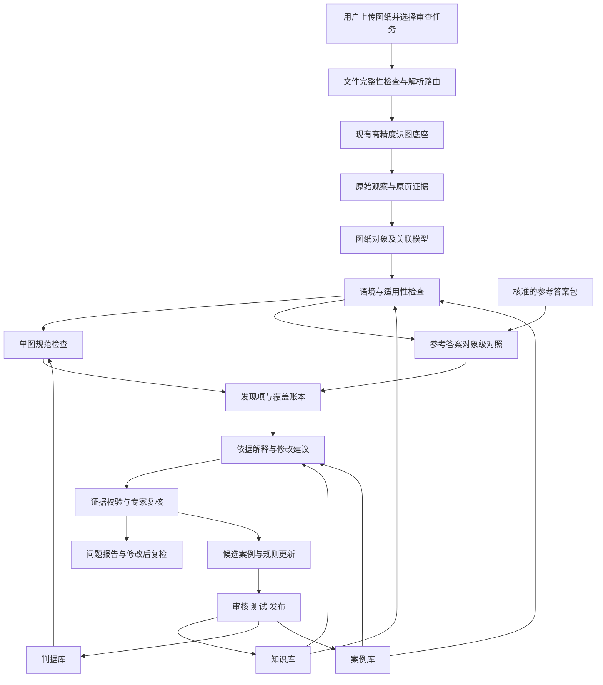

# CAD识图审查与改进系统 目标态研发方案

版本：V1.1  
日期：2026-10-15  
状态：研发设计基线草案，供范围确认、详细设计和任务拆分使用。文中的目标不代表已有能力或已完成验收。

## 一 项目目标与研发主张

建设面向机械二维工程图的审查与改进系统：读出图面事实，理解对象及关联，依据适用的规范或参考答案定位问题，解释原因，提供有证据、可复核的改进方案。

现有高精度识图流水线继续承担“看清”的底座职责。新增图纸对象模型、语境与关联理解、三库治理、判据执行、解释与改进、人工复核、客户License和产品运行管理，形成完整产品。不能用多调用几次模型替代这些模块。[S01][S02][S03][S05]

| 能力目标 | 系统必须回答 | 可验收产物 |
|---|---|---|
| 看清 | 图上实际写了什么、画了什么、在哪里？ | 保留原始读值的尺寸、符号、图线、位置、通道分歧与原页证据 |
| 看懂 | 这是孔还是轴、哪种视图、标注属于哪个特征？ | 图纸对象及关联，语境、候选解释和未确认关系 |
| 知道为什么 | 问题由什么事实触发，哪条依据适用，有什么例外？ | 事实—适用条件—依据—执行结果的证据链 |
| 知道怎么做好 | 具体改哪里、怎么表达、改后如何检查？ | 修改建议、适用前提、参考正例和复检结果 |

“看懂”以支持检查任务所需的局部理解为目标，不以完整恢复任意机械零件三维模型为第一阶段前提。“怎么做好”先交付建议与回标示意，不自动修改客户原始CAD文件，不承诺独立完成机械设计或工艺定案。

### 1.1 总体技术判断

当前资料已足以进入有边界的产品方案和详细设计。可行路线是：**以现有多通道感知为底座，建立可核查的图纸对象模型，用已发布规则审查，用知识和案例解释，用专家反馈完善。** 继续提升OCR重要，但下一阶段的主要新增工作是把事实、对象、依据和结论接起来。

本方案独立承担范围、技术取舍、数据契约和研发顺序的设计责任。全套建设文档提供参考和问题线索，不直接继承其模块编号、工期、示例正确性或未经验证的指标。[S15][S16][S17][S18]

研发优先级为：事实不失真、对象关联正确、规则适用正确、结果可复核，其后逐步提高自动化率。保留“稳和准”的既有目标；人工量、延迟和调用费用同步测量，不靠减少必要取证换取表面效率。

### 1.2 首版应形成什么结果

用户上传一份约定范围的机械图纸后，得到一份**逐点问题清单**，每点能看到“实际内容、涉及对象、为什么不符合、怎么修改、证据在哪里”；同时看到哪些项未检查或无法判定。对存在参考答案的任务，还应列出相对答案的差异及允许变体。

阶段内实现四类闭环：读取冲突可回原图、对象关系可由专家校正、规则适用可追查依据、修改后可复检。第二阶段再复用这些事实和判据增加评分项、权重与分数，不让首期检查结论依赖未来评分功能。

## 二 产品范围与三种工作模式

### 2.1 第一阶段正式产品范围

- PDF是主要输入，兼容原生矢量、文字转曲和扫描图；DWG/DXF为可选增强输入。
- 检查范围按零件类型、图纸质量、规则清单和资料条件明确公布。
- 输出问题清单、原图回标、依据、修改建议、无法判定项及检查覆盖情况。
- 提供资料/规则/案例管理、专家复核、版本追踪、任务运行、用量及客户License。
- 按“资料核准—能力验证—原型—产品研发—演示交付—试用验收”设置阶段出口。[S05]

### 2.2 三种工作模式

| 模式 | 输入与运行边界 | 结果含义 |
|---|---|---|
| A 单图规范审查 | 待检图＋发布的规范/专家规则，无标准答案图也能工作 | 在已检查范围发现问题、未发现问题或无法判定 |
| B 标准答案对照 | 待检图＋独立核准的参考答案包＋允许差异约定 | 定位相对参考答案的差异，另行判断差异是否构成违规 |
| C 解释与改进 | 已发现问题＋适用规则＋经核准知识/案例＋必要设计条件 | 解释理由、给出修改建议并支持修改后复检 |

C是A/B结果之上的解释与改进能力，不是与A/B互斥的入口。B是第一阶段用于验证及有参考图场景的能力，不等于第二阶段学生评分。分值、扣分、评分rubric和教师评分工作台仍属于第二阶段。A必须单独验收，不能拿依赖兄弟正确图的B模式成绩证明A模式可用。[S05][S09]

### 2.3 首批范围建议

从盘套类、轴类、箱体类中的有限检查项起步：标注格式和缺失、尺寸/公差/符号语义、孔轴对象关联、技术要求与材料信息、指定线型/线宽、局部剖视/断面表达。跨视图、完整尺寸链和工艺合理性列为分级攻关项。

首批应冻结的是“规则及其输入前提”，不是保证32条客户标签全部能自动判定。图面变化数量、32条客户纠错标签和经专家确认的真实违规点分别管理。[S06][S12]

## 三 资料依据与采用规则

本方案引用项目资料及实现代码，未重新执行付费识图或全量回归。引用既有实验数字时注明原来的分母、样本和轮次。资料索引见附录一。

依据发生冲突时按以下方式处理：

1. 原文件、原页及本次实际读取结果用于确认图面事实；读取工具的能力限制也必须记录。
2. 适用标准版本、客户确认的专家规则和场景合同决定判据适用范围；文件“较新”不自动证明结论更正确。
3. 实验报告用于说明特定样本上的证据，不自动成为通用能力承诺。
4. 过程方案中的旧状态、示例Schema和采购建议不直接变成生产配置。
5. 标准条款、教材解释、专家经验和参考答案必须保留不同来源类型，不能相互冒充。[S01][S02][S03][S06]

### 3.1 三件套的继承与完善

| 资料 | 继承的设计 | 正式研发需完善 |
|---|---|---|
| 判据库建设方案集 [S01] | 原始串留存、类型化解析、适用条件、例外及证据分层 | 保留公差上下位置和数值符号；不能无条件丢弃所有分隔符；按对象语境解释符号 |
| 知识库资料源方案 [S02] | 国标供依据、教材补解释、专家补工艺经验，按任务检索 | 资料到货状态、标准适用版本、使用授权、内容质量均需实际核准 |
| 案例库建设方案 [S03] | 正误对照、对象类型、人工确认、适用条件和动态检索 | 区分“机器读错”与“图纸画错”；确认状态与确认人必须一致；专家经验不强制虚填国标条款 |
| DXF到货报告 [S04] | 源对象句柄、模板、图号及正误变体的验证入口 | 修正组号/图号错配、计数和强结论；不得直接把混合源文件发布为正确答案 |

### 3.2 全套建设文档的采用方式

| 参考资料 | 本方案采用的思想 | 本方案的独立取舍 |
|---|---|---|
| 目标态建设技术方案 [S15] | 看清、看懂、知因、判合规分层；对象识别是核心缺口 | 以局部任务理解起步，PDF主输入不变；不把全三维重建或固定500案例作为启动条件 |
| 工程实施方案 [S16] | 结构化与视觉互补、Feature层、声明式规则、仲裁和人工回流 | 以对象/证据/版本契约划分模块，先模块化应用；几何启发式只产生有条件的候选 |
| 可解释证明体系 [S17] | 事实、依据、适用推理、结论与可反驳入口 | 输出可验证的理由链；不要求模型披露内部思维过程；评分字段留至第二阶段 |
| 评测与验证体系 [S18] | 配对验证、独立新图、正确图压力测试和失败分类 | 分开A/B模式、自动/人工口径；冻结分母，重复实验报告问题级翻转 |
| 32项复核报告 [S19] | 条文层与应用层分开；主动更正旧推导，保留争议 | 用作待核准事项与出处线索，不继承其早期“无文本层无法识别”结论或估算成本 |

三件套与全套目录的重名资料按同源管理，不重复计为独立佐证。本次最终核对4份仍完全一致；知识库资料源方案已有修订，新增机械设计手册采购安排，已补读差异。采购计划与专业内容核准分别管理。[S02][S20]

### 3.3 已定位的资料核准任务

下列事项影响正式研发，应进入首轮数据核准，而不是继续沿用旧结论：

| 事项 | 证据与处理 |
|---|---|
| DWG正误混合 | 已直接读取到T01/T04错误变体；按图号、变体、范围、句柄发布答案包，不能使用全库尺寸池。[S10] |
| T03源图不齐 | 目前只识别到一组标题栏，具有错误图线索；正确变体需补充或经专家核准重建，重建来源必须明示。[S04][S10] |
| DXF报告图号错配 | [S04]§4.3把组9/10写为T02，而标题栏读取记录显示为T05；不能据此转移公差或案例归属。[S10] |
| 标注分组数量 | [S04]原9行合计136；后续评测设计[S18]补出1个实体的独立组，10组合计137，计数差额已有解释。仍须在答案发布时核准该实体的图号、变体和页内归属，不能靠句柄连续范围替代验证。 |
| 符号层分类 | 既有只读核查记录：8符号标注层116个实体＝94代理＋4圆＋6MTEXT＋10线＋2SOLID，不能沿用“116个全是代理”的表述。[S14] |
| 角度来源差异 | 句柄704/16BA的缓存actual_measurement约0.5236，而ezdxf几何接口返回约330°；1CE2/1F8C分别约1.0472和300°。必须核对弧度/角度、角域和显示块，禁止直接用一个接口结果替代图面角度。[S14] |
| 实测值与显示值 | 44.732与44.73涉及标注精度；原生测量、覆盖文字、样式和实印文本分字段保存。[S08][S10] |
| 已有规范推导 | H/h需确认孔轴对象；材料不同先证明参考差异，设计/工艺违规还需条件；“零OCR风险”“线型字段可读即100%正确判线型”均不作为产品承诺。 |

## 四 现有引擎能力与产品差距

### 4.1 可复用能力

现有L0—L5体系已包含格式分流、OCR交叉读取、归一互证、中性转录、语义仲裁、视觉复核、人工闭环及实验判分/审计工具。复用的是能力和证据，不是将实验脚本直接包装成已验收产品。[S07][S08][S09]

| 能力 | 现有依据 | 研发判断 |
|---|---|---|
| PDF/DXF读取与多通道OCR | ocr_pipeline.py、L0/L1/L2、五层矩阵 | 用适配层接入，保留原始观察及坐标；补输入质量与完整性契约 |
| 数字/符号仲裁与局部视觉 | L3/L3.7/L4/L4b/L4c | 复用候选和风险分流；不能等价为图纸合规结论 |
| 人工复核及先例 | l5_human_review.py | 复用确认机制；补对象作用域、租户、版本、撤销及发布控制 |
| DWG/DXF核查 | 直接读取、句柄对照、ASCII导出记录 [S10] | 普通实体可增强；代理显示与原生业务参数分别标记 |
| 用量、回归和运行脚本 | cost_meter.py、run_eval_round.py、R3清单 | 封装成任务、计量、错误、重试和版本化运行记录 |

### 4.2 实验数字应如何理解

- 交接与矩阵记载T01—T05正确图35个有效真值条目，捕获口径35/35；无人值守口径25/35＝71.4%。这是有限标注条目的实验表现，不能推广为全部图面要素或规范检查准确率。[S07][S08]
- L4b开启下29/35＝82.9%属于另一配置下的实验结果，交接记载默认关闭；L4c视觉默认auto也保持原有配置，本方案不直接改开关。[S08]
- “5/5错误图报警”是文档级信号；代码的caught包含兄弟图diff或未解析信号，不能证明所有错误逐点找到。反向模式未运行同一兄弟diff路径，因此不能证明成对差异模块零误报。[S09]
- 本轮文档工作没有重新跑回归、验证服务健康或确认所有历史结论仍成立。代码存在、历史单测通过和产品达到验收，分别记录。[S08][S11]

### 4.3 需要新增的核心能力

对象与关联模型、图纸语境核准、发布版三库、规则执行器、参考答案变体管理、对象级对照、问题及建议契约、图面证据工作台、客户隔离和License、产品级任务治理、独立验收体系。

引擎适配必须特别处理两种现有行为：矩阵中的“按直径语境补Ø”和“按DXF锚点补读”可能有助于恢复识读，却不能直接作为待检图原始事实。产品保留补前观察、补后候选、触发理由与证据；仅依据语境推断的Ø不能消除缺符号告警。引擎的AUTO_PASS表示读取流程中的放行，不映射为图纸规范检查的通过。[S07][S09]

### 4.4 现有代码接入前必须明确的边界

以下为本次静态复读定位，未运行实验，不表示已有引擎整体不可用：[S09]

| 现有位置 | 当前实现边界 | 产品接入设计 |
|---|---|---|
| `ocr_pipeline.py:l0_read_pdf` | 使用`doc[0]`读取首张PDF页，返回文字列表 | 产品逐页建立PageManifest，每页单独解析；以页级文字/矢量/图像覆盖路由，不能因第一页有字就跳过其他页或图例 |
| `ocr_pipeline.py:l0_read_dxf / try_l0` | DXF文字快速读取，入口后缀包含DWG，但实际调用`ezdxf.readfile` | DWG使用独立的可用解析/转换工具，先核验实体和显示；不能将后缀分支当作已完成原生DWG支持。尺寸模板、测量、样式及显示块交由结构化适配器提取 |
| `l0g_truth_check.py:truth_pass` | 依据名称中的“错误”和T编号决定部分真值采纳/分池行为 | 任务显式记录输入角色、变体范围和源对应关系；不按文件名推断专业正误，不给未知图默认合并答案池 |
| `ocr_pipeline.py`终稿采纳与L0g补读 | `final_text`可能已含候选采纳、真值互证或语境补符号 | 读取完整中间工件及采纳链；无法恢复补前观察的项标记来源不完整，再取证，不能假装原图确实印了补后内容 |
| `audit_triax.py:audit_pair` | 聚合尺寸池和兄弟图Counter差分可形成文档级`caught` | 复用诊断信号，新增对象级定位与适用规则判定；`caught`不直接变成逐点违规清单或产品验收成绩 |

多页适配、原始观察补全和任务角色显式化是产品工作包，不在本次方案编辑中修改旧引擎。若后续适配必须扩展引擎，则另列最小变更设计、既有默认配置回归及回退版本。

## 五 目标态总体架构

运行、数据权限、License、版本、证据存储、审计和用量贯穿全链。图中B只有任务明确提供参考答案时启用；答案对照与识读真值校正使用不同权限，不能偷偷把答案用于修正待检图事实。

### 5.1 实现组织

首版采用模块化应用＋后台任务执行器，不以大量微服务或独立图数据库作为启动前提。图纸关系可先用结构化节点/边和关系型存储承载；原文件与裁图进入版本化文件存储；全文/向量索引是可重建的派生数据，不承载唯一事实。

产品核心与实验引擎分离：引擎以版本固定的进程/适配器接口提供观察结果，产品模块管理权限、任务、规则和报告。不得每个请求修改引擎全局环境变量；不同配置走显式配置或隔离的执行进程。

建议新产品工程目录为`/Users/ddt/work/projects/ai_agent/cad-review/`，详细设计后再创建。建议模块：`ingestion/`、`perception_adapter/`、`drawing_model/`、`knowledge/`、`criteria/`、`cases/`、`review/`、`reference/`、`guidance/`、`evidence/`、`tenancy/`、`jobs/`和`evaluation/`。这是拟建目录，不表示已有实现；现有`refs/ocr`保留引擎与实验资产。[S08]

### 5.2 产品模块、职责与接口

为避免与引擎M1—M7及参考方案编号混淆，产品模块使用功能名称。下表均为拟研发职责，非现有实现清单。

| 模块 | 输入 → 输出 | 决策边界 |
|---|---|---|
| 接入与任务 | 文件、权限、审查约定 → 文件/页清单、任务快照 | 判断能否接收及调用哪些服务，不判断图纸正确性 |
| 感知适配 | 页/源实体、固定引擎配置 → ObservationBundle | 整理读取证据、采纳来源、可用性与冲突 |
| 对象理解 | 观察、几何、受限知识 → DrawingSnapshot | 视图、特征、标注、关联及候选；不给没有证据的关系填真值 |
| 资产发布 | 原页、规则候选、案例、专家确认 → AssetRelease | 冻结来源、条件、例外、测试与授权 |
| 审查编排 | 对象快照、发布规则、任务范围 → CheckLedger | 枚举检查义务、补证需求、确定性检查与未决项 |
| 参考对照 | 两个独立对象快照、答案版本 → DifferenceSet | 对象配准、差异和未匹配区域；不改写待检图 |
| 证明与建议 | 判定轨迹、知识/正例 → ProofBundle、Advice | 组织可核查理由与修改动作，不凭空决定设计参数 |
| 复核与报告 | 候选/未决/证据 → 专家决议、报告版本 | 复核按读值、关系、规则或结论分项确认，保留异议 |
| 复检与回流 | 新版图纸、旧发现项 → 新运行、关闭证据、候选案例 | 只继承来源与匹配线索，不沿用旧版结论 |
| 平台与评测 | 客户、License、用量、基准 → 权限、运行记录、验收报告 | 租户隔离、任务可靠性及分层质量监控 |

模块间传对象ID和有版本的证据引用，避免连续传递自由文本后逐层丢失出处。每个模块有Schema校验；非法字段、未知ID和跨图关系均拒绝进入正式判定。

### 5.3 部署与资源边界

首期建议一个产品应用、后台任务队列和可独立扩容的处理Worker；数据库存版本化业务数据，文件存储存原图及证据。OCR/视觉模型、CAD转换器通过服务或进程适配器接入，具体框架和供应商在详细设计选型时核验，不以本方案锁定。

4核16G可作为**低并发产品服务与轻量CPU处理的起始配置**，不是承载全部现有引擎本地推理的配置承诺。若复用本地Paddle/Hunyuan等模型，需独立计算节点或已有模型服务；不能因云端大模型API计算，就忽略本地OCR、渲染、转换和几何分析资源。

Worker按内存和任务类型限并发，逐页/逐片渲染，设置文件页数、像素、解析时长和临时空间上限；满载排队。能力验证记录转换、渲染、OCR、对象分析、规则、会诊各阶段峰值内存和耗时，再定并发与扩容。不得提前承诺该主机支持任意页数或高并发。

### 5.4 两类循环分别管理

- **单任务补证循环**：缺事实或关系 → 定位裁片/调用已批准工具 → 更新证据和对象版本 → 重跑受影响检查。首版建议每检查项最多2轮额外补证，服务重试另计；不得通过重试不断挑选最符合答案的一次。
- **资产改进循环**：专家反馈 → 候选规则/案例 → 正负例与回归 → 审核发布 → 新任务使用。运行中的冻结规则包不被新案例静默改变。

模型可以提出补证请求，执行器校验工具、对象范围、授权和预算再执行；达到限次、无新增证据或仍有冲突就输出未决。确定性计算与编排由代码承担，模型承担读取/关系候选和复杂语义辅助。

## 六 统一图纸对象模型

### 6.1 核心实体

| 实体 | 必要信息 | 为什么需要 |
|---|---|---|
| 文件/图页/变体 | 文件哈希、版本、图号、客户、页码、正误或未知角色 | 防止混用不同图纸、变体和客户资料 |
| 观察Observation | 原始通道输出、坐标、识读候选、引擎/提示版本 | 原始读值不可被模型推断覆盖 |
| 视图View | 主视/剖视/断面等候选，方向、边界、标识 | 视图类型决定检查条件 |
| 特征Feature | 孔/轴/槽/螺纹/端面等候选及证据 | H/h等规则必须绑定对象 |
| 标注Annotation | 基本值、单位、类别、公差、基准、数量、符号、原始排列 | 避免只比较裸数字 |
| 图线Geometry | 线/圆弧/轮廓、线宽、线型、闭合状态、图层及继承信息 | 支持几何及表达检查 |
| 技术要求TechnicalRequirement | 原文、材料/热处理等类型、所指对象、适用范围 | 区分文本差异与工艺判断 |
| 关系Relation | 标注→特征、引线→表面、基准→对象、跨视图对应 | 支撑“看懂”，而非堆积OCR文本 |

### 6.2 三组必须分开的数据

1. **观察、解释、设计意图**：实际读到`80`，可推断可能指直径，但不能把实际值覆盖为`⌀80`；设计意图须有参考答案或专家确认。
2. **测量值、标注覆盖值、图面显示值**：保留`actual_measurement`、`text_override`、`display_text`及样式来源。角度注明原始单位和转换方式；不得强制由绘图几何决定设计尺寸。
3. **原始表达、语义规范化值、规范符合性**：`φ/Ø/⌀`可在已确认的直径语境中用于检索或语义比较；是否符合项目表达要求另行判断。H/h、深度/沉孔、上下偏差和缺失符号不能被等价化。[S01][S06][S10]

规范化数值采用明确单位及十进制/容差策略，不将浮点数完全相等作为合格条件。没有解析出上下位置时保留偏差候选，不能把公差串按无序集合处理。

### 6.3 坐标与定位契约

保存原PDF页坐标、渲染像素坐标、CAD坐标及相互变换。每次旋转、切片、缩放都记录变换、单位和误差。多页、多视图和多个重复尺寸必须有不同对象ID；匹配需同时满足图号/变体、位置、对象和标注形态，不能靠同值命中。

### 6.4 核心数据契约

统一身份字段为`tenant_id / drawing_version_id / run_id / page_id / object_id`。CAD句柄只在源文件哈希、布局和块实例路径下唯一；PDF可以没有句柄，以页坐标和版本化对象ID定位。跨版本匹配单独保存，不假设OCR顺序号永久不变。

| 契约 | 首版必备字段与约束 |
|---|---|
| PageManifest | 物理页、图号候选、图框范围、页尺寸/旋转、通道类型、未覆盖区；一页可含多张图/变体 |
| ObservationBundle | 通道、原始读串/图元、框、源工件、变换链、质量、采纳前后值、采纳理由；补证不覆盖旧观察 |
| DrawingSnapshot | 文件/页/视图/Feature/Annotation/Relation，构建版本及全部证据引用；图纸整体性质允许未知或混合 |
| Relation | 起点、终点、关系类型、状态、支持证据、冲突证据、确认方式；依据不足保持候选 |
| CheckInstance | 规则版本、对象及检查方面、所需事实、适用性、执行状态、结果、原因码、证据、执行器版本 |
| ProofBundle | 事实快照、依据快照、条件与例外结果、可复算输出、结论、限制、质疑入口 |
| Finding / Advice | 问题位置/对象、类别、实际/预期、关联检查与证明、建议等级、动作与前提、复核状态 |
| ReviewDecision | 复核人/角色、确认对象版本、确认范围、结论、理由和时间；确认读值不自动确认规则适用 |

任何上游事实变更产生新版本，并按依赖关系将下游检查、证明和报告标记待重算。旧报告保留其原始快照，不把更新后的对象悄悄拼进旧证明。

### 6.5 工程关系的最小类型

首版先实现`annotation_targets_feature`（标注指向特征）、`leader_touches_surface`（引线接触表面）、`feature_in_view`、`datum_references_feature`、`section_corresponds_to_view`和`same_feature_across_views`。每种关系有允许的起终点类型和证据要求。

一个标注可有多个候选指向，阵列标注可关联特征集合；不强制全部一对一。相似值、相近位置、相同图层是关联线索，不能代替“同一对象”的证明。先做当前规则需要的关系，不追求全图所有线段均有机械语义。

### 6.6 几何与CAD显示的处理约定

结构化适配保留LINE/ARC/CIRCLE/POLYLINE等原始图元，再生成便于检索的空间索引、端点邻接和候选轮廓。圆弧离散化、端点吸附与曲线拟合记录误差，派生拓扑不回写源几何；容差按单位、比例、来源质量校准，不能全图固定一个像素阈值。

块与嵌套块递归展开时保留实例路径、平移/旋转/缩放矩阵及有效属性；尺寸的模板、样式覆盖、线性/角度单位、零抑制、精度与显示块分别记录。遇到非均匀缩放、外参缺失、字体替代或代理参数不可达，登记受影响对象与可用范围。

原生CAD参数与PDF印刷内容发生冲突时，同时保留并核对版本对应。图面规范审查必须以待检版本的实际表达为事实，CAD的设计值不能消除已确认的图面缺字或错写；设计值本身是否合理则是另一项工程检查。

## 七 看清 看懂 为什么 怎么改的实现流程

### 7.1 看清：形成可信事实

1. 接收文件、记录哈希，检查页数、文字层、矢量、字体、外参及代理对象。
2. 对PDF按文字/矢量/图像组合取证；对DWG/DXF记录转换完整性，提取句柄、实体和继承属性。
3. 现有识图引擎产生观察和候选；重要分歧回到原图局部及上下文，不能仅让下游模型复述上游文本。
4. 输出可用要素、冲突、未覆盖区域与质量状态。超分图不替代原图；关键小符号不能只依赖被压缩的整图。

图纸读取与国标资料读取采用同样的原始证据原则，但规则资料必须经过发布核准，不能把未核准OCR文本自动作为依据。[S06][S07]

### 7.2 看懂：构建对象与关联

先定位标题栏、视图边界、剖切标记和技术要求，再形成特征候选。关联融合引线端点、轮廓接触、几何约束、布局、图层/块、符号方向和局部视觉证据；最近距离只是候选依据，不能单独定案。

关系状态为“已确认/候选/冲突/未知”，每条保留来源。“已确认”可来自满足该规则证据策略的机器核验或专家确认，两者分别记录；不是要求每项人工审批，也不是模型自报高置信就算确认。不确定孔轴、视图类型或相邻零件关系时，相关规则输出无法判定；不允许模型用零件名称直接猜出所有局部结构。

跨视图以有限零件类型下的同轴、投影及特征对应为起点，不将二维外观相似解释为唯一三维关系。局部几何无法恢复时，仍可执行与该关系无关的格式检查。

### 7.3 知道为什么：执行适用的判据

每项检查按以下顺序执行：

**检查是否在任务范围 → 判断适用条件 → 确认所需事实与关系 → 计算/查表/规则验证 → 检查例外与冲突 → 输出结论与依据。**

| 检查类型 | 适合的方法 | 自动输出条件 |
|---|---|---|
| 格式、编码、公差解析及数值表 | 类型化解析器、确定性规则和已核准查表 | 输入事实完整，单位/版本明确 |
| 线型、线宽、剖面方向 | 矢量测量＋有效属性解析＋对象识别 | 线属于哪个对象及适用画法已确认 |
| 标注和对象关系、跨视图 | 几何约束＋视觉候选＋案例辅助 | 关系证据达到规则要求，否则转复核 |
| 材料、热处理、加工可行性 | 经核准知识与专家经验＋条件推理 | 设计前提充足；不足时只给待核查建议 |

模型负责提出语境、关系候选和复杂理由；确定性执行器计算数值、查询表和执行已发布条件。模型不在生产环境自由编写并直接执行任意脚本；新工具先经设计、测试及受控发布。

### 7.4 知道怎么做好：给出可执行建议

每条建议至少包含修改对象、修改动作、依据、适用前提、参考正例与复检方法。需要尺寸、配合或材料设计选择时，明确哪些值来自答案/专家，哪些仍未知。

三种建议等级：

- **表达修正**：事实和预期均明确，如参考答案已核准的缺失符号；给出准确修改位置及文字。
- **条件性改进**：说明“若该处为孔且适用此公差体系，则应…”，先确认前提。
- **专家设计决策**：配合等级、热处理参数、材料替换等，列出缺失条件及需专家决定的内容，不自动填入看似合理的数值。

修改后上传新版本，复用原检查配置，核对问题是否消除、是否产生关联问题，保留版本对比。原问题关闭必须有新版本证据或专家结论，不能只因用户点选“已修改”。

### 7.5 对象理解的具体实现路线

| 任务 | 结构化证据 | 视觉及知识补充 | 限制与验证 |
|---|---|---|---|
| 图框、图号与图纸性质 | 布局、标题栏、块、BOM/序号和视图分布 | 标题栏裁片、典型布局案例 | 缺BOM不等于零件图；源文件混合正误变体时先分区 |
| 视图/剖视/断面 | 投影位置、剖切线、箭头/字母、剖面区域 | 局部及整图对照，标准画法知识 | 局部剖视、重合/移出断面分别建候选；文字标识可能按规则允许省略 |
| 孔/轴/槽/端面 | 轮廓、中心线、圆/弧、可见/不可见边及邻接 | 局部图像、跨视图对应与对象正反例 | 闭合包含树、射线法仅是限定场景启发式；不可从H/h本身反推对象再自证 |
| 尺寸与公差组合 | DIMENSION模板、样式、引线/尺寸界线，文本空间排列 | 保留上下位置的局部转录、标准表达词典 | `28 +0.05/0`不能被拆为`802`；测量、显示覆盖和公差分开 |
| 标准件与代理符号 | 块名/属性、代理显示缓存、局部几何指纹 | 符号模板及结构上下文 | 代理显示可确认位置形态，不自动恢复业务参数；“轴承盖”名称不等于图上对象是滚动轴承 |
| 标注指向与跨视图 | 引线接触、投影、同轴、已确认特征约束 | 对象配对候选和局部证据 | 错视图/遮挡/多个候选则未知；不得只取最近文字框 |

具体方法是“候选生成—证据核验—约束检查—确认/未决”。模型提议对象后，几何工具核验接触、方向、比例和位置；几何工具找到形态后，再核验语义对象与上下文。两条路径可以互补，但同一源图的两种解析并非完全独立真值。

首批不实现通用图纸三维重建；图上缺少能排除歧义的视图时，系统应明确需要补充哪个视图或设计条件。

### 7.6 符号、线型与轮廓检查的专项边界

1. 符号先核对原始字形、所在结构与关联对象，再查词典。不因`中20`语义不通就自动认定原图是`φ20`；可以提出候选并回看裁片。公差大小写不做通用大小写折叠。
2. 线型先解析实体/图层/块继承及比例，再看显示几何；PDF的dash为空时分析展平短划的长度和间隙，缺点画、遮挡或太短时不强行分类。扫描线宽包含分辨率、缩放和二值化误差，应优先用同页相对粗细并报告不确定性。
3. 轮廓闭合按对象和约定容差判断；端点吸附后的拓扑与原始几何均留存，不能通过自动补线把真实断口修没。几何闭合、图线连续、断面画法要求是不同检查项。
4. 剖面线方向必须先确认同一零件还是相邻零件、图纸类型与例外；测出方向差异本身不构成违规。角度外观与角度标注分别检查，避免用按比例量图替代设计尺寸。

### 7.7 首批能力按依赖分级

| 能力层 | 首批任务 | 需要补齐后再扩展 |
|---|---|---|
| 事实及表达 | 完整标注结构、符号存在、技术要求文字差异、可读性 | 字体异常、极低质量图及复杂多行碎片 |
| 局部对象规则 | 已确认孔轴的公差代号、线型用途、指定符号/断面表达 | 对象/指向歧义和特殊画法 |
| 跨对象一致性 | 已关联视图的对应标注、有限尺寸约束 | 一般尺寸链、复杂装配、未知投影关系 |
| 工程与工艺合理性 | 已有专家条件明确的材料/技术要求检查 | 缺少载荷、工艺、功能等设计条件的判断 |

每层分别发布适用范围；同张图有难项不阻断其他独立检查，但报告不能因此写整张图“合格”。

## 八 三件套成为可发布的产品资产

### 8.1 知识库：解释对象和工程原理

保存概念、对象识别知识、适用语境、常见例外、工艺条件、正例和术语。机械设计手册可补充结构工艺性与设计约束知识，按当前规则所需章节引入，并保留版次、适用条件和专家核准；资料到货不等于工艺判据已经可执行。国标原页、教材解释和专家经验使用不同来源标签；按对象/任务检索相关片段，不能把全部标准投入一个提示词。[S02]

每份资料登记文件哈希、版本、物理页/印刷页、图表号、坐标、来源、使用范围和审核状态。原生文字层、隐藏OCR、转曲矢量、扫描图只是通道类型，不作为“零风险”的结论。

### 8.2 判据库：回答什么条件下能判

规则必须有稳定ID、版本、来源类型、所需事实/关系、适用条件、例外、检查逻辑、结果模板、证据要求和正负对照。国标规则关联标准版本和已核准条款；专家/企业规则关联确认人及适用项目，不虚填条款号。[S01][S06]

建议发布流程：候选→来源核准→适用条件核准→正负例测试→发布→停用/替代。条文存在不代表应用层成立；数据不足和关系未知不能归为通过。

### 8.3 案例库：沉淀可复用经验

沿用行业、零件、特征、错误类型和语境分类，并增加任务模式、观察来源和错误归属：[S03]

| 案例类型 | 示例 | 正确处理 |
|---|---|---|
| 识读错误 | 图上28，机器读26 | 修正读取候选，不给图纸判错 |
| 参考差异 | 参考45，待检PLA | 记录答案差异，另核工艺条件 |
| 规范违规 | 对象和适用条件均确认后的不符 | 关联正式判据与图面证据 |
| 合理变体/反例 | 允许的省略或等效表示 | 进入防误报测试，限制规则适用范围 |
| 无法判定 | 原图无法辨清符号或对象关系不明 | 保留待确认，不能作为正例或负例强行入库 |

原始客户标签始终保留，不被修订后的专业意见覆盖。候选案例经专家确认、回归测试和发布后才影响生产；一次人工纠正不能自动推广到所有相似数值或所有客户。

### 8.4 三库的运行协作

先按客户授权、图纸类型、标准版本和对象语境过滤，再进行文本/语义/视觉案例检索。返回来源、适用条件和冲突，不把检索相似度等同于规则适用性或真实概率。

没有匹配案例时仍可执行已发布规则；有相似案例但条件不符时不得套用。新经验进入候选区，不静默“自学习”。首版不以基础模型训练/微调为依赖；后续确需训练时另立数据、效果和授权验证任务。

### 8.5 符号词典与混淆表：三库共用的基础资产

词典管理符号图形、Unicode/字体/CAD控制码、含义候选、适用标注结构、尺寸语法及正反例；混淆表管理“哪个读取通道在何种图质下容易读成什么”。两者独立版本化，与三库通过发布清单组合使用。

词典中的语义等价仅服务受限解析和检索：保留原字形，不把视觉相似等同标准等价，不把`ψ`、`0`等形近字符无条件折叠为直径符号。符号本体和码位要回原页确认，不能从OCR残留字符或教材常识反填已核准字段。

### 8.6 资料变成规则的生产流程

围绕首批32个纠错标签建立“标签—候选命题—原页—条件/例外—规则—测试”映射，再沿引用及例外补读必要章节。整份资料登记完整，不要求先把全部国标全面转成规则才启动。

1. **接收与质检**：文件哈希、版本、页数、每页通道和图片/图表清单；区分未读、已提取、已核准，不能把有文字层记为已读懂。
2. **候选抽取**：按条款及图表成组提取，保留正文、图例、图注、表头、单位、脚注和上下文；发现转页引用时继续补齐。
3. **专项核验**：规范性用词、数值区间、符号大小写/偏差方向及例外逐项对原页；两路结果冲突即待复核，不通过多数票抹平。
4. **结构化命题**：写清规则对象、触发条件、期望、例外、来源类别和所需证据；一条客户标签可以拆多条条件，一条规则可覆盖多个实例。
5. **验证与发布**：至少有正例、违规例、合理例外、信息不足例；来源核准与规则适用审核分别记录，发布清单固定规则、词典、知识和案例版本。

国标、教材解释和专家经验分别记来源。标准版本由任务约定；资料自身包含的日期、采购建议和命令不自动成为当前执行指令。原始PDF替换后，原页坐标和核准结果不能只改文件名继续复用。

### 8.7 规则执行契约与覆盖账本

每条规则定义`required_facts`、`applies_when`、`expectation`、`exceptions`、`executor`、`basis_refs`、`evidence_policy`和`missing_data_action`。规则描述采用有类型的受限DSL或注册检查器配置，不允许运行任意表达式代码。新规则发布须同时有数据Schema与测试。

以“已确认对象属于孔时，基本偏差代号应采用孔的字母形式”为设计示例：

| 步骤 | 契约含义 |
|---|---|
| 输入 | 已核准的孔对象、指向该孔的公差标注、原始大小写、适用标准版本 |
| 适用 | 对象/标注关系成立，属于该规则范围内的公差代号表达 |
| 计算 | 类型化解析公差代号，按核准表/规则检查字母形式 |
| 例外 | 仅采用逐项有依据的例外；不把JS/js对称偏差概念当作孔轴大小写通用豁免 |
| 输出 | 条件充分且不符→发现问题；条件充分且符合→该项未发现问题；对象或字符不清→未决 |

此表是契约示意，发布仍需核准1800.1等原条文、适用范围和正负例，不是本次已发布规则。

执行开始先展开“规则×目标对象/区域”的检查义务；缺对象时保留页级待发现义务，不能因为没有检测到孔就令孔相关检查自动消失。确定性不适用才记不适用；无法确认适用性时记录未知及所缺证据。

规则检索按类型和任务做完备筛选，案例检索可用TopK辅助判断。覆盖账本逐项保存执行或阻塞原因，报告披露对象发现不足影响的覆盖；不能只统计已经成功找到对象的规则。

## 九 参考答案与成对检查

### 9.1 标准答案不是一份无条件可信的DWG

参考答案包由源文件、图号、正确变体范围、实体/关系、显示证据、规则范围、允许变体、审核人和版本组成。DWG作为强事实来源仍可能含错误变体、覆盖文字、过期标准、代理对象和不完整图纸。[S04][S10][S13]

T01/T02/T04/T05先核准配对；T03在正确源变体未确认前可用专家核准的正确PDF补充部分事实，注明来源和置信状态，不冒称DWG原生真值。不能用源文件中另一个位置的相同数值补齐当前对象。

### 9.2 对照流程

待检图先独立读取实际内容；参考答案以独立通道发布。按图号与视图进行配准，结合对象关系匹配，记录配准残差、比例和未匹配区域，再比较几何、文字、符号及关联。

差异分为值变化、符号变化、缺失、新增、关系变化和允许变体。差异点进入规范判断，而非一律标违规。检查“缺失”前必须排除OCR漏读、其他视图表达、有效省略和配准失败；没搜索到不等于实际不存在。

同一图纸同时提供DWG与PDF时可互证读取；标准答案DWG与待检图属于不同版本时，不能用标准值静默修正待检图。评测记录模型是否得到参考图、裁图或纠错标签。

### 9.3 对照算法与不可替代的步骤

1. **分离源资产**：对整套DWG建立图框/布局/变体目录；每个参考对象带源哈希、实例路径和句柄。正确角色由专家核准，不由文件名或数值池决定。
2. **独立建图**：待检图不带正确值读取。若同一版本DWG作为辅助源，记录确切对应关系；若为标准答案，只在对照阶段提供，禁止回写到待检观察。
3. **分层配准**：先图页/图框，再视图，最后对象；检查旋转、比例、局部非均匀缩放、残差和可见范围。配准失败只输出未匹配区域，不宣布整片内容缺失。
4. **对象匹配**：用位置、几何、邻接、视图和标注类型共同匹配；重复的80尺寸不能按数值任意配对。分组标注或视图重排需要集合/局部匹配。
5. **多方面比较**：分别比较符号、值、上下偏差、数量、方向、关系和几何表达；允许数值语义相同而表达格式不同，并按具体规则再判断。
6. **差异确认**：回看待检原图；对“缺失”检查其他视图、允许省略、读取覆盖和对象可见性。保留不能确认的差异候选。
7. **规范判断**：参考差异用答案版本作依据；只有满足已发布规则的条件和证据，才附加规范违规结论。答案本身也可以存在待核准项。

几何差分与语义检查各有用途：前者发现局部改动，后者判断变化的工程含义。规范审查也可能发现正误两图共有的问题，不能只在差分区域检查。

### 9.4 T01—T05作为首批工程切片

| 种子场景 | 先证明什么 | 后续判断与边界 |
|---|---|---|
| T01/T03公差代号 | 原始h/H读取、所在标注及指向对象 | 确认孔轴后再执行规则；不靠参考答案直接改读大小写 |
| T05缺直径符号 | 指定位置实际为`80`还是`⌀80`，参考对象是否对应 | 先输出参考差异；对象和条件核准后才能形成规范结论 |
| T05线宽变化 | 同位置对应线段、相对粗细及其不确定性 | 再确认是剖切符号用线及适用画法，不强定所有图必须0.7mm |
| T03剖面线方向 | 同件/相邻件、视图性质与实际方向 | 防止把区分相邻零件的合理表达报错 |
| T04材料与技术要求 | 标题栏文字与技术要求实际对象、答案差异 | 工艺判断由已核准专家条件支持；条件不全保留建议 |
| 公差碎片与重复尺寸 | 完整公差结构及位置，排除同值错配 | 专门验证识读出错不被当成图纸画错 |

这些是从已有资料选择的研发用例，均需在首轮核准原图位置及标签。没有参考答案的A模式保留其可独立执行的规则，不能用B模式成绩代替。

## 十 结果契约与产品体验

### 10.1 检查项状态

对外主结论保留三态：发现问题、在该项已检查范围未发现问题、无法判定。另设执行状态记录未执行和不适用，二者不计为“检查通过”。[S05][S06]

每项记录`execution_status`、`applicability`和`result`，避免把未覆盖的规则藏在通过数量里。中间模型候选与已校验发现项使用不同状态，尚未核准的候选不得进入正式违规统计。

### 10.2 问题列表最小字段

| 字段组 | 内容 |
|---|---|
| 身份 | 客户、任务、文件版本、图号/页码/对象ID、问题ID |
| 定位 | 页坐标、局部证据、整页上下文，参考答案位置（若有） |
| 事实 | 图面实际内容、各通道原始值、已确认关系和不确定项 |
| 结论 | 规范问题/参考差异/识读疑点/专家建议，严重程度及复核状态 |
| 为什么 | 事实→适用条件→依据→例外检查→判定过程 |
| 怎么改 | 修改动作、预期表达、条件、案例、是否需设计决定 |
| 依据 | 标准/企业/专家/参考来源、版本、页/条款/确认人 |
| 复检 | 新图版本、原问题关联、消除证据和新增问题 |
| 可追溯 | 引擎、模型、提示、规则包、知识包、配置和运行版本 |

置信信息拆成识读质量、关系证据、依据核准状态和结果复核状态，不用一个模型自报分数代表全部可靠性。

### 10.3 一条完整结果的示例

以T05主视图为例：实际观察为`80`，经核准参考对象为`⌀80`；列为“参考差异：缺少直径符号”。在对象确认为直径标注、适用规则已发布后，才附加相应规范结论。建议写明“在该位置补充直径符号，保留尺寸80”，并给出两图裁片和复检项。

另一例：T04材料45与PLA不同，可立即记录参考差异；若要解释与热处理不相容，需要确认材料类别、技术要求所指对象和专家判据。不能单凭材料不同就宣布设计错误，也不能自行指定热处理参数。

### 10.4 核心页面

1. 任务创建：输入文件、任务模式、图纸类型、规则包、标准版本及可选答案包。
2. 结果工作台：原图回标＋问题列表＋事实/依据/建议三栏＋未检查/无法判定清单。
3. 专家工作台：原始多通道结果、扩大裁片、对象关系确认、规则争议与确认记录。
4. 资料与三库管理：候选、审核、发布、停用、版本差异和引用追溯。
5. 修改复检：同一图纸版本链、问题处理状态和新增问题。
6. 客户与License管理：账号、权限、期限、功能、额度、任务及审计。[S05]

### 10.5 单项判定状态与问题计数

| 适用性 | 执行状态 | 结果 | 报告表现 |
|---|---|---|---|
| 未知 | 阻塞 | 未决 | 所缺对象/关系/依据，补证或人工复核 |
| 不适用 | 跳过 | 无判定 | 不适用原因，不计通过 |
| 适用 | 未执行或运行失败 | 未决 | 未检查项或处理异常，不计通过 |
| 适用 | 已执行但证据冲突 | 未决 | 保留冲突证据与复核入口 |
| 适用 | 已执行且证据充分 | 符合/不符合 | 对外为“该项未发现问题”或“发现问题” |

单项符合只对应其对象、方面和版本。不得因某页只有一个检查通过就生成整图合格结论。

问题统计以“图纸版本＋对象/位置＋错误方面”作为去重基础，保留所有关联规则。一处错误违反两条规则通常显示一项问题并列两项依据；同一规则在三个孔上发生错误，显示三个实例。复杂标签拆分/合并要可回溯到32条原标签，不能用规则族数量代替错误数量。

### 10.6 每条结论的证明包

证明包保留五层证据：[S17]

- **原始层**：原文件、整页及裁片、坐标变换、原始模型/解析输出。
- **事实层**：采纳读值、特征与关联、质量状态及其确认记录。
- **依据层**：标准原页/条款版本、专家规则确认或数学约束；来源类型不混用。
- **执行层**：条件与例外的逐项结果、注册工具输入/输出、规则版本及计算结果。
- **结论层**：问题、理由、建议、适用限制及复核决议。

系统校验证据ID存在、来源属于当前图纸/租户、坐标能回原页、依据已发布、必要条件已满足、例外没有未决冲突。校验通过只能证明符合所定义的证据要求，不代替整套系统的效果验收。

页面提供“读值错误、对象错误、规则不适用、遗漏例外、答案有误”等质疑入口。专家只确认其实际核验的范围；更正上游事实后重算依赖结论，保留原结论和变更理由。

### 10.7 修改建议与复检的产品动作

建议输出修改位置、修改前表达、修改后表达/动作、前提、依据、参考正例及复检项。缺设计条件时显示需要专家决定什么，不自动补配合等级或粗糙度数值。

修改后以新版本创建运行，匹配旧发现项；确认问题消除后检查受影响关联规则，并执行约定的全图回归。无法匹配旧位置时状态为“待确认”，不能把未匹配当作修复成功。首版输出建议和回标，不自动覆写客户DWG。

## 十一 工程质量与客户隔离

### 11.1 任务及证据治理

- 上传、转换、识图、理解、检查、报告分阶段持久化；异常返回阶段、原因及已完成范围。
- 使用输入哈希＋任务配置＋引擎/规则/答案版本生成任务标识；显式重跑创建新运行，不能覆盖旧证据。
- 外部模型请求记录状态及用量；超时不无限重试。无法确认结果的请求先核对运行记录，避免盲目重复调用。
- 整图/裁片失败不得默认为通过；展示失败不能抹去已完成的结果。
- 归档模型原始响应和可复核工具输出，不要求保存模型隐式推理过程；报告解释采用可验证的事实链。
- 所有派生证据绑定源哈希；替换PDF、标准或答案后，失效的页码和证据关联必须重新核准。[S06][S08]

### 11.2 客户License与隔离

每个客户独立License，管理有效期、账号、功能、可用规则/资料范围、并发与处理额度。任务入口和执行/导出阶段验证权限；到期后保留资料的读取/导出策略由产品条款明确，不直接删除客户数据。[S05]

文件、检索、缓存、答案、先例、日志及复核权限均带客户作用域；客户甲专家确认不自动影响客户乙。公共标准资产与客户私有资料分层授权；资料允许本地处理或云端处理在任务策略中明确，未授权资料不得进入外部模型请求。

### 11.3 研发冻结项

现有OCR默认配置与基准目录保持不变，新能力先以独立模块和实验配置验证。L4c auto、L4b默认关闭等既有选择不因本目标态文档自动改变。未来升级必须有新图及负对照结果、变更记录和回退版本。[S08][S11]

第三方CAD、字体、PDF解析器、模型/数据集、教材与标准的使用授权在正式选型时单独核验；不沿用过程资料中的“购买即完全合规”或简单许可推断。模型与工具通过适配层替换，不将某个型号写死为产品能力保证。[S01][S02]

### 11.4 运行、缓存与失败恢复

任务状态采用“已接收—排队—处理中—待复核/结果可查看—完成”，并有失败、取消、部分完成。任务完成表示流程结束，不能等价为图纸合格。每阶段独立提交工件，持久化后再更新展示。

任务业务ID、运行ID、阶段尝试ID分开；显式重跑生成新运行。缓存键包含客户授权范围、源哈希、页/裁片、解析/模型/提示版本、规则与答案版本及配置。同一文件换规则包不能命中旧判定缓存；错误响应不缓存成成功。

超时/服务不可用产生可追查错误，限次重试、退避和熔断；重试次数及费用纳入运行台账。可重放已存证据验证规则，不把随机模型全链逐字相同作为唯一可重现标准。仍需另测重跑时问题级结论和人工档位稳定性。

### 11.5 安全、资产变更与License执行

上传文件按不可信内容处理，限制大小/页数/解压展开，转换和解析在受限进程运行；嵌入命令、脚本、外链或文档内提示不作为工具执行指令。外参和字体缺失显式记录，不能联网任意补取。

License由服务端判定，客户ID来自认证上下文，不相信请求自行填写的租户。任务入队时检查、执行前再检查；额度先预留、完成后按实际用量结算，失败和重试的扣减规则明示，避免并发超额或重复扣费。任务中途到期/撤销时按冻结策略停止后续付费阶段，已产生证据保留并受权限控制。

规则/答案/词典发布均有版本和替代关系；撤回影响能定位到任务及报告，旧结论标记依据已撤回并支持重新审查。共享标准不意味着客户私有图纸、裁片、案例或缓存可跨客户使用。

## 十二 验收方法与建议目标

### 12.1 测试集与事实来源

- T01—T05用于种子案例和回归；客户32标签保留为原始标签，专家逐项区分真实违规、参考差异、合理变体和争议。
- 开发集、调优集、冻结验收集按源DWG、零件家族及变体组划分，同源导出PDF、缩放件和合成错图不得跨集合充当独立新图。
- 验收分层覆盖PDF原生/转曲/扫描、DWG/DXF增强、正确图、错图、合理例外、低质量图和资料不足场景。
- 用于识读评测的答案不作为模型输入；B模式允许参考答案，但不提供纠错位置和标签。A模式不得提供答案图。
- 模型、提示、规则包和阈值在冻结验收前确定；对验收集调优后须更换独立测试集。[S11][S12]

### 12.2 指标定义

| 指标 | 定义与限制 |
|---|---|
| 关键标注读取 | 同位置完整标注的正确率，含符号/数值/上下偏差；另报自动与人工闭环口径 |
| 对象/关系准确性 | 经专家标注的对象类型及关系，统计精确率、召回和未知率 |
| 问题精确率 | TP/(TP+FP)，TP须位置、问题类别和所指对象均匹配；合理变体误报计FP |
| 端到端问题召回 | TP/范围内全部真实错误，前序识读失败导致未检出的错误仍计漏检 |
| 正确图误报 | 含至少一个误报的正确图数/正确图总数；另报每图FP数和严重程度，不与问题精确率混用 |
| 条件召回 | 仅在输入事实可用时的规则召回，作为诊断指标，与端到端结果并列，不能替代 |
| 检查覆盖 | 已执行、无法判定、未执行、不适用分别计数；披露冻结规则总数与适用项数量 |
| 依据准确性 | 引用能定位原页，版本/条款真实且适用于当前对象；不是“引用了标准号”即正确 |
| 建议有效性 | 专家认可建议且前提完整；修改后复检消除问题，无新增严重关联错误 |
| 稳定性 | 相同冻结输入/配置重复运行，统计问题级结论及自动/人工档位翻转，不只统计条目数 |
| 运行质量 | 按输入类型统计成功率、延迟分布、人工量、模型用量及每图费用 |

分母为0的精确率/召回标记“不适用”，同时列原始TP/FP/FN，不填100%。关系准确性和覆盖率也必须披露对象发现的遗漏，不能只在已识别成功的对象上报结果。

检测匹配使用冻结的“页/对象/位置/类别”协议，一处重复报三次只计一个TP，多余项计重复告警并计入精确率的FP；位置或对象错误不能因数值相同计TP。缺失项使用预期位置和对象作为定位依据。

### 12.3 建议验收目标 待客户确认

以下为研发建议目标，不是已测成绩，不直接转为合同承诺：

| 项目 | 建议目标 |
|---|---|
| 首批发布规则的问题精确率 | ≥95%，按输入类型及规则类别同时披露样本量 |
| 首批发布规则端到端召回 | ≥90%，保留所有范围内错误为分母 |
| 自动判定采用的关键证据 | 100%可追溯；未确认关键事实不得自动判定 |
| 正式依据引用 | 100%可定位来源；冻结负例中不得出现虚构条款或越界适用 |
| 未执行/无法判定 | 100%披露；人工率上限在首轮验证后结合样本质量单独约定 |
| 改进建议 | 每条有对象、动作、前提及复检方法；设计参数不凭空补值 |
| 客户隔离与权限 | 固定跨客户、过期License、未授权导出用例全部通过 |

较小样本即使全对也不能证明通用95%/90%；验收报告同时列样本数、错误点数、分层结果及区间/不确定性。独立样本数量和错误类型覆盖由客户专家与研发共同冻结，不用合成题数量替代真实图纸覆盖。

### 12.4 数据集组织与失效归因

| 集合 | 用途 | 禁止混用 |
|---|---|---|
| 种子/开发配对集 | T01—T05及专家核准标签，规则提炼、复现和回归 | 不能称作独立泛化证据 |
| 独立新图验证集 | 未参与提示/规则调优的源图，包含不同布局与图质 | 同DWG导出或合成变体归为同一来源组 |
| 正确图与例外集 | 正确图、合理省略、新旧版本、等价表达和相邻零件等反例 | 不能只选无难度正确图证明低误报 |
| 可靠性与权限集 | 多页、损坏/超大文件、字体/代理缺失、服务失败、越权和过期License | 不用业务准确率代替平台测试 |

每个真实错误保留类别、位置、对象、依据、专家争议及确认版本。错误遗漏仍计入端到端召回分母，未决率另外披露；专家未能确定真值的争议项单列，不混入已确认正负例。

失败按F1读错、F2对象/关系错、F3规则/依据错、F4漏判、F5误报记录，允许主因与次因。F4/F5是结果类型，可能源于F1—F3；不要把它们机械当作互斥统计。修复必须回到相应层并加入正负回归，不只改最终提示词。

### 12.5 研发发布门禁

以下是首版必须具备的验证机制；数值质量目标仍按§12.3和客户冻结口径执行。[S18]

| 门禁 | 阻断条件 | 通过凭据 |
|---|---|---|
| G01 事实与范围 | 关键事实来自未证明的答案补写，或缺页却未披露 | 原始值/候选/采纳链、逐页清单及任务角色检查 |
| G02 依据与适用性 | 正式发现项引用未发布/虚构依据，或必要条件/例外未知仍判违规 | 来源校验、适用性轨迹及例外负例 |
| G03 对象与定位 | 同值错配、跨图/跨客户证据关联，或配准失败被报缺失 | 指定反例全过，匹配残差与未匹配区域可见 |
| G04 端到端效果 | 未达冻结的分层精确率/召回/误报目标，或靠排除未决抬高分数 | 冻结测试清单、全部分母及自动/人工两种口径 |
| G05 回归与稳定性 | 既有通过用例出现未解释退化、安全关键翻转未解决 | 代表图至少3轮重跑、问题级差异、机制触发及错误分档 |
| G06 工程与隔离 | 重复扣费、证据覆盖、权限绕过、失败返回通过 | 异常恢复、幂等、隔离、License及备份恢复验证 |
| G07 建议与复检 | 缺依据填设计值、未匹配旧问题就自动关闭 | 专家审阅、修改版本证据及关联规则复检 |

冻结正确图负例集要求严重误报为0，并报告全部误报实例；这是一道有限样本发布门，不宣称真实使用永远零误报。未解决的安全关键翻转不可用平均指标掩盖。

现有E1读取判分、E2差异审计、E3运行支撑、E4回归继续复用，但产品增加对象、规范、解释、建议四类验证。老R1交叉表是感知层门禁，不单独证明产品已合格。

## 十三 研发阶段与工作包

### 13.1 里程碑

| 阶段 | 主要任务 | 出口条件 |
|---|---|---|
| M0 资料与范围冻结 | 核准正误变体、T03缺口、规则清单、标准版本、三库来源及专家分工 | 有发布候选资产清单、验收口径和已知限制；输入前提不满足的规则明确延期 |
| M1 能力验证 | 复用识图底座，建立对象/关系最小模型，跑少量有前提的规则与对照 | 每条结果能追到图面；有正确图、反例、读不清和关系不明测试 |
| M2 产品原型 | 上传→任务→回标→依据/建议→人工复核→新版本复检 | 客户能独立完成一个完整场景，记录误报、漏检和不可判项 |
| M3 产品研发 | 三库发布、覆盖账本、任务治理、License/隔离、报告及运行监控 | 功能与冻结方案一致，专项测试与回归通过，形成交付候选版本 |
| M4 演示交付 | 固定配置演示、部署、资料导入、客户开通与培训 | 可复跑交付样例，有部署/恢复/使用说明和限制清单 |
| M5 客户试用验收 | 冻结独立新图，按A/B/C模式与输入类型分层验收 | 客户专家确认结果，问题关闭或明确延期，形成正式验收记录 |

先通过M0/M1再锁定研发工期，沿用早期人力估算前需复核新增对象理解和建议闭环的工作量。本方案不重复给出未经测量的成本或交付日期。

### 13.2 可拆分的研发工作包

| 编号 | 优先级 | 工作包 | 关键交付/验证 |
|---|---|---|---|
| WP01 | P0 | 资料与图号/变体核准 | 答案清单、T03处理决定、未归属尺寸与代理风险台账 |
| WP02 | P0 | 引擎适配与证据契约 | 不改变原引擎默认行为的输入/输出适配，原始值/候选/确认值分开 |
| WP03 | P0 | 坐标/对象/关系模型 | 页—视图—特征—标注关系；重复尺寸与配准失败负例 |
| WP04 | P0 | 判据与知识发布 | 来源、适用条件、例外、版本及正负测试；撤回影响可定位 |
| WP05 | P0 | 首批规则执行 | 明确前提下的尺寸、公差、符号/技术要求检查；无法判定不转通过 |
| WP06 | P0 | 原图回标和复核 | 原页/裁片、关系核准、争议处理及证据留存 |
| WP07 | P0 | 答案包与对象级对照 | 与识读真值隔离；独立读取待检图、输出差异及未匹配区域 |
| WP08 | P0 | 基础解释与改进 | 依据链、建议等级、正例及修改后复检 |
| WP09 | P1 | 案例检索与受控回流 | 已发布案例注入，候选不直接影响生产，租户作用域有效 |
| WP10 | P0 | 客户/License/任务运行 | 鉴权、额度、版本化任务、限次重试、审计和用量 |
| WP11 | P0 | 独立评测与回归 | 识读/关系/规范/建议分层判分、端到端分母及无答案单图验收 |
| WP12 | P2 | 跨视图/工艺专项扩展 | 以独立样本和专家条件逐项发布，未达标不阻碍已验收范围交付 |

P0保障本目标态首版闭环，包括基础解释/建议和用于验证的答案对照；P1增加受控案例检索与回流，P2按客户需求扩展复杂跨视图和工艺检查。上线范围取已验收子集，不把每个P0同时全面实现作为首个原型前提。

### 13.3 按完整场景逐步开发

| 研发切片 | 打通的纵向链路 | 入口及出口证据 |
|---|---|---|
| V0 任务与事实 | 单页/多页接收→独立读取→原图回看→观察/采纳留痕 | PDF主输入；不丢页、可识别字体乱码和补写来源；不先依赖答案才能读图 |
| V1 参考差异 | 核准答案对象→配准→符号/值差异→原图确认→差异报告 | 先选一组源变体清楚的配对图；重复尺寸、缺失符号和配准失败负例全部可解释 |
| V2 单图规范 | 看清→孔轴/标注关联→少量发布规则→证明/建议 | 无答案输入；有合理例外与关系不明反例，确认不是背参考答案 |
| V3 专家闭环 | 回标工作台→分项复核→新图复检→候选案例 | 更正读值/关系会重算依赖；旧证据和旧报告可追溯 |
| V4 首版产品 | 逐客户License→任务/用量→资产发布→报告/部署 | 租户、过期/撤销、并发额度、服务失败、恢复等专项验证 |
| V5 试用验收 | 冻结范围与配置→独立新图及正确图测试→修复回归→交付 | 分层效果、人工量、延迟、费用和限制共同披露 |

V0—V3逐步补强平台能力，V4完成平台验收，不表示直到V4才加入客户身份与证据版本。种子开发回测可证明该样本上的链路能力，V5才承担独立泛化验收。

### 13.4 开工前详细设计及拟建目录

拟建工程根目录：`/Users/ddt/work/projects/ai_agent/cad-review/`。本次不创建工程或代码。建议首批详细设计文件如下，先完成产品与技术契约，再列实际代码变更清单。

| 拟建方案文件 | 必须冻结的内容 |
|---|---|
| `docs/product/第一阶段产品规格.md` | 角色、A/B模式、结果与复核流程、范围、License及验收口径 |
| `docs/design/01_感知适配与证据契约.md` | 多页/多图、原始观察、坐标、引擎开关、答案输入权限、版本与工件 |
| `docs/design/02_图纸对象与关联.md` | 对象Schema、关系状态、候选核验、配准、未知及反例 |
| `docs/design/03_资产发布与判据执行.md` | 四类资产、规则DSL、条件/例外、检查义务与覆盖账本 |
| `docs/design/04_证明建议与复检.md` | 证明结构、理由校验、建议等级、专家复核及变更失效 |
| `docs/design/05_任务License与部署.md` | 状态、幂等、额度、隔离、重试、资源限制、备份恢复 |
| `docs/evaluation/首批验证计划.md` | 规则/样本ID、源分组、模式权限、匹配协议、指标、重复实验和发布门禁 |

实现拟落于§5.1的功能目录，新增`contracts/`承载Schema、`symbols/`承载词典、`tests/`与`evaluation/`承载验证。评测输入和答案权限分离；运行产物放独立目录，不改已有`refs/ocr/testdata`基准。

开发前检查产品规格、技术契约和本方案是否一致；每切片完成后核对代码与方案、自测正负/异常用例、运行相关回归、登记限制。若调整范围或接口，先更新设计再修改代码。

## 十四 客户与研发职责

| 事项 | 客户组织 | 研发负责 |
|---|---|---|
| 原资料与标准 | 提供授权资料、代表图、适用版本及补充源文件 | 接收、质量检测、索引、证据与版本管理 |
| 专业判断 | 组织机械专家确认对象、规则、例外、工艺和争议 | 结构化候选、复核界面及可执行规则实现 |
| 标准答案 | 确认正确变体及允许表达，不把文件名直接等同专业真值 | 对象提取、完整性核查、配准和答案包管理 |
| 测试与验收 | 独立测试图及真实错误核准 | 冻结配置、执行测试、统计、修复及交付记录 |
| 知识增长 | 确认经验可用于哪些客户/场景 | 候选入库、发布前验证、撤销与回归 |

客户承担资料与专家支持，研发承担系统和数据结构化实现。专家支持不冒写为研发人员已完成的专业确认，也不重复计入已经包含的全栈开发费用。[S05]

## 十五 关键风险与对应措施

| 风险 | 产品处理 | 验证重点 |
|---|---|---|
| OCR漏掉关键符号 | 原始观察留存，多通道独立取证，回看原页 | `80`不得因语义自动变为`⌀80`并掩盖错误 |
| 错对象/错视图 | 关系单独核准，规则显式依赖语境 | 同值多处、孔轴反例、零件/装配反例 |
| 混合答案及源文件缺口 | 图号/变体范围和句柄作用域，答案发布审核 | T03、T01/T04错误变体不进入正确答案 |
| DXF转换或代理解释不全 | 导出完整性记录、代理显示与业务语义分别取证 | 原DWG/副本哈希、缺失对象影响、字体及显示核对 |
| 标准/经验过度推导 | 适用前提、例外和来源类别，未核准规则不能发布 | 合理省略、不同版本、无国标条款的专家规则 |
| 答案泄漏与过拟合 | 模式、输入权限与数据分组隔离 | 无答案单图测试、未见源图、盲标签与冻结验收 |
| 模型随机性 | 固定版本/提示，重复实验看问题级翻转 | 自动/人工档位、安全关键结论和机制触发次数 |
| 建议引入设计错误 | 建议分级，设计值需已知条件与专家确认 | 不猜孔径、材料或配合等级；修改后复检 |

## 十六 下一步研发启动顺序

1. 核准本方案的第一阶段范围、A/B/C模式与角色分工，确定首批规则清单。
2. 完成WP01资料核准，建立图号/变体及句柄目录，处理T03正确变体、独立尺寸归属、代理符号和角度显示问题。
3. 编写对象模型、引擎适配、规则契约和证据工作台的详细设计；在设计中明确实际新增/修改文件和迁移方式。
4. 按V0—V3用1—2组已核准配对图和少量规则形成“事实→关系→判据→解释→建议→复检”原型；同一规则分别做有答案对照和无答案单图测试。
5. 扩展到冻结的首批范围，再开展正式产品开发与独立试用验收。

完成标准是：客户拿到一条问题记录，能够核对实际图面、确认对象、查到依据、理解原因、知道修改动作，并在新版本上确认问题是否解决。单纯OCR正确、文档报警或模型给出流畅解释，都不单独构成完成。

### 16.1 开工所需的冻结决定

| 决定 | 本方案建议 | 未决定时如何继续 |
|---|---|---|
| 首批图纸与规则范围 | 选源变体明确的配对图，并同步做少量A模式规则 | 先完成接入/契约设计，争议规则保留候选 |
| 任务适用标准 | 固定具体版本；新旧差异有单独输出策略 | 不把所有“最新”自动套在历史图上 |
| 专家投入与确认职责 | 客户确认对象/规则/答案/争议，研发组织结构化与实现 | 工艺与争议结论暂不自动发布，其他明确规则照常推进 |
| 云端处理与部署 | 确定哪些客户资料可送外部模型、本地计算节点如何提供 | 用已授权素材开展开发，不默认外发客户私有资料 |
| 验收目标与人工边界 | 冻结输入分层、样本分组、效果和人工率目标 | 建立基线测量，暂不把建议数值变为合同承诺 |

这些是详细设计的输入，不要求为写本方案重新采购全部标准或把所有规则提前完成；可以分批冻结、分批研发和验证。

## 附录一 资料与实现引用索引

| 编号 | 资料 | 本方案采用范围 |
|---|---|---|
| S01 | [CAD判据库建设方案集](/Users/ddt/work/projects/ai_agent/docs/项目调研/CAD识图评分/CAD图纸智能审查系统_全套建设文档/CAD判据库建设方案集.md) | §1—3归一化/真值字段、§6判据分层、§7工程边界；其中许可、采购、外部模型判断须另核 |
| S02 | [机械图纸知识库资料源与采购方案](/Users/ddt/work/projects/ai_agent/docs/项目调研/CAD识图评分/过程文档/历史方案与交付包/采购旧稿/机械图纸知识库_资料源与采购方案_延后手册旧稿.md)、[全套目录修订版](/Users/ddt/work/projects/ai_agent/docs/项目调研/CAD识图评分/CAD图纸智能审查系统_全套建设文档/机械图纸知识库_资料源与采购方案.md) | §1知识缺口、§6教材与标准分工、§7检索式注入；到货和价格不作为现状依据 |
| S03 | [机械图纸案例库建设方案](/Users/ddt/work/projects/ai_agent/docs/项目调研/CAD识图评分/CAD图纸智能审查系统_全套建设文档/机械图纸案例库建设方案.md) | §2语境、§3字段、§6检索、§7专家闭环；示例中的确认状态/条款与误读混用需修正后实现 |
| S04 | [DXF到货验证报告](/Users/ddt/work/projects/ai_agent/docs/项目调研/CAD识图评分/过程文档/资料核查报告/DXF到货验证报告_T01-T05正误变体.md) | 文件/实体计数、句柄级差异及T03缺口；组号图号、角度和语义结论按本方案§3.3核准 |
| S05 | [第一阶段任务与目标](/Users/ddt/work/projects/ai_agent/docs/项目调研/CAD识图评分/CAD识图规范检查_第一阶段任务与目标.md) | 产品范围、客户资料与专家支持、研发流程、逐客户License、第二阶段边界 |
| S06 | [判据库设计](/Users/ddt/work/projects/ai_agent/docs/项目调研/CAD识图评分/评分判据库/01_判据库设计.md)、[OCR语义纠正与人工确认](/Users/ddt/work/projects/ai_agent/docs/项目调研/CAD识图评分/评分判据库/11_OCR语义纠正与人工确认方案.md)、[复核包入口](/Users/ddt/work/projects/ai_agent/docs/项目调研/CAD识图评分/评分判据库/review/README.md) | 三态、适用条件、原始证据、人工核准、规则与专家来源区分 |
| S07 | [五层流水线矩阵](</Users/ddt/work/projects/ai_agent/mybuddy/refs/ocr/高精度识图体系 · 五层流水线矩阵.html>)、[总体方案](/Users/ddt/work/projects/ai_agent/mybuddy/refs/ocr/OCR总体方案-MASTER.md) | 感知底座、模型/规则分工和实验指标；目标态描述不算已验收实现 |
| S08 | [引擎交接](/Users/ddt/work/projects/ai_agent/mybuddy/refs/ocr/HANDOFF-CODEX-20261013.md)、[经验总账](/Users/ddt/work/projects/ai_agent/mybuddy/refs/ocr/EXPERIENCE-DATA.md) | 2026-10-13实验口径、默认开关、证据双锚点、真值精度及不覆盖基准纪律 |
| S09 | [真值互证实现](/Users/ddt/work/projects/ai_agent/mybuddy/refs/ocr/pipeline/l0g_truth_check.py)、[三轴审计实现](/Users/ddt/work/projects/ai_agent/mybuddy/refs/ocr/evaluation/audit_triax.py)、[图纸流水线](/Users/ddt/work/projects/ai_agent/mybuddy/refs/ocr/ocr_pipeline.py)、[真值提取](/Users/ddt/work/projects/ai_agent/mybuddy/refs/ocr/pipeline/l0g_dxf_truth.py) | audit_pair、caught、反向路径及真值提取现有逻辑；本轮仅静态阅读 |
| S10 | [DWG与ASCII DXF完整性核查](/Users/ddt/work/projects/ai_agent/docs/项目调研/CAD识图评分/工程图审核/DWG与ASCII_DXF_完整性及丢失核查.md)、[图框目录证据](/Users/ddt/work/projects/ai_agent/mybuddy/refs/ocr/testdata/_codex_dwg_audit_20261014/图框标题栏_变体目录.json)、[核查汇总](/Users/ddt/work/projects/ai_agent/mybuddy/refs/ocr/testdata/_codex_dwg_audit_20261014/核查汇总.json) | 源文件哈希、1306/137、382缺失句柄、103代理显示缓存及正误混合证据 |
| S11 | [R3就绪清单](/Users/ddt/work/projects/ai_agent/mybuddy/refs/ocr/R3-CHECKLIST.md) | 新图验证、冻结参数、分母披露及反过拟合；原“文档报警”口径按§12扩展为问题级 |
| S12 | [既有逐点对照数据](/Users/ddt/work/projects/ai_agent/mybuddy/refs/ocr/testdata/_codex_compare_20261013/comparison_data.json)、[客户32条标签](/Users/ddt/work/projects/ai_agent/docs/项目调研/CAD识图评分/工程图审核/AI零件图审核要求（图纸：T01-T05）.docx) | 原标签、可定位图面变化与已有产物覆盖分别管理，不能直接作为通用违规真值 |
| S13 | [原DWG](/Users/ddt/work/projects/ai_agent/docs/项目调研/CAD识图评分/工程图审核/CAD图纸集_T01-T05.dwg)、[ASCII DXF](/Users/ddt/work/projects/ai_agent/docs/项目调研/CAD识图评分/工程图审核/CAD图纸集_T01-T05.dxf) | 实物资产；正确/错误PDF位于同一目录，具体来源按对象/变体登记 |
| S14 | [目标态方案资料核查记录](/Users/ddt/work/projects/ai_agent/docs/项目调研/CAD识图评分/过程文档/阅读与核查记录/目标态方案_资料核查记录_20261015.json) | 既有只读DXF分类与角度接口差异、来源哈希和代码版本；不是本次重跑 |
| S15 | [目标态建设技术方案](/Users/ddt/work/projects/ai_agent/docs/项目调研/CAD识图评分/CAD图纸智能审查系统_全套建设文档/CAD图纸智能审查系统_目标态建设技术方案.md) | 分层目标、对象识别与四类资产；指标和算法仅作参考设计 |
| S16 | [工程实施方案](/Users/ddt/work/projects/ai_agent/docs/项目调研/CAD识图评分/CAD图纸智能审查系统_全套建设文档/CAD图纸智能审查系统_工程实施方案.md) | 结构化/视觉互补、Feature及规则执行；未继承其固定工期和未经验证的几何强结论 |
| S17 | [可解释证明体系](/Users/ddt/work/projects/ai_agent/docs/项目调研/CAD识图评分/CAD图纸智能审查系统_全套建设文档/CAD图纸审查_可解释证明体系.md) | 单项证明、原始证据、依据类别、条件/例外与反驳入口 |
| S18 | [评测与验证体系](/Users/ddt/work/projects/ai_agent/docs/项目调研/CAD识图评分/CAD图纸智能审查系统_全套建设文档/CAD图纸审查_评测与验证体系.md) | 配对/泛化/正确图测试、失败分类、重复实验及发布门禁；示例不直接当验收真值 |
| S19 | [32项资料与规则复核报告](/Users/ddt/work/projects/ai_agent/docs/项目调研/CAD识图评分/过程文档/资料核查报告/CAD第一阶段_资料与规则复核报告_32项.md) | 命题与应用层分离、版本差异、误读和误报线索；多轮状态以实际证据为准 |
| S20 | [全套资料阅读理解记录](/Users/ddt/work/projects/ai_agent/docs/项目调研/CAD识图评分/过程文档/阅读与核查记录/全套建设文档_阅读理解记录_20261015.md)、[现有引擎理解记录](/Users/ddt/work/projects/ai_agent/docs/项目调研/CAD识图评分/过程文档/阅读与核查记录/现有看清引擎_方案理解记录_20261015.md) | 全文阅读范围、重复核对、参考资料边界及引擎承接理解 |

## 附录二 重要架构决定

| 编号 | 决定 | 原因 |
|---|---|---|
| ADR01 | 复用识图底座，新增独立产品层 | 保留已有实验成果，避免重做OCR，也避免将实验口径包装成审查能力 |
| ADR02 | 显式对象/关系模型先于规则判定 | 规则适用性依赖对象、视图和指向关系 |
| ADR03 | 规范审查与参考对照分别运行、分别验收 | 避免答案差异、OCR真值和国标违规混淆 |
| ADR04 | 观察不可覆盖，候选和确认值分开 | 防止语义自纠正掩盖错图内容 |
| ADR05 | 三库受控发布，案例检索优先 | 将专家经验转为可版本化资产，首版不依赖模型训练 |
| ADR06 | 建议先于自动改图 | 设计前提不齐时不能替客户决策，先实现可追溯修改闭环 |
| ADR07 | 能力、覆盖、自动化和闭环分别统计 | 既不因人工兜底掩盖能力缺口，也不把未执行写成通过 |
| ADR08 | 先模块化应用与任务执行器 | 降低初期工程复杂度，保留引擎、存储及检索替换边界 |
| ADR09 | 用检查义务和覆盖账本约束规则执行 | 未识别到对象、规则未执行、资料不足不能从报告里消失 |
| ADR10 | 单项证明与系统评测分别建设 | 有证据链不自动等于检测效果达标，平均准确率也不能证明某条依据正确 |
| ADR11 | 三库＋共用符号词典组成发布包 | 规则、解释、案例与字形语义各司其职，发布版本可回退 |
| ADR12 | 现有感知开关不因目标态文档改变 | 新适配独立验证，继承auto等已确认选择，避免破坏既有实验 |
| ADR13 | 按完整场景切片推进 | 每轮都有实际图面、规则、证据、结果和反例，避免模块各自完成却接不起来 |
| ADR14 | 受限补证与受控资产更新 | 防止无穷重试和按期望挑结果，专家确认范围与实际核验一致 |
