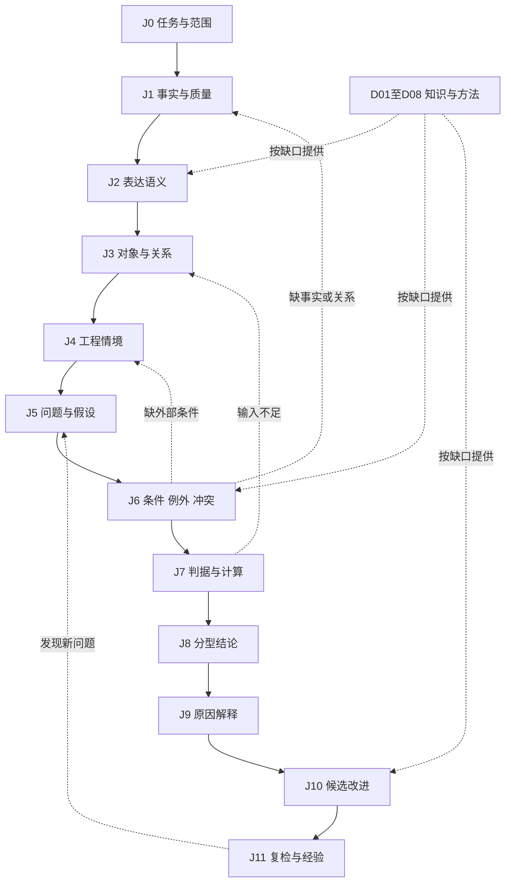

# 工程判断链与可组合能力单元

KB-DESIGN-005；2026-10-21；探索设计。J0—J11是当前分析模型，可以合并、跳过、并行和回退，不是12道审批门槛。

## 1. 从五步主线补全工作闭环

用户提出的主线保留：**图面事实 → 对象关联 → 适用条件 → 判据执行 → 解释与改进**。

容易遗漏的内容在主线前后和内部：任务是什么、资料是否对应、事实是否可靠、符号语义、图外条件、问题是否检查全、例外与冲突、计算方法、结论分型，以及修改后的再次验证。

因此扩展为：

> 任务/范围 → 事实与证据质量 → 表达语义 → 对象与关系 → 工程情境 → 待查问题/假设 → 条件与例外 → 判据/计算 → 分型结论 → 可解释理由 → 改进方案 → 复检与经验回写。

全程横切：来源版本、坐标/单位、覆盖范围、未知与冲突、变更影响。相关知识按缺口取用，不要求每个问答完整走一遍。



图示表示可回退依赖，不要求每个问题经过所有节点；知识检索与实际工具执行分别计时。

## 2. J0—J11输入输出与缺口

| 步骤 | 要解决的问题 | 输出 | 证据不足时 |
|---|---|---|---|
| J0 任务与范围 | 读图、单图审查、答案对照还是工艺建议？输入是否同版同图？ | task_type、scope、输入绑定、交付要求 | 澄清关键意图；可独立部分继续 |
| J1 事实与质量 | 实际读到什么，哪里没读到，来源可靠程度如何？ | 原始观察、定位、提取通道、覆盖/冲突 | 补读/换通道；不把未读当不存在 |
| J2 表达语义 | 文字/符号/图线组合表达什么？单位和结构是否明确？ | 语义候选、raw到解释的映射 | 保留多候选；不擅自纠正原文 |
| J3 对象与关系 | 是什么对象，哪个标注属于它，跨视图是否对应？ | 对象候选与有证据的关系图 | 未确认关系单独列出，不套对象规则 |
| J4 工程情境 | 功能、材料、制造/装配/检验、标准版次等条件是什么？ | 有来源的情境参数与未知项 | 只作条件化建议，不编造设计意图 |
| J5 问题与假设 | 应检查哪些问题？已有解释之外还有哪些可能？ | 问题清单、候选原因、检查覆盖计划 | 说明未检查范围，补对照分支 |
| J6 条件与例外 | 哪些规则/方法适用？前提满足吗？有无例外或矛盾？ | 适用性与例外结果、冲突列表 | UNKNOWN/CONFLICTED，不当作FALSE |
| J7 判据与计算 | 用什么方法检查，需要什么输入、工具和精度？ | 计算/规则结果、输入与过程记录 | 返回缺参数/工具不适用，禁止编结果 |
| J8 结论分型 | 是读错、答案差异、规范问题还是工程建议？ | 发现项、类型、范围、确定性与影响 | 局部说明/待补，不能整图一票PASS |
| J9 原因解释 | 哪些证据和条件支持结论？为什么近似案例不适用？ | 可复核的理由、引用和边界 | 可说明已知与未知，不拼因果故事 |
| J10 改进方案 | 怎样改、有哪些替代、会影响什么？ | 候选修改、前后差异、约束与复检计划 | 有条件建议；不声称唯一正确方案 |
| J11 复检与学习 | 改后问题消失吗，有无新问题？经验可复用到哪？ | 复检结果、影响范围、经验修订 | 未执行就标待验证，不自动记为成功 |

J5不等于先认定图纸有错；正常图和“不适用”也是正常结果。J7可以执行确定规则、计算或方法，不限于国标判定。J9是证据支持的说明，不要求暴露模型内部思维过程。

## 3. 六种不能遗漏的关系

1. **表达附着**：尺寸/公差/符号对应哪个特征或表面。
2. **空间/拓扑**：包含、相邻、相交、贯通、同轴等；各自须有几何依据。
3. **视图对应**：投影、剖切、局部放大、同一对象跨视图一致性。
4. **功能/装配**：配合、定位、接触、运动、安装与检验基准；图上无法确定的保留未知。
5. **知识依赖**：结论依赖哪些条件、定义、规则、例外和方法。
6. **变更影响**：尺寸/视图/条件变化会使哪些结论、建议、经验需要重检。

空间近不等于附着，形状相似不等于同一对象。关系是独立可错的结果，必须能检验和被替换。

## 4. 三值条件与冲突

单个条件取 TRUE/FALSE/UNKNOWN；若来源对同一条件有实质矛盾，另外记录CONFLICTED及双方证据，不强行塞成某个布尔值。

沿用16：规则适用需要必需条件均为TRUE、在已核范围内必需排除条件均FALSE且无相关未决冲突；前提/排除条件UNKNOWN时不进入该规则分支的确定执行。空例外数组须有上下文核对范围，不能把未提供当已排除。FALSE说明该分支不适用，不意味着图纸错误；UNKNOWN说明缺证据，不意味着条件不成立。

多个规范/企业约定/项目要求相遇时，先判断范围、版次与要求角色。没有明确依据时不自动按“文件更新”“国标优先”“多数资料一致”等简单排序裁决冲突；把冲突及所缺决定列出来。探索阶段可提出暂定解释并清楚标假设。

## 5. 否定、缺失与封闭范围

“没识别到符号”只是一条读取观察。“图纸缺少符号”还需要相关区域确已检查、对象绑定正确、规则要求适用、其他视图/通用说明没有替代表达等证据。

局部清晰区域可以作局部缺失判断，但不能外推整图。每个缺失结论保存 inspected_scope、expected_item、alternative_locations_checked、reading_quality和未检查区域。库里没有搜到某例外，也不能当作没有例外。

只有定义明确、枚举完整的集合，才可在声明范围作穷举否定；开放对象识别和自然语言检索默认不具备这种条件。

## 6. 工程能力单元：比普通文本块多保存什么

建议把可复用方法组织为CapabilityUnit。它不是模型权重，也不是可直接执行的任意脚本：

| 字段组 | 内容 |
|---|---|
| 身份与职责 | capability_id/version、解决的问题、D域、适用J步骤、task_types |
| 输入 | input_roles、对象/关系要求、单位/坐标、外部条件、允许未知项 |
| 知识 | 概念、源单元、理由、方法、适用条件、例外、近似反例 |
| 执行 | 可选工具及版本、参数语义、精度/公差、预期输出、资源级别 |
| 结果 | 输出类型、解释模板、不能下结论的情况、改进候选 |
| 验证 | 正例/反例/边界例、验证方法、实际运行记录与未测范围 |
| 维护 | 依赖知识、替代项、变更影响、来源变化与复用边界 |

简单概念项可以只填必要字段；不要为一条术语强行填满方法模板。工程能力单元是对多个知识项的组合，底层知识项与来源仍可独立更新。

```json
{
  "capability_id": "EXAMPLE-CAP-ANNOTATION-BINDING",
  "status": "EXPLORATORY",
  "domain_ids": ["D01", "D03", "D08"],
  "stage_ids": ["J2", "J3"],
  "question": "此尺寸标注关联哪个特征？",
  "input_roles": ["annotation_observation", "candidate_features", "coordinate_mapping"],
  "method_ref": "待选择并验证的关联方法",
  "source_refs": [],
  "unresolved_inputs": ["真实图纸与来源尚未绑定"],
  "output_roles": ["binding_candidates", "supporting_evidence", "unresolved_relations"],
  "validation_refs": [],
  "execution_status": "NOT_RUN"
}
```

此示例只示意结构，没有声称关联算法已实现或有效。知识项、能力单元、工具实现和实际运行记录必须分开。

## 7. 一次任务的四种状态不要混用

- 知识项：有何来源、解释和验证范围。
- 图纸实例：本图读到什么、对象与条件是什么。
- 能力执行：本次用了什么工具/参数，是否完成。
- 工程结论：针对哪一范围、哪类要求成立或尚无法判断。

例：库中有完整公差知识，不代表当前图的孔身份已确认；算法在旧图成功，不代表新图关联正确；依据已找到，不代表本次计算已执行。

## 8. 按缺口检索与回退

执行器根据缺口选择知识角色。例如“已读出H7，附着关系未知”优先查D03关联方法和D02对象对照；不是继续返回十篇H7释义。“对象明确但工艺能力未知”应查D06方法并说明现场参数缺失，不能靠相似图猜加工厂能力。

回退的价值取决于它是否可能改变当前结论。可先完成已有证据支持的分支，保留未知分支；不因一个不相关条件缺失而停止所有任务，也不为了凑齐12步无限检索。

查询回合数、原文读取、几何计算和模型调用分别预算。秒级路径先交付知识地图/关键证据/最小缺口，真正执行识图、复杂计算和修改验证按实测另计。

## 9. 结论与改进

建议结论类型：READING_ISSUE、REFERENCE_DIFF、NORMATIVE_FINDING、ENGINEERING_ADVICE、NO_ISSUE_IN_CHECKED_SCOPE、NEEDS_EVIDENCE。类型可并存但分别说明来源和证据，不把严重性评分当第一期必需。

改进建议描述目标、前提、修改对象、前后差异、保留约束、预计收益、副作用、替代方案和复检方法。若“改为H7”依赖设计配合意图，必须先指出缺少的设计输入，而不是为了让图纸看起来像例图就改值。

知识库可以给改法，实际写回图纸由具体任务指令决定；修改后重新经过受影响的J步骤。经验回写保存真实前后版本、执行与复检结果，用户说“这个思路可以”不等于工程修改已成功。

## 10. 如何避免把探索做成繁重流程

J编号用于表达知识缺口和测试覆盖；D编号用于检索与建设导航，都可更改。采用“必要字段随用途补齐”：术语查阅只需来源与语义，工程确定结论需要支撑它的条件和验证。不给普通检索附加专家审批；真实专业争议才需要进一步证据或专家判断。

不把本方案地位、历史修订号、复杂表单作为工程正确性的来源。保留可回查记录是为了能修正，而不是为了不准修正。

## 11. 局部工程方法的证据等级补充

真实B（见19）说明：同一0.72pt既可来自中心线分段，也可来自尺寸线；数值一致不能验证角色绑定。方法测试同时需要原图角色核查和数值/变换反例，不能只用一组数值对比证明语义正确。

方法输出区分technical_result与工程用途结论：局部名义比例匹配、差异候选、不适用、证据不足分别保存。表格圆整、线组选择与特殊条件未覆盖时，不允许用局部MATCH推成整图规范PASS。此处是正确性范围约束，不要求探索阶段设行政签字门槛。

## 12. 同目标证据与量的正确组合（2026-10-21）

按[31第4/5节](31-知识吸收完整性与工程判断正确性补强.md)，知识角色齐全之后还需核对目标图/变体、对象与标注、视图坐标、语境版本、量类型及方法输入，不能用图A观察和图B计算拼出结论。此为J3/J6/J7约束，不新增强制模型调用。

同单位不代表同物理量；名义/实测、纸面/零件、半径/直径分列。工具不确定度、标准允许区间、数值舍入分别记录，区间跨判定边界保持UNKNOWN；表格公式范围/脚注未齐不擅自插值或外推。J8/J9再检查每条理由是否得到对应命题和实际运行支持，不因材料角色齐备就给整图PASS。
