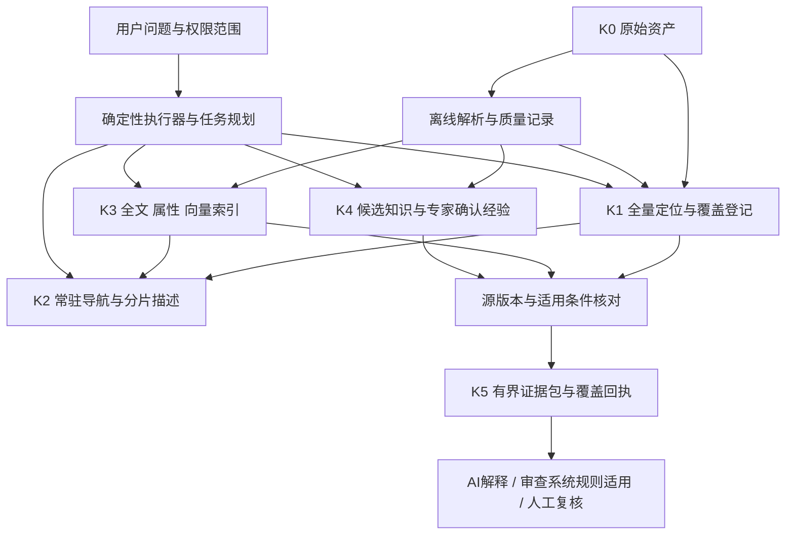

# 大容量知识库总体建设方案

日期：2026-10-16；KB-DESIGN-001；设计态。与 [数据治理](02-全量记忆与数据治理.md)、[检索流程](03-检索执行与秒级响应设计.md)、[验收](06-实施验收与持续维护.md)共同使用。

## 1. 产品目标与适用边界

“胸有成竹”定义为：对问题涉及的对象、事实、规则、例外和缺口形成一个可追溯的证据集合，而不是模型表现得自信。系统应能快速回答：库里有没有、在哪、哪个版本适用、哪些依据一致、哪些矛盾、哪些还不知道。

面向机械 CAD 审查，同时可扩展至标准、教材、项目方案、源码、工艺经验和行业资料。原件可以是文本、图像、表格、DWG/DXF、三维模型或压缩包；不假设全部都能转成无损文本。

知识库提供证据，审查系统做对象识别、规则适用与判定。知识库不能替代 CAD 解析、图纸真值抽取、几何计算或专家确认。

### 1.1 六项成功标准

- 全量资料保留来源与版本，不能因未进入向量库就“从记忆消失”。
- 每类资料有明确的登记、解析、可检索、已核验状态及分母。
- 精确编号、工程符号和罕见条款可以直接定位，不依赖摘要中是否出现。
- 局部问题走快速路径，跨库综述走完整性优先路径，用户可识别差别。
- 证据同时包含适用条件和反例，不能只找支持结论的片段。
- 内容更新、撤销和纠错能传播到索引、缓存、经验和回答。

### 1.2 本方案对上一轮思路的深化

| 上一轮方向 | 本轮补强 |
|---|---|
| 资料/样本/经验/规则四类 | 保留业务分类，增加统一全量身份、定位、覆盖和版本机制 |
| 先入精选样本 | 仅重语义计算可先精选；全量登记及可达性不能等精选成功后才做 |
| 混合检索 + 精排 | 增加路由漏召回防线、精确直达、反例展开和跨分片覆盖回执 |
| 24 GB Mac 做精干版 | 给出常驻工作集、磁盘索引、进程预算、索引代际和迁移触发条件 |
| 几秒拿到证据 | 明确预处理、冷热、并发、超时和“不完整”的输出合同 |

## 2. 全面记忆的三个层次

**原始记忆**：保存所有获准资料及其版本，能恢复原件。这一层可以以哈希、清单和备份验证。

**检索记忆**：每个获准对象有路径、状态与至少一个可达入口；已解析资料保留结构、关键字段及细粒度位置。未解析不能冒称全文可检索。

**工程理解**：对象/语境/标准适用性和经验得到验证。这一层需要任务评测和专家复核，不能用文件数、OCR 页数或向量数代替。

三层覆盖分别统计；“全部登记”不能写成“全部理解”，但理解暂缺也不能导致原始资料没有入口。

## 3. 六层记忆架构

| 层 | 名称 | 保存内容 | 运行位置与边界 |
|---|---|---|---|
| K0 | 原始资产层 | 原件、归档、版本、许可、内容哈希 | 大容量外置盘/对象存储；原则上只读 |
| K1 | 全量定位层 | 文件/归档成员/章节/页/实体定位、配对及解析状态 | 磁盘目录库；不能受 100 MB 总量硬限制 |
| K2 | 常驻导航层 | 主题卡、资料族、分片描述、版本入口、覆盖与未知列表 | 目标约 100 MB 工作集，进程按需读取 |
| K3 | 专项检索层 | 全文倒排、结构化属性、文本/图像向量、精选关系 | 磁盘分片，热点页缓存；不同模态不同索引 |
| K4 | 证据与经验层 | 已核条款、正反案例、经验卡、冲突与解释链 | 版本化知识对象；候选和已确认分列 |
| K5 | 任务工作层 | 本次检索回执、证据包、短时缓存、必要上下文 | 有界、可过期；不是永久事实来源 |

K2 是“总目录和路标”，不是“把书烧掉后留下的摘要”。K1/K3 承担完整定位和搜索；K4 承担经验证的高价值工程经验。

## 4. 对“1 TB → 100 MB → 1 GB”的工程解释

1 TB 是获准原件的物理量级，100 MB 是常驻导航的目标工作集，1 GB 是某一问题潜在相关原件集合的示例。三者不是同一种表示，也没有固定比例关系。

如果 1 TB 包含 100 万个视频帧，导航规模与包含 100 万条标准条款完全不同。压缩率、信息密度、独立对象数、模态和问题分布共同决定索引大小。

原件完整性靠 K0/K1；大规模检索靠 K3；100 MB K2 不承担细粒度全文和每个样本的全部属性。路由不足时直接访问 K1/K3，不能为了守住 100 MB 而静默删去长尾。

相关资料即使有 1 GB，通常也只需要其中的若干章节、图块、表格行和实体记录。任务工作层先产生候选清单，再按问题读取有界证据。若任务确需遍历整个 1 GB，则转深度分析，不能承诺统一秒级完成。

## 5. 长期记忆与项目接续分离

借鉴 MRPMES：稳定 ID、短入口、当前修订、原文指纹、关系边、变更登记和交接点。

扩展为两条互相链接的链：

- **领域知识链**：来源 → 可定位单元 → 事实/规则/案例 → 条件/例外 → 验证结果。
- **项目接续链**：目标 → 已确认决定 → 当前状态 → 未决项 → 下一动作 → 交付证据。

短摘要可以更新，原始来源和历史决定不覆盖。项目“下一步做什么”不能混进通用工程知识；成本台账不进入业务检索正文。当前入口只留当前，不逐轮追加长历史。

## 6. 总体技术决策

首期：本地文件/内容寻址资产 + SQLite 目录与关系/全文基线 + Qdrant 专项语义索引候选 + 一个有界检索服务。先证明增益，再固定模型和引擎版本；不同时维护多套重叠全文引擎。

SQLite 负责可查询的权威元数据；向量库是可重建投影，不能决定权限、条款有效性或知识确认状态。Qdrant 的硬过滤结果仍需在证据装配阶段由权威目录复核，处理版本切换和撤销竞态。

先用关系表实现明确关系，不全库自动抽取无限知识图谱。跨域综述可借鉴分层摘要，但所有关键结论回原文；全局查询单列深度服务，不塞进 2 秒快速路径。

检索服务暴露有界查询、定位读取、关系展开、覆盖回执接口。AI 可以建议检索计划，执行器控制权限、次数、字节数、时限及可访问对象；原文中的命令不会变成执行指令。

## 7. 反对的五种建设方式

- 只做大摘要：稀有规则、例外和精确数值不可保证保留。
- 每张图都先让大模型写描述：成本高且可能制造不存在的符号和对象。
- 所有资料统一切固定 token 块：打断条款条件、表格表头和 CAD 几何关系。
- 相似度最高即有效规则：旧版、不同对象和错误样例可能更相似。
- 一次把全库送给 AI：超过上下文与资源预算，且不能证明全面覆盖。

## 8. 开放问题

1 TB 是规划容量而不是本轮已拥有的全部资料；完整模态分布和对象数需 W0 测量。硬件达标、索引占用、解析工时和长期费用均未实测。外部模型和云服务默认关闭，若后续引入，先明确数据范围、费用和许可。

本方案补充目标态建设，不覆盖原系统事实和标准判据。编制期间参考方案由 v1.0 更新至 v1.1；已按 v1.1 对齐 PDF 主输入、依据分型、源事实与专业正确性分离。旧版疑点与新版修订状态见 04/07，不静默修订原件。
