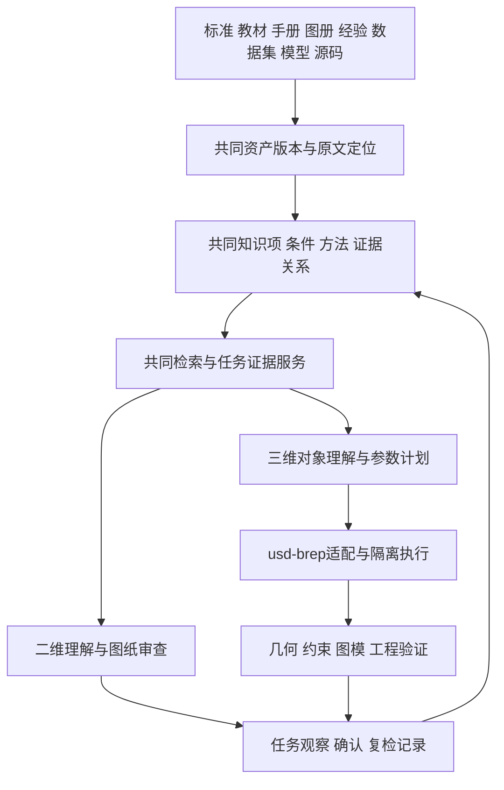

# 总体方案与共库架构

KB-3D-DESIGN-001。承接[二维总体方案](../../CAD识图评分/CAD图纸智能审查系统_全套建设文档/知识库重点建设方案/01-总体建设方案.md)、[知识职责](../../CAD识图评分/CAD图纸智能审查系统_全套建设文档/知识库重点建设方案/10-知识域与认知职责组织.md)与[判断链](../../CAD识图评分/CAD图纸智能审查系统_全套建设文档/知识库重点建设方案/11-工程判断链与能力单元.md)。这些是共同讨论基线，可修订；本文件不单方面更改二维当前实现合同。

## 1. 建设对象

共同建设“可用于工程任务的知识与方法”，同时容纳二维表达和三维模型。三维任务包括参数建模、既有模型理解、局部修改、图模一致性检查、装配/工艺分析；任务不同，所需依据和结论范围不同。

知识库回答：是什么对象、有什么关系、什么条件下采用什么结构、为什么、有哪些替代、如何验证。建模执行器把明确的参数计划转换成几何。工程验证器检查计划、结果和要求之间的关系。这三者各有输入输出，但使用同一来源和知识身份。

## 2. 共库架构

图为目标设计，箭头不代表接口已实现。I→C保留观察、假设、确认和可复用方法的区别；不能把一次建模成功自动发布成普遍工程知识。

一个逻辑库允许专题分片与执行服务分离，保留项目/企业/资料用途边界。共库不意味着所有项目资料互相可见；检索与缓存仍按当前权限、用途、版本过滤。

## 3. D01—D08在三维中的延伸

|职责|三维用途|需要避免的误判|
|---|---|---|
|D01 表达符号|尺寸、公差、螺纹、表面要求如何映射到参数或语义属性|每个符号都必须雕成实体；网格能表达全部技术要求|
|D02 对象功能|孔/轴/槽/轴肩/基准/零件族及其候选功能|见到圆柱面就断定是通孔或轴承座|
|D03 关系语境|面边邻接、特征依赖、尺寸附着、装配接触、视图对应|几何相近即同对象；邻接即功能关系|
|D04 规范约定|特定任务、材料、标准版次下的设计/表达要求|找到标准件形状便自动宣称合规|
|D05 工程原理|定位、载荷传递、互换性、刚度及设计取舍的依据|生成合理故事替代有依据的分析|
|D06 实现工艺|加工可达、装配顺序、检验方法、设备能力和成本|建模内核能做即工厂能做|
|D07 诊断改进|薄壁、干涉、约束冲突、失败操作的原因与备选|为求几何成功偷偷改设计尺寸|
|D08 验证学习|重放、体积/拓扑、参数扰动、投影对照和复检|截图相似即模型准确；某个测试通过即整件合格|

一条知识可以被二维与三维共同引用，增加任务标签和输入角色即可；不复制正文分别维护“二维版条款”和“三维版条款”。

## 4. J链扩展为工程事实链

保留二维J0—J11的编号与认知含义，只在三维增加输入类型和方法。二维文档中的“图面事实”在共同层可理解为工程事实的一类，二维原开发无需立即改名。

|环节|三维输入输出|
|---|---|
|J0任务范围|新建/修改/检查、目标零件、允许修改范围、质量与交付表示|
|J1事实质量|参数、BRep、图纸、扫描/网格的来源、精度、已读范围|
|J2表达语义|尺寸与技术要求解释；几何单位、坐标和公差类型|
|J3对象关系|特征候选、参数附着、拓扑邻接、装配及跨表示关联|
|J4工程情境|材料、载荷、工序、设备、装配及检验条件|
|J5问题假设|候选结构、待建特征、检查覆盖和不确定性|
|J6适用条件|结构/方法的前提与例外、冲突、必要补充信息|
|J7方法执行|参数求值、操作DAG、内核调用、工程计算或规则|
|J8结论分型|几何成功/失败、约束满足、条件建议、工程未判定|
|J9解释|参数来源、采用方法、验证证据及未覆盖范围|
|J10改进|候选修改、依赖影响、副作用、代价和替代路线|
|J11复检回写|同输入重放、修改后检查、失败反例与适用范围|

允许只问某孔体积或某条知识位置；不强制每次完整运行所有环节。

## 5. 保持二维聚焦的接入方式

- 二维继续现有W0/W1及七对象原型；三维先用快照和适配映射研究，不要求先部署公共服务。
- 共享合同扩展用新增对象/明确版本表达，二维已有合法输入应仍可读取；迁移不得静默变更旧字段含义。
- 三维结果通过共同Observation/KnowledgeItem等引用接入，专项大几何数据放派生存储，目录保留指纹与定位。
- 共同组件变动先给出差异和兼容样例；本轮不改二维Schema、文档或运行状态。

## 6. 首轮边界

从简单但有诊断价值的参数化单零件开始：板孔或阶梯轴。先验证“参数—计划—几何—检查—证据”，再处理二维歧义、手册经验、既有模型特征恢复及装配。自由曲面、通用逆向、自动完整装配求解、CAE/CAM均为后续能力，不能由内核名称推导已具备。

## 7. 2026-10-21：持续积累与工程Wiki

共同底座补入知识修订、逐条主张支持、Wiki投影和持续编译，复用二维28而非另建三维Wiki主存。三维模型/意图/方法/案例按有版本的关系接入；知识依赖与实例依赖分开维护。导航页面不等于已编译的工程知识页，详见[20](20-持续知识编译与三维工程Wiki设计.md)。
