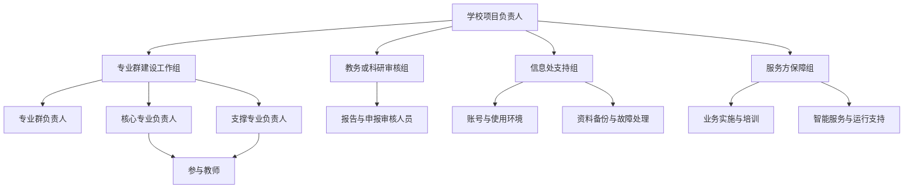
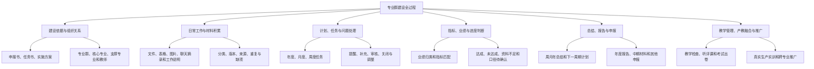
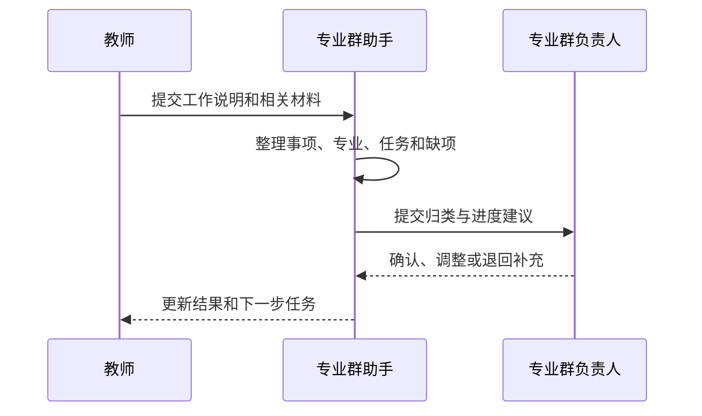

# 专业群 AI 工作站

## 让专业群建设工作看得见、接得住、说得清

> 校方沟通展示稿 · HTML 内容底稿
>
> 本稿用于面向学校领导、教务人员、专业群负责人和教师进行方案讲解。重点展示专业群建设怎样从文件要求落实到日常工作，再从日常积累形成进度、成果和报告。

这份沟通稿只围绕八个问题展开。讲解时先把问题摆出来，再直接回答，随后用同一条建设主线和同一组例子说明。每一章都承接上一章，不需要听众先理解页面栏目或专业术语。

本稿完整保留专业群建设涉及的业务事项、人员责任、工作规则、资料要求和验收内容。后续制作 HTML 时，主画面先展示每章的直接回答和图形关系，详细规则、办理要求、确认事项和待补内容继续向下展开，不能因为页面图形化而删减业务信息。

| 学校首先会问     | 本稿直接回答                                        |
| ---------- | --------------------------------------------- |
| 为什么要建      | 为了把多年建设要求、日常工作、材料、指标和成果持续连起来，避免每到节点重新找材料、对数字。 |
| 谁来使用和保障    | 教师和教务人员通过专业群助手查询和办理；学校负责人确认，信息处和服务方分别提供保障。    |
| 建设工作怎样运转   | 从三类建设依据出发，分解任务，持续记录，核对进度，形成成果，再安排下一步。         |
| 日常工作怎样进入   | 教师说明真实工作并提交材料，助手帮助整理，专业负责人核对后进入建设记录。          |
| 怎样判断进度     | 对照要求、时间、有效材料和确认结果，说明完成多少、为什么、还差什么。            |
| 怎样形成成果     | 用已确认的同一批事实，按照学校模板形成总结、计划、报告和申报材料。             |
| 权责和资料怎样保障  | 学校拥有资料的完整权利和控制权，各类人员只在获准范围内查看和办理。             |
| 怎样试点、验收和推广 | 先用一个真实专业群和一条完整工作链试点，逐项验收后再评估推广。               |

> **贯穿全稿的例子**：某专业群 2026 年要新增 3 家合作企业。A 企业已经完成，B 企业正在签约，C 企业属于上年度合作，D 企业尚未形成正式洽谈记录。后文用这同一组事实说明任务怎样产生、教师怎样推进、材料怎样进入、进度怎样判断以及报告怎样形成。

---

## 01 为什么要建设专业群 AI 工作站

> **先说结论**：要建设，是因为专业群建设不是临近检查时集中写一份材料，而是持续多年的组织工作。学校需要把建设依据、教师日常工作、支撑材料、指标进度和最终成果长期连在一起，随时知道“做到哪里、凭什么这样判断、下一步由谁处理”。

这一章直接回答三个问题：现在为什么费力、如果不改变会反复发生什么、建设以后学校能够得到什么。

**例如**：学校年底要判断“新增合作企业 3 家”是否完成。没有持续过程时，只能临时向教师收协议、翻聊天记录、核对年份；有工作站后，A—D 企业从日常推进时就已经对应到任务、人员和材料，年底直接形成“已确认 1 家、尚差 2 家”的说明和后续任务。

### 目前专业群建设为什么容易出现断点

专业群建设是一项持续多年的工作。它涉及多个专业、多位教师、多类任务和多个检查节点。真正困难的地方，通常不是某一份报告不会写，而是平时的工作、材料和建设要求没有持续连起来。

#### 常见的四种情况

**资料散在不同地方**

文件、表格、图片、聊天记录和工作说明分别保存在个人电脑、办公平台和群聊中，需要使用时很难一次找全。

**日常工作与建设任务没有对应起来**

教师每天做了很多工作，但到了年度总结或检查节点，才开始判断这些工作能够支撑哪项建设任务、哪项指标。

**进度依赖人工询问和临时统计**

负责人需要逐个询问教师，才能知道哪些任务已经完成、哪些还在推进、哪些只是缺少材料。

**报告编写变成集中补材料**

年度报告、中期检查和各类申报到来时，学校需要重新翻文件、对数字、找依据，容易出现遗漏、重复和前后口径不一致。

#### 还需要同时关注的情况

- 同一成果由多个专业共同完成时，容易重复统计或遗漏参与关系。
- 指标经过修订后，历史数据采用哪个口径不清楚。
- 已有智能助手能够形成初稿，但按学校要求反复修改或查找原始依据仍不方便。
- 学校资料可以由谁查看、服务过程中可以使用到什么范围，需要提前说明清楚。

第一次沟通时，可以由学校补充四项现状：组织一份报告到定稿通常需要多少人天、查清一个指标及其证据需要多久、每周填报和汇总几次，以及历史报告返工最常见的原因。后续试点再用同样口径观察是否改善。

专业群 AI 工作站要解决的核心问题，是让建设要求、日常工作、支撑材料、指标进度和报告成果始终保持联系。

因此，学校需要的不是更多分散的填报入口，而是一个能够持续理解专业群情况、承接查询和办理任务的统一入口。

---

### 建设完成后，学校具体得到什么

**一套清楚的建设依据**

申报书、建设任务书和实施方案中的目标、指标、任务、节点和支撑要求能够相互对应。

**一本持续更新的专业群建设台账**

每个专业、每位教师、每项任务和每份材料都有清楚的归属和进展。

**一种更自然的日常工作方式**

教师用日常语言记录和查询，负责人按专业、任务和指标掌握整体情况。

**一条从发现问题到完成处理的工作链**

未完成、缺材料和待确认事项都能够形成下一步任务，并持续跟踪到处理结束。

**一批随时可以组织使用的建设成果**

平时积累的工作和材料，可以按照学校模板形成总结、计划、申报材料、年度报告和中期检查材料。

**一位能够持续协助专业群建设的助手**

已经明确的工作由她统一承接，后续出现的新任务也可以继续交给她办理。

---

**本章需要校方确认**：当前最费时的环节是什么，查清一项指标和材料通常需要多久，形成一份正式报告需要哪些人参与，以及希望本次试点优先改善哪一个问题。

**承接下一章**：既然要把多年建设工作持续连起来，就必须先说清谁来使用、谁来确认、谁来保障。

---

## 02 谁来使用和保障

> **先说结论**：学校老师、专业负责人、教务或科研审核人员都可以通过“专业群助手”查询和办理工作；学校项目负责人和专业群负责人作业务确认，信息处保障使用环境，服务方在学校授权范围内提供建设与运行支持。

专业群助手是统一入口，不是最终决定人。她可以回答问题、找材料、整理任务和起草成果；指标是否完成、报告能否定稿、材料能否对外提交，仍由学校指定人员确认。

**例如**：教师可以问“B 企业现在卡在哪里”，助手回答缺少正式协议；李老师负责补充协议，专业群负责人确认是否达到任务要求，教务审核人员审核报告中的正式表述，信息处保障账号和资料空间正常使用。

### 统一使用入口：一位了解本专业群情况的数字同事

专业群工作站以一位有名字、有形象、可以持续交流的“专业群助手”作为统一入口。

她了解本专业群获准使用的申报书、建设任务书、实施方案、专业分工、教师任务、工作材料、指标要求、报告模板和历史报告。教师或教务人员只需要说清楚想查什么、想做什么或希望得到什么材料，不需要先判断应该进入哪个栏目。

#### 她可以帮助学校完成五类事情

**问得到**

回答专业群、专业、教师、任务和指标的当前情况，并说明资料更新到什么时间。

**找得到**

从已经归集的文件、图片、表格和工作记录中，找到与某项任务或指标有关的材料。

**理得清**

把零散工作整理为任务、进度、成果、问题和下一步安排。

**写得出**

按照学校提供的模板，协助形成总结、计划、申报材料、年度报告和中期检查材料。

**接得住**

遇到新的申报、新的检查要求或临时交办事项时，只要属于本专业群建设范围，她就可以根据已有资料继续办理；缺少条件时，先列出需要补充或确认的内容。

#### 教师和教务人员可以直接这样说

- “我们专业群今年建设到什么程度了？”
- “帮我看看还有哪些指标没有完成。”
- “王老师还有哪些任务没有提交？”
- “这批材料分别能够支撑哪些建设任务？”
- “把本月工作整理成总结和下月计划。”
- “下个月要做中期检查，先把现有材料整理出来。”
- “按照学校模板，做一份今年的国家级人工智能试点校申报材料。”
- “第三部分按我的意见改一下，数字和依据保持不变。”

#### 她的名称、形象和交流方式由学校共同确定

- **助手名称**：当前暂称“专业群助手”，正式名称可以结合学校名称、校训或校园文化确定。
- **助手形象**：可以采用女性、男性或中性形象，由学校选择；整体风格保持专业、亲切和稳重。
- **称呼方式**：可以点击形象进入，也可以直接称呼她的名字，具体方式由学校确认。
- **交流方式**：首期以文字交流为主，语音交流是否后续增加由学校确认。
- **展示位置**：电脑端、教务工作台、手机端和大屏分别确认本期使用范围，不因列出某个位置就默认全部建设。
- **回答风格**：可以采用专业简洁或学校教务工作口吻，学校也可以提供希望采用的示例。

这些内容用于确定统一的校内使用形象和交流体验，不改变专业群助手的业务边界，也不代替学校人员作出正式决定。

专业群助手能够成为统一入口，还需要学校明确谁负责业务、谁负责审核、谁保障使用环境。只有组织责任清楚，助手整理出来的任务、进度和报告才有明确的确认人。

---

### 组织保障：各类人员分别承担什么责任

专业群 AI 工作站不是由某一位教师独自维护的资料工具。它服务于学校专业群建设工作，需要业务负责人、专业负责人、教师、审核人员、信息处和服务方共同配合。下图是依据现有业务责任整理的建议组织方式，组织名称、具体人员以及是否单独成立工作组由学校确认。

#### 学校项目负责人：确定方向和最终责任

- 确认专业群建设范围、试点目标和阶段安排。
- 协调跨部门事项，确定重大口径和争议处理人。
- 确认正式报告、对外申报和推广决策。

#### 专业群负责人：负责专业群建设过程

- 维护申报书、建设任务书和实施方案形成的建设依据。
- 明确核心专业、支撑专业、负责人和教师分工。
- 安排年度、月度和阶段任务，核对工作进展与支撑材料。
- 确认指标完成结果、问题处理结果和报告内容。

#### 核心专业与支撑专业负责人：把群级任务落实到专业

- 说明本专业承担哪些建设任务、由哪些教师负责。
- 组织教师持续提交工作进展、成果和支撑材料。
- 核对跨专业共同完成事项，避免遗漏或重复统计。
- 处理本专业待补材料、逾期任务和阶段总结。

#### 教师：记录真实工作并完成本人任务

- 查看本人任务、时间节点和完成要求。
- 按日常工作实际提交工作说明、成果和相关材料。
- 根据退回意见补充内容，确认本人记录是否准确。
- 在获准范围内查询专业群资料和建设进度。

#### 教务或科研审核人员：把住正式成果出口

- 审核报告、申报材料、指标结论和对外提交内容。
- 对不完整、不一致或依据不足的内容提出退回意见。
- 确认修改后的正式版本；报告编写人不能审核自己的报告。

#### 信息处支持人员：保障工作站能够稳定、安全地使用

- 配合学校账号、统一登录、人员调整和使用权限开通。
- 保障学校内部设备或学校租赁专用空间的运行环境。
- 负责资料备份、恢复演练、故障联系和使用环境问题处理。
- 信息处负责运行保障，不默认查看专业群全部业务正文；如因排查问题确需临时查看，应由学校指定人员批准并记录范围和时间。

#### 服务方保障人员：提供建设、培训和持续服务

- 配合学校梳理业务、整理模板、完成试点建设和教师培训。
- 提供专业群建设智能体的服务能力。
- 处理服务故障和使用问题，但不能代替学校作出指标、审核和对外提交决定。

#### 建议建立三项日常工作机制

**定期推进**：专业群负责人按学校确定的周期查看任务、指标、缺项和近期节点。

**问题协调**：跨专业、跨部门或文件口径冲突的事项，由明确的负责人协调并保留结论。

**人员变化处理**：教师调岗、离校，外部专家授权到期或负责人调整时，及时变更其查看和办理范围，并安排任务交接。

有了责任清楚的组织，专业群建设才能从一份文件要求开始，持续落实到各专业和教师的日常工作中。

---

### 使用范围：不同人员看到和办理什么

#### 校级业务负责人

查看学校授权范围内的专业群整体情况、重点任务、主要差距和汇总报告。

#### 专业群负责人

维护建设依据，安排任务，核对进展和材料，确认指标结果及报告内容。

#### 教师

查看本人任务，记录工作，提交材料，处理退回补充，并查询本人获准查看的内容。

#### 教务或科研审核人员

审核申报材料、建设报告和其他正式成果，提出修改意见并确认定稿。

专业群助手负责交流、查询、整理和协助办理，但不代替业务负责人、填报人和审核人。报告编写人不能审核自己的报告；指标达成、报告定稿、对外申报和正式提交，最终仍由学校指定人员确认。

同一人员可以承担多个业务角色，但报告作者不能同时审核自己的报告，需要指定替代审核人。校级人员的查看范围限定在本校授权内容，专业群负责人不默认查看其他专业群。由专业群助手协助形成的内容，继续记录是谁提出任务、谁补充资料、谁审核以及谁确认最终结果。

人员职责和查看范围明确后，工作站才能与学校当前使用的办公平台、教务工具、网盘和线下流程稳妥衔接。

---

**本章需要校方确认**：实际岗位名称、各岗位人员、专业群负责人、正式审核人、信息处对接人，以及一人兼任多个角色时的替代审核安排。

**承接下一章**：人员和责任明确后，下一步要说明这些人围绕同一套建设依据怎样把工作持续运转起来。

---

## 03 建设工作怎样运转

> **先说结论**：建设工作沿一条主线循环运转——先把申报书、建设任务书和实施方案整理为共同依据，再把年度目标分到专业、负责人和教师；教师持续完成工作并提交材料，负责人据此确认进度，形成总结和报告，发现差距后再生成下一步任务。

它不是“文件归档—年底写报告”两件分开的事情，而是“依据—任务—日常工作—材料—判断—成果—下一步”不断循环。

**例如**：任务书提出“2026 年新增合作企业 3 家”，实施方案指定核心专业牵头。工作站把它变为李老师推进 B 企业、王老师推进 D 企业的具体任务；教师提交协议和洽谈记录后，再回到同一个年度指标判断进度。

### 一条从建设依据到下一步任务的完整主线

专业群工作站不是等到写报告时才使用。它从建设依据开始，贯穿任务安排、日常执行、材料积累、进度确认和报告形成。这条主线既是学校开展工作的顺序，也是后续页面组织和讲解演示的顺序。

#### 建设依据从哪里来

**申报书**说明为什么建设、准备建成什么样。

**建设任务书**说明建设期内必须完成什么、达到什么标准、需要哪些支撑材料。

**实施方案**说明由谁负责、什么时候完成、怎样推进。

专业群助手把三类文件中描述同一件工作的内容对应起来，形成可以持续跟踪的建设任务。以后教师提交工作、负责人查看进度、学校编写报告，都使用同一套建设依据。

建设依据明确后，下一步不是马上写报告，而是让每天真实发生的工作持续进入这条主线。

---

### 年度目标怎样落实到专业和教师

学校的中心工作、部门年度计划和专业群建设任务，可以逐步落实为阶段任务、月度安排和教师工作。上级要求有出处，教师任务有承接，完成结果再回到原来的建设目标。

#### 负责人看到的是整体

- 本年度有哪些重点建设任务。
- 各专业分别承担什么工作。
- 哪些指标已经完成，哪些仍有差距。
- 哪些任务临近节点，哪些长期没有进展。
- 哪些事项工作已经开展但材料还没有补齐。

#### 教师看到的是本人需要完成的事情

- 当前由本人负责的任务。
- 每项任务的时间节点和完成要求。
- 已经提交的工作和材料。
- 被退回补充的内容及原因。
- 本周、本月需要继续推进的事项。

教师工作页面可以按学校授权显示本人任务、专业群内任务或汇总情况；材料上传数量只表示提交情况，不能自动等同于教师绩效或工作质量。由人员直接建立的任务和专业群助手提出的任务建议需要分别标明，助手建议经过负责人确认后才能成为正式任务。

#### 一项问题要有完整的处理结果

提醒只是开始，不能因为发出了提醒就把问题标成完成。一项任务只有经过“提交进展—补充材料—负责人核对—确认结果”，才能关闭；确实无法继续的事项，也需要记录暂停原因和批准人。

上面的流程比较抽象，下面沿用同一组企业合作资料，把建设依据、教师任务、材料、进度和下一步工作连起来说明。

---

### 这条主线覆盖哪些专业群建设工作

到这里，主线已经从建设依据走到日常工作、进度判断和成果形成。为了保证对外讲解顺畅但内容不遗漏，下面把原有业务内容归入六个能够沿主线逐层展开的部分。

**展开：建设依据与组织关系**

- 登记申报书、建设任务书和实施方案的版本、批准状态和适用周期。
- 整理建设目标、指标、任务、阶段节点和需要提供的支撑材料。
- 每项要求能够回到原文件的章节、表格或页码。
- 文件之间出现冲突时，列出差异及影响，交学校负责人确认。
- 建立学校、部门或学院、专业群、专业和教师之间的关系。
- 明确核心专业、支撑专业、负责人及跨专业共同建设事项。

**展开：日常工作与材料积累**

- 接收文件、表格、图片、聊天摘录、纸质材料整理件和日常工作说明。
- 现有材料类型可包括 Word、Excel、PPT、文本 PDF、图片、扫描件、音视频、旧版 Office、压缩包、聊天记录和网页链接；哪些类型纳入本期由学校提供样例后确认。
- 资料可能来自本地电脑、学校网盘、办公平台和纸质材料，先明确需要一次性集中整理的范围。
- 聊天内容采用复制粘贴、导出文件还是后续选配采集，需要分别确认，不能把能够接收聊天摘录理解为已经能够自动采集聊天记录。
- 按工作事项持续追加材料，保留原始文件、来源、业务日期和提交人员。
- 按名称或内容查找材料，并按专业、任务、指标和时间推荐分类。
- 保留历史版本，发现重复、损坏、空白、无关或无法归类的材料。
- 批量整理既有业绩，形成文字、表格或汇报内容；Excel 成品、PPT 成品和不同文件之间转换的范围分别确认。
- 扫描件文字识别、录音或视频转文字、旧版文件和网页内容整理，可按学校优先级分阶段增加。

**展开：计划、任务与问题处理**

- 把学校重点工作、部门年度计划和专业群要求落实为阶段、月度和周度任务。
- 每项任务保留上级目标、责任人、完成时间和预期形成的材料。
- 教师查看本人任务，负责人查看授权范围内的专业和整体进展。
- 区分已安排、已开展、待提交、待核实、未完成、暂停和已关闭。
- 对逾期、缺材料和临近节点事项进行提醒；提醒频率、接收人和发送方式另行确认。
- 问题经过补充、复核或批准调整后才能关闭，不能用提醒代替处理结果。

**展开：指标、业绩与进度判断**

- 按学校提供的分类要求，将已有业绩逐条对应到专业、任务和指标。
- 说明匹配理由，单列无法匹配、缺少证据、可能重复和仍需核实的事项。
- 明确数量指标、定性指标、统计期间、是否累计、是否允许跨专业共享及去重规则。
- 所有适用指标都有去向，不能只展示已经有材料的指标。
- 区分工作未完成、材料不足、统计口径冲突和不适用事项。
- 指标完成结论、关键数字和争议处理结果由学校指定人员确认。

**展开：总结、报告与申报**

- 形成周、月、年度总结及下一周期计划，连续承接上期遗留事项。
- 按模板生成专业群年度报告、中期检查或中期评审材料。
- 同时形成指标对照、支撑材料目录、待补清单和引用位置。
- 按使用者指定的专业、任务、指标或成果分类方式组织内容。
- 支持多轮修改，保留人工内容、原始依据和历史版本。
- Word、PDF、Excel、PPT 内容或文件的具体交付范围逐项确认。
- 正式报告、申报和对外提交必须经过学校审核，助手不能自行发布。

**展开：教学管理、产教融合与推广**

- 教学检查和听评课：归集人工检查记录、评价、发现问题及整改结果；是否纳入专门办理过程由学校确认。
- 考试出卷：跟踪出卷要求、责任人、截止时间、提交、退回补充和人工审核；试卷正文是否保存按保密要求另行确认。
- 真实生产与实训：整理项目任务、教师和学生参与、技术标准、过程记录、人工检测及交付结果。
- 试点推广：复用工作模板、指标组织方法和使用步骤，但每个新专业群重新确认任务书、专业关系、教师权限和报告要求，不能复制其他专业群的事实和数字。
- 排课继续使用现有排课项目；本期可评估配合范围，不把排课自动纳入专业群试点。

---

**本章需要校方确认**：采用哪一版申报书、任务书和实施方案作为依据，专业群包含哪些专业，核心与支撑关系怎样确定，本期优先走通哪一项真实任务。

**承接下一章**：主线能够运转的关键，是教师平时已经做的工作能够自然进入，而不是到检查前重新填报。

---

## 04 日常工作怎样进入

> **先说结论**：教师按照真实工作说明时间、事项、参与人、结果和材料；专业群助手帮助补齐和推荐归属；专业负责人核对后，这条记录才进入专业群建设过程。学校现有办公平台、网盘、教务工具和纸质流程可以继续使用，双方只需明确资料怎样取得和结果怎样交回。

教师不需要先研究任务编号，也不需要为了工作站再做一遍工作。她可以用日常语言说“今天和 B 企业确认了协议条款，形成一份修改稿”，再附上协议草稿。助手把它推荐到校企合作任务，并提示“已有推进记录，但还不能按正式签约计入完成”。

### 教师的一次真实工作怎样进入建设过程

工作站不要求教师为了系统重复做一套工作，而是把教师已经在做的事情，用统一方式持续记录下来。教师负责说明真实工作，专业群助手负责整理，负责人负责确认，三者共同形成可以继续使用的建设记录。

#### 教师记录一次工作，只需要说清五件事

1. **什么时候做的**：记录实际工作日期，不用上传日期代替。
2. **做了什么**：用日常语言说明工作内容。
3. **谁参与了**：记录负责人、参与教师及相关专业。
4. **形成了什么结果**：说明已经完成、正在推进或还存在什么问题。
5. **有哪些材料**：附上文件、表格、图片、记录或其他支撑内容。

日常工作可以包括各专业的软件建设、硬件建设和教学建设等内容，具体怎样分类、分别包含哪些工作，由学校提供真实样例后确认。教师可以按周补录，不要求每天重复填写同一成果。

#### 专业群助手接着完成整理

- 建议这项工作属于哪个专业、哪项建设任务或哪个指标。
- 检查是否缺少时间、负责人、结果或必要材料。
- 发现同一成果被重复提交时，提示合并或保留不同版本。
- 无法判断归属时，先进入待整理事项，不丢失原始材料。
- 经负责人确认后，进入专业群建设记录，供后续查询、统计和报告使用。

这些经过确认的工作记录，继续汇入年度任务和阶段计划，形成从专业群整体到每位教师的工作安排。

---

### 现有工具、资料和线下流程怎样配合

工作站建设不要求学校先停止现有工具。办公平台、教务工具、排课工具、学校网盘、已有智能助手和纸质流程可以继续使用，再逐项确认哪些资料需要取得、哪些结果需要交回。

#### 先确认现有工具能够提供什么

- 能否查询、下载或导出需要的资料。
- 能够提供到什么时间、什么范围和什么格式。
- 是由教师手工提交，还是经过学校批准后由工作站协助取得。
- 结果是否需要回到原有工具，由谁确认写入或发布。

#### 配合使用必须先走通一个真实样例

即使学校提供了账号，也不代表工作站能够自动完成全部操作。需要明确用于测试的账号、允许查看的页面、是否允许填写、可使用时间、成功标准和停止条件。

#### 学校前期需要完成一次资料交接

交接内容包括：

- 申报书、建设任务书、实施方案、验收指标和修订记录。
- 专业群、专业、成员、核心与支撑关系及负责人名单。
- 已有成果、典型指标台账和历史合格样例。
- 申报、报告、计划、台账和表格的模板、填写说明与正式通知。
- 年度报告和中期材料各自的模板、时间要求和审核流程。
- 学校现有资料分类、保存期限和不同人员的查看范围。

其中，用于专业群助手演示的样例资料，需要由学校明确同意可用于本次演示。这里的“同意用于演示”是对资料使用范围的确认，不代表样例文件本身已经正式批准。文件可以是正式版、编写中的草稿或历史样例，但必须标明实际状态，不能把草稿当成正式依据。

为走通一次完整演示，学校可以直接从现有资料中选择以下内容，不需要另行制作：

1. **建设依据样例**：现有的申报书、建设任务书和实施方案各一份；暂时缺少哪一类就明确列出，并注明现有文件的版本和批准状态。
2. **专业与人员样例**：一个拟试点专业群的专业名单、核心与支撑关系、专业群负责人、专业负责人和参与教师。
3. **指标任务样例**：从任务书中选择一项学校容易核对的真实指标，提供目标、统计期间、负责人、完成标准和需要的支撑材料。
4. **实际进展样例**：围绕同一项指标，选择一项已经完成的工作、一项正在推进的工作，以及一项缺材料或尚未开始的工作。
5. **支撑材料样例**：与上述工作对应的文件、表格、图片、工作记录或其他现有材料，并说明哪些是正式材料、过程材料或历史材料。
6. **成品格式样例**：一份学校准备优先演示的报告或申报模板；如有历史合格成品，可同时提供一份用于核对格式和表达。
7. **问答样例**：学校希望现场直接询问专业群助手的若干个问题，例如整体进度、某位教师的任务、某项指标为什么未完成、还缺哪些材料，以及怎样形成下一步计划。
8. **使用范围说明**：哪些内容需要隐去，哪些人员可以查看，演示结束后样例如何保存、返还或清除。
9. **已有尝试样例**：如果学校已经尝试过业绩归类、Excel 整理或其他智能助手，提供整理前材料、整理后结果和已知问题，便于沿用有效做法并核对差异。
10. **计划与总结样例**：学校重点工作、部门年度计划、月周任务，以及周、月或年度总结和下一周期计划的现有样式。
11. **选配业务样例**：如果准备演示教学检查、听评课或考试出卷，再提供对应记录、填写要求、审核过程和退回补充样例。

这组资料应围绕同一个专业群和同一条业务主线，确保演示时可以从建设依据一直讲到教师任务、实际进展、材料、指标判断和报告草稿，而不是使用彼此无关的零散文件。

资料交接不是一次性结束。新通知、新模板、新专业和新任务出现后，可以按同样方式继续补充。

无论资料由教师提交，还是从学校批准的现有工具取得，学校对资料的权利和控制方式都不发生变化。

---

**本章需要校方确认**：教师常用的提交方式、首批材料类型、哪些资料可以用于演示、现有工具能够提供什么，以及一次真实工作由谁负责核对。

**承接下一章**：日常工作和材料进入以后，学校最关心的是它们能不能证明任务已经完成，以及还差什么。

---

## 05 怎样判断进度

> **先说结论**：进度不能按照上传文件数量判断，也不能只分成“完成”和“没完成”。需要逐项对照建设要求、实际发生时间、材料有效性和负责人确认结果，区分已完成、正在推进、材料不足、历史成果和口径待确认，并为每个差距安排下一步工作。

下面始终用同一项任务说明：2026 年新增合作企业 3 家。A 企业满足本年度、正式协议和实际活动记录三项条件；B 只有协议草稿；C 是 2025 年合作；D 尚无正式洽谈记录。因此当前不是“有 4 家材料”，而是“确认完成 1 家、尚差 2 家”。

### 用 A—D 企业看懂一次完整的进度判断

以下数字仅用于说明专业群工作站怎样工作，不代表学校实际指标。整段示例始终使用同一项年度任务和同一批材料，避免讲解过程中出现数字和口径变化。

#### 建设任务

某专业群的任务书要求：**2026 年新增校企合作企业 3 家**。

实施方案明确：由核心专业牵头，两个支撑专业配合，张老师总负责；李老师跟进 B 企业，王老师跟进 D 企业。

#### 截至 2026 年 6 月 30 日的实际情况

##### A 企业 · 已确认完成

4 月 15 日正式签订合作协议，5 月 20 日完成一次合作活动，材料齐全。经负责人确认后，计入本年度新增合作企业 1 家。

##### B 企业 · 正在推进

已经完成洽谈并形成协议草稿，但尚未正式签订。当前不能计入完成数量，下一步由李老师完成协议确认和正式签订。

##### C 企业 · 历史合作

合作协议签订于 2025 年。可以用于说明已有合作基础和持续合作情况，但不能计入 2026 年新增数量。

##### D 企业 · 待开展

已经列入拟合作名单，但尚未形成正式洽谈记录或协议。下一步由王老师完成首次正式洽谈并提交记录。

#### 工作站给出的阶段结论

> 2026 年目标为新增 3 家。截至 6 月 30 日，已确认完成 1 家，尚差 2 家。B 企业正在推进，D 企业待开展，C 企业属于上年度历史合作。

这个结论不是按照上传了多少份附件计算，而是按照任务书要求、实际发生时间、有效材料和负责人确认结果得出。

同一结论形成后，学校不需要换一套资料重新统计，可以围绕它继续查询原因、安排教师任务、形成总结并编写报告。

---

### 围绕同一结论继续追问和安排工作

#### 问整体进度

**教师或负责人：**“我们今年新增合作企业完成得怎么样？”

**专业群助手：**“年度目标 3 家，截至 6 月 30 日已确认完成 1 家，尚差 2 家。A 企业已完成，B 企业待正式签约，D 企业待开展，C 企业属于上年度历史合作。”

#### 追问具体原因

**教师或负责人：**“B 企业卡在哪里？”

**专业群助手：**“B 企业已经形成协议草稿，目前缺少正式签订的合作协议，因此暂不能计入完成数量。现由李老师跟进，提交正式协议后，还需要负责人确认。”

#### 查询教师任务

**教师或负责人：**“王老师还要做什么？”

**专业群助手：**“王老师负责跟进 D 企业，目前尚无正式洽谈记录。下一步需要完成首次正式洽谈并提交记录，该事项当前为待开展。”

#### 形成月度总结和计划

**教师或负责人：**“把 6 月工作整理成总结，再列出 7 月计划。”

**专业群助手形成：**

- 6 月完成：A 企业已完成签约并开展一次合作活动。
- 6 月推进中：B 企业已形成协议草稿，尚未正式签订。
- 6 月待开展：D 企业尚未形成正式洽谈记录。
- 7 月计划：李老师推动 B 企业完成正式签约；王老师完成 D 企业首次正式洽谈；张老师核对新增企业材料。

已经完成的 A 企业签约不会再次列为 7 月新增任务，但后续合作活动可以作为新的工作继续记录。

能够连续回答问题只是表面，背后更关键的是对“完成、推进、缺材料和待确认”作出一致判断。

---

### 为什么不能只看“完成或没完成”

专业群助手逐项对照任务书时，需要区分四种情况。

#### 已完成

工作已经达到任务书要求，必要材料齐全，并经过负责人确认。

#### 工作在推进

已经开展实际工作，但尚未达到完成条件。例如 B 企业已经形成协议草稿，但还没有正式签订。

#### 材料不足

工作可能已经开展，但现有资料不足以确认。助手应列出缺少什么材料，请相关人员补充，不能直接判断工作没有做。

#### 口径待确认

不同文件、不同人员或不同统计方式存在冲突。例如申报书写“新增 10 家”，任务书写“新增 8 家”。助手应列出两处原文和影响范围，请学校负责人确认，不能自行选择一个数字。

每个未达成事项都应继续形成下一步行动：需要补工作、补材料，还是请负责人确认；由谁负责，在什么时间前处理。

**展开：学校还需要确认哪些指标口径**

- 核心专业、支撑专业的关系和有效期，以及一个专业是否可以属于多个专业群。
- 谁负责录入指标，谁确认指标生效；每次修订保留修改原因和生效日期。
- 指标按自然年、学年、建设周期累计还是学校自定期间统计，并明确起止日期。
- 数量指标采用最新确认值还是其他累计方式，避免把历次累计填报再次相加。
- 越大越好、上限、区间、定性和比例等不同指标分别提供真实样例；规则未确认前不自动计算。
- 哪些是最末级指标，哪些事项不适用；不适用由谁批准，汇总时怎样避免父项和子项重复计算。
- 是否使用权重和总分；如使用，权重来自哪里，缺失时怎样处理，不默认跨专业群计算平均百分比。
- 每类指标达到什么实际值、满足什么验收标准、提供哪些证据后，才能由指定审核人确认达成。
- 协议、奖项和其他成果采用什么唯一标识，跨专业、跨年度使用时怎样去重。
- 每类指标要求的证据类型、最低数量和有效期；学校尚未给出标准时，显示“标准待补”。
- 风险提醒条件、暂停原因和批准人；风险状态与业务是否完成分别记录。
- 教师填报频率、负责人确认时限，以及从学校现有工具取得信息时的更新周期。

学校应选择一条真实指标，提供编号、名称、统计期间、目标、单位、实际值来源、完成标准、必需材料和审核人，作为后续核对进度判断是否正确的标准样例。

当每项工作都有明确判断和后续行动，平时积累的内容才能在检查、总结和申报节点直接组织为成果。

---

**本章需要校方确认**：选择一条真实指标，给出统计期间、目标值、完成标准、必需材料、审核人和人工标准答案，用它验证工作站的判断是否符合学校口径。

**承接下一章**：进度判断一旦稳定，同一批事实就可以直接进入总结、计划、报告和申报，不必每次重新统计。

---

## 06 怎样形成成果

> **先说结论**：成果不是由助手凭空写出来，而是把已经确认的任务、工作、指标结论和支撑材料，按照学校提供的最终模板组织成稿；缺少依据时列出待补项，发生冲突时等待负责人确认，经过学校审核后才形成正式版本。

同一批资料可以形成不同成果，但口径必须一致。例如 A—D 企业资料可以同时进入 6 月总结、7 月计划、年度指标对照表和年度报告：A 写入已完成，B 写入推进中，C 作为历史基础，D 写入下一步任务，不能在不同材料中改变事实状态。

### 平时持续积累，到节点怎样形成正式成果

当日常工作、任务进度和支撑材料已经持续积累，学校面对不同工作节点时，不必重新从头收集。

#### 周、月、年度总结与下一周期计划

汇总已经完成的工作、计划与实际差异、未完成事项及原因，并把遗留事项带入下一周期计划。

学校需要分别确认优先形成周、月还是年度材料，提供相应模板，并确定是使用者需要时生成，还是到约定日期形成草稿；接收人以及发送前是否需要审核也分别确认。

#### 专业群年度报告

按照学校模板，汇总各专业工作、建设成效、任务书指标完成情况、存在差距和下一步措施。

#### 中期检查或中期评审材料

按照中期检查通知和专用模板，形成阶段工作说明、指标对照、支撑材料目录和缺项清单。中期材料与年度报告分别整理，不混用模板。

#### 各类项目申报材料

根据申报通知、正式模板、填写说明和截止日期，从专业群已有资料中组织申报草稿和支撑材料。例如国家级人工智能试点校申报材料。

**展开：当前已经明确需要考虑的最终成品**

**专业群申报与立项**

- 专业群建设申报书。
- 专业群建设任务书。
- 专业群建设实施方案。

**专业群建设考核**

- 专业群建设年度报告或年度自评报告。
- 专业群中期评审材料或中期建设自评报告。
- 专业群终期验收材料或验收自评报告，具体名称及是否需要由学校确认。

**日常与周期管理**

- 周工作总结及下周计划。
- 月度工作总结及下月计划。
- 年度工作总结及下一年度计划。
- 指标完成对照表、差距或缺项清单、后续措施清单和支撑材料目录。
- 业绩分类汇总表及指标对应表。

**教学与考试管理，如纳入本期**

- 教学检查台账、问题整改及处理完成记录。
- 听评课记录及汇总表。
- 出卷任务、命题要求、试卷审核及退回记录。

**其他项目申报**

- 国家级人工智能试点校申报材料。
- 省级“人工智能+教育”应用场景项目申报材料。
- 后续新增的其他申报、检查和临时交办材料。

#### 学校需要提供最终成品模板

对于学校已经明确会使用的申报书、建设任务书、实施方案、年度报告、中期材料、验收材料和其他申报成果，学校提供实际使用或主管部门要求的模板。不同项目、年度或批次格式不同时，分别提供，不用一份通用模板替代。

每类模板同时说明必填章节和栏目、表格样式、字数或页数限制、附件与支撑材料清单、文件命名规则、页眉页脚、目录、页码、签章位置、提交格式和最终提交渠道。电子签章不默认包含；是否需要、怎样办理由学校另行确认。没有正式空白模板时，应明确采用哪份主管部门通知、在线填报页面或历史合格文档作为格式依据。

#### 报告形成和修改遵循同一套规则

- 初稿可以按学校选择采用“依据材料起草”“组合已有素材”或“先形成框架和待补项”。
- 文件版本必须保留；引用位置根据材料类型定位到页段、表格单元格、图片区域，音视频如纳入则定位到起止时间。
- 正式事实和数字必须能够回到材料；计划、建议和预计内容要明确标识，不能写成已经完成的成果。
- 使用者要求修改时，保护指定保留的人工章节，生成新的草稿版本，不覆盖旧稿和其他人员已经完成的内容。
- 没有依据或不同资料存在冲突时，列出缺项和争议并停止定稿，交指定人员确认。
- 报告提交人、独立审核人和替代审核人由学校确定；如需要逐级审核，再明确具体环节。
- 多人修改同一份文档时避免相互覆盖；是否需要多人同时编辑由学校另行确认。
- 退回必须说明原因并对应具体版本；通过审核的报告再次修改后，需要重新提交审核。
- 最终是否输出 Word、PDF 和配套支撑材料，按照具体成品逐项确认。
- 历史报告保留当时使用的指标、材料、模板和正文，后续变化不覆盖旧稿。
- 专业群助手不自行发布，不代替学校对外申报，正式提交继续按照学校现有流程完成。

没有正式模板或申报要求时，专业群助手可以先整理已有基础和待补内容，但不能把草稿写成已经正式申报、通过评审或完成验收。

固定的建设主线覆盖日常高频工作，但专业群建设还会不断出现新的检查、申报和临时任务，因此统一入口不能被现有示例限制住。

---

### 没有预先列出的新任务怎样继续承接

专业群建设过程中会持续出现新的工作。现有任务示例不应成为助手能够办理事项的封闭清单。

遇到新的申报、新的检查要求、新的报告格式或临时交办事项时，专业群助手先判断：

1. 是否属于本专业群建设工作。
2. 当前使用者是否有权查看和使用相关资料。
3. 已有资料是否足以办理。
4. 学校是否提供了正式要求、模板和确认人员。

条件具备时，她直接开始整理和办理；条件不足时，她先列出需要补充的资料、需要确认的口径和需要其他部门配合的事项。

#### 面对宽泛问题，也能逐步问清楚

当使用者问“我们专业群现在建设得怎么样”，助手先给出：

- 当前建设周期和资料更新时间。
- 总体进度和已经形成的重点成果。
- 尚未完成或尚不能确认的事项。
- 当前最需要推进的任务。

使用者可以继续追问某个专业、某位教师、某项指标或某份材料。没有资料支持的内容，助手明确回答“目前没有可确认的记录”，并说明需要谁补充什么资料。

---

**本章需要校方确认**：优先形成哪类成果、最终文档模板、必填栏目、审核流程、输出格式和正式提交渠道。已知模板先列出，后续出现新的申报或检查任务时继续补充。

**承接下一章**：能够形成成果，还必须保证谁能看、谁能改、资料属于谁以及服务方能使用到什么范围。

---

## 07 权责和资料怎样保障

> **先说结论**：学校始终拥有学校资料的完整权利和控制权。资料可以放在学校内部服务器，也可以放在学校租赁的私域远程云服务器；专业群助手所使用的服务能力本身不取得学校资料。每类人员只在获准范围内查看和办理，正式审核、对外提交、资料导出、迁移和清理均由学校决定。

**例如**：李老师可以查看本人负责的 B 企业任务和获准材料；专业群负责人可以查看本专业群整体；信息处默认只负责账号、运行、备份和故障处理，不因承担保障工作就自动查看业务正文；服务方排查问题需要学校指定人员批准查看范围和时间。

### 学校资料的权利、保存和使用边界

学校对专业群建设中的全部业务资料拥有完整权利和控制权，包括专业群、指标、任务、成员、原始材料、整理结果、报告、使用记录和备份。

资料可以保存在学校内部设备，也可以保存在学校租赁并控制的专用空间。保存位置不同，不改变学校对资料的权利。

服务方提供材料整理、查询、内容生成和任务处理等服务。办理一次任务时，只在学校批准的范围内临时使用完成该任务所需的资料；任务完成、失败、取消或超过约定时间后，清除临时内容。服务方不把学校业务资料长期保存在服务方环境中，也不用于训练或提供给其他学校使用。

如果确需使用其他单位提供的处理能力，应事先向学校说明由谁处理、处理哪些内容、在哪里处理、保留多久、怎样清除，经学校确认后才能使用。

**展开：资料查看、共享、版本和保留规则**

- 材料默认由提交人保管，在负责人确认后按学校授权范围共享；材料审核通过不等于所有成员都能查看。
- 同名文件由人员选择保留为新版本或独立材料，不直接覆盖已经被报告或指标引用的版本。
- 共享范围可以限定为本专业群、同校指定专业群或指定人员，跨校默认不共享。
- 学生信息、合同、财务等受限内容需要明确隐去敏感信息的要求、查看人和分享审批人。
- 外部专家可以查看的内容、下载或导出是否需要单独批准，由学校逐项确定。
- 回收站保留时间、正式报告证据保存期限和清理批准人由学校确认；被正式引用的材料与一般素材分别管理。
- 单个文件、一次提交、页数或音视频时长上限由样例核对后确定；加密、损坏和无法读取的文件明确交由谁处理。
- 登录可以采用单独账号或学校统一登录，具体方式和校方对接人由学校确认。
- 操作记录、备份、对话记录、业务原件和正式报告分别明确保存位置和期限。
- 服务方临时协助排查问题时，明确批准人、允许查看范围和允许时间；合作结束后按约定完成资料导出、返还和临时内容清除。
- 如需另行签署保密或资料处理文件，由学校和服务方明确文件及负责人。

资料权利和使用边界确定以后，还需要把使用人数、等待时间和保障方式说明白，才能形成可以长期运行的服务约定。

---

### 使用规模和日常服务怎样形成保障

工作站投入使用前，学校与服务方需要把实际使用条件说清楚。这里不是用复杂参数限制学校，而是为了保证日常使用有明确预期。

#### 使用规模

- 预计使用的教师和管理人员数量。
- 同一时间可能查询、提交或生成材料的人数。
- 首批资料数量、占用空间、指标数量和每年新增材料规模。
- 单份报告的篇幅、材料取用范围及 Word、PDF 等文件输出要求。

面谈中提到的 71 个专业和百余名教师，是后续推广背景，不直接作为本期试点范围。本期覆盖多少专业群、多少专业和多少教师，以学校正式确认的试点数量为准。

#### 使用时间和保障

- 学校常用时段、集中填报期和检查申报高峰期。
- 一般查询、报告生成和 Word/PDF 输出可以接受的最长等待时间。
- 演示和验收时的使用地点、网络条件、材料是否提前整理及连续使用时长。
- 一般问题与紧急问题的响应方式、联系人和双方责任。
- 暂停维护的通知时间、最长持续时间和恢复安排。
- 资料备份频率、可以接受的数据缺失时间、最长恢复时间和演练负责人。
- 支持的电脑浏览器、是否支持手机浏览器，以及首期是否需要独立手机应用。
- 教师、专业群负责人、审核人员和运行保障人员分别需要的现场或线上培训。
- 合作结束时原始文件、材料说明、指标和报告采用什么格式交接，怎样核对完整性。
- 采用一种已经验证的智能服务，还是不同任务使用不同服务，以及由谁确认。
- 智能服务暂时不可用时，暂停相应处理并保留人工办理方式，不擅自改用学校未确认的其他服务。

这些使用条件不要求在第一次沟通中全部确定，可以随着样例核对和试点逐步确认，但未经确认的内容不能直接写成正式承诺。

---

**本章需要校方确认**：资料保存位置、账号方式、各角色查看范围、临时协助审批人、备份恢复责任、保存期限、智能服务使用安排和合作结束后的资料交接方式。

**承接下一章**：权责和资料边界明确后，就可以用小范围真实任务试点，逐项核对，再决定推广。

---

## 08 怎样试点、验收和推广

> **先说结论**：先选择一个专业群、一条真实任务、一批经学校同意用于演示并标明状态的样例资料，走通“依据—任务—教师工作—材料—进度—报告”的完整过程；发现问题就修改并再次核对，通过共同确认后再评估推广到其他专业群。

试点不是只演示页面，也不是只看助手能否生成文字。它需要让教师真实提交一次、负责人真实确认一次、审核人员真实定稿一次，并验证资料权限、失败处理、备份恢复和使用速度。

**例如**：可以直接选“新增合作企业 3 家”作为首条试点任务，使用 A—D 四种状态的样例，演示查询、补材料、确认进度、形成月度总结和年度报告草稿，再由学校按人工标准答案逐项验收。

### 怎样分阶段建设并共同验收

专业群工作站适合先用一个专业群、一批真实材料和一条完整工作链完成试点，再决定后续推广范围。前面讲到的组织、流程、业务内容、资料边界和服务条件，都需要在这条真实工作链上共同核对。

#### 第一阶段：资料核对与原型验证

用学校确认可以用于本次演示的样例，演示材料上传、查询进度、生成草稿和回答问题，确认学校关心的主线是否正确。

#### 第二阶段：需求与办理规则确认

确认专业群和专业关系、填写栏目、统计口径、模板、资料使用范围、人员责任和验收样例。

#### 第三阶段：建设与准备

准备学校保存资料的位置、人员账号、首批材料和已确认事项，并完成内部核对。

#### 第四阶段：试点使用与修复

由指定教师和负责人完成真实填报、进度查询、缺项处理和报告定稿；记录问题、修复后再次核对。

#### 第五阶段：验收与移交

共同完成业务样例核对、人员培训、资料恢复演练、使用说明和已知限制清单，再由学校确认试点结果。

**展开：本期试点与后续增加需要逐项确认**

**建议作为本期基础范围逐项确认**

- 专业群、专业、建设周期和成员关系。
- 指标填写、批量整理、目标、历史版本和达成确认。
- 材料上传、内容读取、查找、历史版本、依据确认和重复文件识别。
- 任务填报及工作站内的逾期、缺材料提醒。
- 一份优先模板、反馈改稿、人工审核和 Word/PDF 输出。
- 进度展示和自然语言查询。
- 批量整理、人员查看范围、操作记录和资料备份恢复。

**根据样例和学校实际需要决定本期采用或后续增加**

- 从任务书协助整理指标、扫描件文字识别、录音整理、相似材料识别和版本比较。
- 逐级审核、更多模板、支撑材料整理打包、定期简报、更多提醒规则和外部通知。
- 趋势分析、成果展示、与其他工具配合和工作建议。
- 排课是否评估，继续与现有排课项目分开确认。
- 自动读取学校现有工具中的资料、独立手机应用和复杂绩效评分，另行确认是否立项。

表中或页面中出现某项能力，不代表该能力已经完成或自动成为本期交付内容。双方需要在试点前逐项确定“本期采用、调整后采用、后续增加或不纳入”。

#### 验收需要覆盖十一类真实情况

1. **试点范围和基础资料**：专业群、专业、成员、建设周期和任务书整理准确，重复材料不产生重复记录。
2. **指标计算和支撑材料**：数量、文字判断、跨年度、重复成果、无资料、不适用和指标调整均符合人工确认结果。
3. **材料整理和推荐**：正常、重复、损坏、空白、无关和无法匹配的材料都有明确处理结果。
4. **进度查询和查看范围**：回答与进度记录一致，说明更新时间和来源；无权人员看不到受限内容。
5. **报告、依据和修改**：报告事实、数字、材料版本和引用位置能够对应，局部修改不覆盖其他人工内容。
6. **审核和文件输出**：作者不能审核自己的报告，修改后重新审核；输出的 Word/PDF 章节、表格、页码和支撑材料清单完整，草稿有明显标识，正式文件与通过审核的内容一致。
7. **人员查看范围和离岗处理**：不同专业群和不同人员分别验证，取消授权后不能继续查看。
8. **重复操作和失败处理**：覆盖重复提交、多人同时修改、等待过久、主动取消、结果不明确和智能服务不可用等情况；不能产生重复正式记录、覆盖他人内容或擅自改用未经学校允许的服务，再次处理次数和结果可以核对。
9. **学校资料权利和恢复**：学校能够决定资料的查看、取消授权、导出、迁移、删除和恢复，服务方临时内容按约定清除。
10. **日常使用速度**：在双方确认的人数、材料数量、网络条件和报告篇幅下，查询、报告生成和文件输出达到约定等待时间。
11. **教师试用和交付**：教师完成一次填报，负责人确认进展，审核人完成一次报告定稿，并取得培训、使用说明和问题处理结果。

**展开：验收样例和记录怎样准备**

需求确认单中给出的样例数量是便于双方讨论的建议起点，不自动成为最终验收承诺。双方确定试点范围后，再根据真实材料量共同调整：

- 指标核对建议准备至少 10 个经人工确认的例子，覆盖数量、文字判断、跨年度、重复成果、无资料、不适用和指标调整。
- 材料整理建议准备 100 份经学校同意使用并隐去敏感信息的样例，其中至少 20 份覆盖重复、损坏、空白、无关或无法匹配等情况。
- 进度查询建议准备至少 20 个真实问题，覆盖不同时间、缺项、无资料、问题不清楚和无权查看。
- 报告核对使用一份完整报告，逐条核对事实、数字、材料版本和引用位置。
- 查看范围使用至少两个专业群或两种不同查看范围进行核对。
- 使用速度建议查询不少于 100 次，报告生成和文件输出分别不少于 20 次，完整记录成功、失败和等待时间，不删除较慢结果。
- 教师试用走通一次“教师填报—负责人查询和确认—审核人定稿”的完整过程。
- 如果本期纳入扫描件识别或录音整理，增加相应样例，核对文字、数字和原文位置。

每次验收记录至少包括：核对日期、工作站和模板版本、采用的智能服务、样例编号、操作人员、预期结果、实际结果、未通过原因和再次核对结果。查询、报告生成和文件输出的完成情况要求由双方填写，未成功样例单独说明。

材料推荐需要分别核对“已经推荐出来的是否正确”和“本来应该推荐的是否遗漏”。同一份材料可以支撑多个指标；没有对应指标的材料如果被错误推荐，也应记录为问题。核对前明确标准答案、核对人和争议处理人。

未通过的项目需要修改后重新核对，或由双方书面调整范围。无权人员看到受限资料、关键事实错误、绕过审核、原始材料损坏或资料无法恢复，不能只作为“已知限制”直接通过。

#### 尚未确认的事项怎样处理

没有确定的样例数量、指标口径、资料保存位置、现有工具配合方式和正式时间节点，不影响先用学校同意用于演示并隐去敏感信息的样例进行演示，但不能标记为已经正式确认。影响本期建设的事项，应在进入相应阶段前由双方明确负责人、日期和结论。

**展开：进入相应阶段前需要逐项确认的内容**

- 试点专业群、专业、建设周期和任务书是否已经批准。
- 数量指标、年度或累计口径、联合成果和不适用事项怎样计算。
- 每类指标必须提供哪些材料，以及优先形成哪类正式报告。
- 学校资料保存位置、服务方获准使用的范围、允许办理的事项、临时内容清除和保存期限。
- 独立审核人、跨专业群共享范围和外部专家能够查看的内容。
- 样例格式、数量、单个文件上限和历史材料整理范围。
- 现有教务或排课工具能够提供的查看范围及原有服务方配合条件。
- 学校资料保存、智能服务和日常运行的保障分工。
- 材料推荐准确程度、遗漏情况、使用速度、资料恢复时间和问题判定标准。
- 工作站、学校资料和通用工作方法的权利归属，以及合作结束后的资料交接和支持方式。
- 会议提到的五个专业实际名单、核心与支撑关系，以及中期评审的正式年份和日期。
- Excel、PPT 输出，年度计划分解，周、月、年总结与下期计划的交付安排。
- 教学检查、听评课、考试出卷和产教融合事项，本期是完整办理、只归集材料，还是后续增加。

#### 验收结束后形成正式确认记录

正式确认内容包括本期采用范围、后续增加事项、保留未决问题、配套文件版本、学校资料使用授权和周期约定。由学校项目负责人、学校业务审核负责人、学校信息化负责人和服务方项目负责人按各自职责确认。尚未决定的内容继续标明负责人和预计确认日期，不因签字而自动视为同意。

每次确认还需要标明本次文件属于调研记录、演示范围、正式建设范围还是正式验收依据，并记录配套需求文档版本、功能说明版本、最终范围、附件清单、允许先行的事项及其限制。

前面说明的是完整业务关系。到了实际界面上，需要按照每天最常见的使用顺序分层呈现，让老师先看到今天要处理什么，再逐步进入依据和细节。

---

### 学校实际看到的首页怎样组织

后续 HTML 展示建议以“今天需要关注什么”为首页主线，不把全部功能和规则一次堆在页面上。

#### 页面顶部：一句话询问专业群助手

使用者可以直接输入：

> “帮我看看本月重点任务进展，列出还需要处理的问题。”

#### 第一屏：专业群当前状态

- 当前建设周期。
- 本年度重点任务数量。
- 已完成、推进中、待补材料和待确认事项。
- 最近更新日期。

#### 第二屏：今天需要处理

- 临近截止日期的任务。
- 长时间没有进展的任务。
- 被退回补充的材料。
- 等待负责人确认的指标和报告。

#### 第三屏：各专业建设情况

按核心专业和支撑专业查看各自承担的任务、已形成成果、存在问题和下一步工作。

#### 第四屏：建设成果与材料

查看近期新增成果、对应建设任务、支撑材料是否齐全以及哪些成果可以用于报告。

#### 第五屏：快捷办理

- 查询整体进度。
- 查看本人任务。
- 整理本月总结。
- 生成下月计划。
- 对照任务书检查指标。
- 起草年度报告或中期材料。
- 按模板办理新的申报任务。

首页只呈现当前最需要关注的内容。完整依据、历史版本、核对记录和规则在需要时逐步展开。

界面结构是否顺畅，最终要通过一条从资料进入到报告形成的真实演示来验证，而不是只看静态页面。

---

### 给学校演示时怎样讲完一条真实工作链

建议使用学校批准并隐去敏感信息的一组真实材料，按下面顺序完成一次完整演示。

#### 第一步：明确专业群和建设依据

展示专业群包含哪些专业、哪些是核心专业和支撑专业，以及申报书、任务书和实施方案怎样形成共同建设依据。

#### 第二步：安排一项年度任务

选择一个真实指标，把年度要求落实到专业、负责人、时间节点和需要形成的材料。

#### 第三步：教师提交日常工作

用一份工作说明、一个文件和一张图片，展示助手怎样整理工作、推荐归属并指出缺项。

#### 第四步：查询进度并追问原因

先问“完成得怎么样”，再追问“哪位老师还要做什么”“这一项为什么还不能算完成”。

#### 第五步：形成总结和下一步计划

使用同一批资料形成月度总结、遗留事项和下月计划，验证前后数字一致。

#### 第六步：形成一份正式材料草稿

按照学校提供的模板，生成年度报告或中期材料草稿，同时列出支撑材料和待补内容，再由学校人员修改、审核和定稿。

这条演示链能够让学校直观看到：同一份日常工作怎样进入建设过程，又怎样逐步形成进度、成果和报告。

要让这条演示链能够完整走通，学校只需要先准备一组范围清楚、已经批准使用的真实材料和确认人员。

---

### 学校开始试点前需要准备什么

为了让第一次演示和后续试点都建立在真实工作上，建议学校先准备一组规模可控、由学校确认可以用于本次演示的现有样例资料。文件本身可以处于正式、草稿或历史状态，但必须如实标明；“可以用于演示”不等于“文件已经正式批准”。

#### 一张项目基础信息卡

- 学校名称和学校代码。
- 调研日期、本次确认日期及当前沟通性质。
- 校方项目负责人、服务方项目负责人、信息处负责人和教务审核负责人。
- 试点专业群数量、专业数量和参与教师数量，三种数量分别填写。
- 专业群属于国家级、省级、校级还是尚待确定。
- 当前处于申报、建设、中期检查、验收或已经完成的哪个阶段。
- 建设周期、本期采用自然年还是学年，以及统计起止时间。
- 最近需要交付的材料、使用目的和正式时间节点；会议提到的“2028 年中期评审”需要学校提供正式依据和日期。
- 学校名称、院系、专业和人员信息的最终核对人。

#### 一套建设依据

- 现有的申报书、建设任务书和实施方案各一份；暂缺的文件明确列出。
- 三份文件各自的版本、批准状态、适用时间及已知差异。

#### 一个真实专业群范围

- 专业群名称和建设周期。
- 核心专业、支撑专业及实际专业名单。
- 专业群负责人、专业负责人、参与教师和审核人员。
- 各人员可以查看和办理的范围。

#### 一批真实工作与材料

- 至少一项已经完成且材料齐全的工作。
- 至少一项正在推进的工作。
- 至少一项工作已开展但材料不足的事项。
- 至少一项尚未开始或统计口径需要确认的事项。
- 正常、重复、历史版本、无法归类和无法读取的材料样例。

#### 一套学校实际使用的成品格式

- 一份优先使用的报告模板和一份历史合格报告。
- 年度报告与中期材料各自的通知、模板和填写要求。
- 当前已知的申报书、任务书、实施方案及其他申报成品模板。
- Word、Excel、PDF、PPT 或在线填报页面等最终交付要求。

#### 一次共同确认

- 选定试点任务、演示范围和隐去敏感信息的方式。
- 确定指标标准答案、材料归类答案、审核人和争议处理人。
- 确定资料保存位置、账号方式、备份恢复负责人和日常服务分工。
- 确定试用教师、核对日期、通过标准和后续调整记录方式。

当以上材料和责任人到位后，学校能够从一次小范围试点开始，验证工作方式，再决定后续专业群和功能范围。

---

**推广原则**：推广时可以复用已经验证的工作方法、页面结构和办理步骤，但每个新专业群仍需重新确认建设依据、专业关系、教师权限、指标口径和报告模板，不能复制其他专业群的事实和数字。

**本章需要校方确认**：试点专业群、试点任务、样例资料、参与人员、各阶段时间、验收标准、问题修复方式以及何时决定是否推广。

---

## 结语

专业群 AI 工作站的价值，不仅仅是帮助学校写材料，而是把多年建设要求落实到每天的工作中，让每项任务有人负责、每份成果有据可查、每个问题有后续处理、每次总结都能建立在平时积累之上。

教师和教务人员面对的，是一位熟悉本专业群情况、能够持续交流和协助办事的专业群助手；学校沉淀下来的，是一套能够持续使用、逐步完善、可以复制但又保留各专业差异的建设工作方式。
