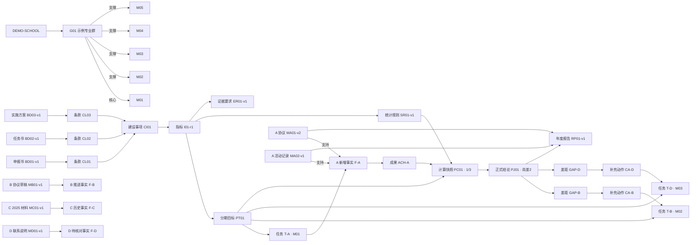

# 多专业知识图谱演示样例与验证

> 版本：v1.0　日期：2026-10-18　状态：内部演示设计。  
> 对应波次：W2。  
> 重要说明：本文所有学校、专业群、专业、人员、企业、目标、数字和材料均为演示数据，只用于验证产品结构，不代表任何学校事实，也不能导入正式知识范围。

## 1. 验证目的

用一个专业群、五个专业、一项建设指标和一条完整工作链验证：

- 多专业关系能否清楚表达；
- 三类依据能否共同形成建设事项；
- 指标、任务、人员、材料、证据和成果能否双向追溯；
- 智能体能否为不同任务组装受控知识包；
- 版本变化是否能找到受影响的进度和报告；
- 复制到新专业群时是否只复制结构，不复制事实。

## 2. 演示范围

| 对象 | 演示值 | 说明 |
| --- | --- | --- |
| 学校 | DEMO-SCHOOL | 虚构学校 |
| 专业群 | DEMO-G01 示例专业群 | 虚构专业群 |
| 建设周期 | 2026—2028 演示周期 | 虚构周期 |
| M01 | 示例核心专业 | 核心专业 |
| M02 | 示例支撑专业 A | 支撑专业 |
| M03 | 示例支撑专业 B | 支撑专业 |
| M04 | 示例支撑专业 C | 支撑专业 |
| M05 | 示例支撑专业 D | 支撑专业 |
| 负责人 | 负责人甲 | 虚构人员 |
| 教师 | 教师甲、乙、丙 | 虚构人员 |
| 企业 | A、B、C、D 企业 | 沿用需求确认单中的虚构说明案例 |

## 3. 演示对象清单

### 3.1 组织与人员

| 编号 | 对象 | 关系 |
| --- | --- | --- |
| G01 | DEMO-G01 示例专业群 | 属于 DEMO-SCHOOL |
| M01 | 示例核心专业 | 作为核心专业组成 G01 |
| M02—M05 | 四个示例支撑专业 | 作为支撑专业组成 G01 |
| U01 | 负责人甲 | 负责 G01，确认指标、任务和进度 |
| U02 | 教师甲 | 参与 M01，负责 A 企业相关工作 |
| U03 | 教师乙 | 参与 M02，负责 B 企业推进 |
| U04 | 教师丙 | 参与 M03，负责 D 企业洽谈 |

M04、M05 暂无该指标责任任务，但仍属于专业群；查询时应显示“当前无相关任务”，不能误写为专业不存在或未完成。

### 3.2 建设依据

| 编号 | 对象 | 状态 |
| --- | --- | --- |
| BD01-v1 | 演示申报书 v1 | 已批准 |
| BD02-v1 | 演示建设任务书 v1 | 已批准 |
| BD03-v1 | 演示实施方案 v1 | 已批准 |
| CL01 | 申报书相关条款 | 已确认来源于 BD01-v1 |
| CL02 | 任务书相关指标行 | 已确认来源于 BD02-v1 |
| CL03 | 实施方案相关任务段落 | 已确认来源于 BD03-v1 |
| CI01 | “校企合作能力建设”建设事项 | 由 CL01—CL03 共同支持 |

### 3.3 指标与任务

| 编号 | 对象 | 关键内容 |
| --- | --- | --- |
| I01-r1 | 新增合作企业指标修订 r1 | 演示目标：2026 年新增 3 家 |
| PT01 | 2026 年分期目标 | 目标值 3，比较方式 gte |
| SR01-v1 | 统计规则 v1 | 正式协议、本年度、按企业去重、负责人确认 |
| ER01-v1 | 证据要求 v1 | 正式协议及相关活动/过程记录 |
| T-A | A 企业成果确认任务 | 责任人教师甲、M01 |
| T-B | B 企业正式签约推进任务 | 责任人教师乙、M02 |
| T-D | D 企业首次正式洽谈任务 | 责任人教师丙、M03 |

指标采用联合完成方式，不把专业任务数量简单相加成群级成果数量。

### 3.4 材料、事实与成果

| 编号 | 对象 | 状态与用途 |
| --- | --- | --- |
| MA01-v1 | A 企业正式协议扫描件 | 可读、已确认 |
| MA01-v2 | A 企业正式协议电子版 | 当前版本；与 v1 属于同一协议，不另计成果 |
| MA02-v1 | A 企业合作活动记录 | 已确认过程证据 |
| MB01-v1 | B 企业协议草稿 | 过程材料，不能证明正式签约 |
| MC01-v1 | C 企业 2025 年合作材料 | 已确认历史合作，期间不适用 |
| MD01-v1 | D 企业初步联系说明 | 待核对，不能形成新增成果 |
| F-A | A 企业 2026 年新增合作事实 | 已确认 |
| F-B | B 企业协议推进中事实 | 已确认，但不是完成事实 |
| F-C | C 企业为历史合作事实 | 已确认 |
| F-D | D 企业尚未形成有效进展 | 待负责人确认 |
| ACH-A | A 企业新增合作成果 | 已确认，唯一键 DEMO-2026-A |

### 3.5 进度与成果编制

| 编号 | 对象 | 内容 |
| --- | --- | --- |
| PC01 | 进度计算快照 | 规则 SR01-v1、截止 2026-06-30、实际 1/目标 3 |
| PJ01 | 进度正式结论 | 未达成，尚差 2；负责人甲确认 |
| GAP-B | B 企业差距 | 工作已推进，缺正式协议 |
| GAP-D | D 企业差距 | 工作尚未形成有效进展 |
| CA-B | B 补充动作 | 完成正式签约并补文件 |
| CA-D | D 补充动作 | 完成正式洽谈并提交记录 |
| RP01-v1 | 演示年度报告草稿 v1 | 使用 PC01、PJ01 及已确认事实 |
| RP01-C01 | 报告引用 | 指向 I01-r1、PC01、MA01-v2、MA02-v1 |

## 4. 关系图

## 5. 关键关系明细

| 起点 | 关系 | 终点 | 状态 | 确认人 |
| --- | --- | --- | --- | --- |
| M01 | 核心专业组成 | G01 | 已确认 | 负责人甲 |
| M02—M05 | 支撑专业组成 | G01 | 已确认 | 负责人甲 |
| CL01—CL03 | 归入 | CI01 | 已确认 | 负责人甲 |
| CI01 | 要求 | I01-r1 | 已确认 | 负责人甲 |
| I01-r1 | 采用 | SR01-v1/ER01-v1 | 已确认 | 负责人甲 |
| PT01 | 分解为 | T-A/T-B/T-D | 已确认 | 负责人甲 |
| MA01-v2/MA02-v1 | 支持 | F-A | 已确认 | 负责人甲 |
| MB01-v1 | 支持 | F-B | 已确认过程关系 | 负责人甲 |
| MC01-v1 | 支持 | F-C | 已确认历史关系 | 负责人甲 |
| MD01-v1 | 支持 | F-D | 候选 | 未确认 |
| ACH-A | 计入 | PT01 | 已确认 | 负责人甲 |
| PJ01 | 发现 | GAP-B/GAP-D | 已确认 | 负责人甲 |
| CA-B/CA-D | 转为 | T-B/T-D | 已确认 | 负责人甲 |
| RP01-v1 | 引用 | PC01、PJ01、MA01-v2、MA02-v1 | 待审核 | — |

## 6. 知识成熟度看板样例

| 层次 | 数量 | 解释 |
| --- | ---: | --- |
| 已登记材料 | 6 | 六份演示材料均保留原件 |
| 可读取 | 6 | 演示均设为可读取 |
| 已拆解 | 5 | D 联系说明仍未完整拆解 |
| 候选事实/关系 | 2 | F-D 及其材料支持关系待确认 |
| 已确认事实 | 3 | F-A、F-B、F-C |
| 正式进度结论 | 1 | PJ01 |
| 待处理差距 | 2 | GAP-B、GAP-D |
| 报告待审核版本 | 1 | RP01-v1 |

“可读取 6”不能显示为“知识完成 6”；每层分别统计。

## 7. 不同角色看到的范围

| 角色 | 可以看到和办理 | 不应看到或不能执行 |
| --- | --- | --- |
| 教师甲 | T-A、本人工作、获授权 A 材料 | B/D 受限正文、进度正式确认 |
| 教师乙 | T-B、B 过程材料、退回意见 | A 协议受限内容、任务正式派发 |
| 教师丙 | T-D、D 工作记录 | B 材料正文、报告批准 |
| 专业负责人 | 本专业任务、事实、材料关系 | 其他专业受限正文，除非授权 |
| 专业群负责人 | 群内获授权对象、指标、进度和报告 | 校内其他专业群独立事实 |
| 审核人 | 指定报告版本及审核所需引用 | 未授权日常材料、源对象修改 |
| 运维人员 | 运行状态、作业错误和恢复信息 | 默认无业务正文读取权 |

## 8. 智能体任务知识包样例

### 8.1 查询“今年新增企业完成多少”

知识包包括：G01、2026 周期、I01-r1、PT01、SR01-v1、PC01、PJ01、相关已确认成果和数据截止点。不需要装载其他无关指标或其他专业群材料正文。

输出：目标 3、已确认 1、尚差 2；A 计入，B 推进中，C 年度不符，D 待开展；说明截止点和来源。

### 8.2 办理“帮教师乙补充 B 企业进展”

知识包包括：当前用户权限、T-B、F-B、MB01-v1、ER01-v1、退回意见和预期产出。不装载 A 企业协议正文。

输出：工作记录草稿、缺正式协议提示和可提交的材料清单；由教师乙修改提交。

### 8.3 办理“起草年度报告企业合作部分”

知识包包括：模板章节、PC01、PJ01、F-A/F-B/F-C、相关材料权限、缺项和报告任务状态。

输出：章节草稿、指标表、引用和缺项；D 未确认内容不能写成正式事实。

## 9. 版本变化影响验证

### 场景一：任务书新增版本

上传 BD02-v2，将目标从 3 改为另一个演示值，但批准状态为“待批准”。系统应：

1. 保留 BD02-v1 为当前有效；
2. 建立条款差异和冲突候选；
3. 不自动修改 PT01、PC01、PJ01 和 RP01-v1；
4. 提示负责人待批准后处理。

### 场景二：统计规则正式变化

SR01-v2 经确认生效。系统应创建影响批次，列出 PC01、PJ01 和 RP01-v1；负责人决定重新计算和重新审核，旧版本仍可追溯。

### 场景三：A 协议证据被撤销

MA01-v2 证据关系失效。系统不删除文件和旧报告，而是把 F-A、ACH-A、PC01、PJ01、RP01-v1 列为待复核；正式导出按规则暂停或标记失效。

## 10. 新专业群复制验证

创建 DEMO-G02 时可以复用：

- 对象类型和关系模型；
- 三类依据拆解流程；
- 指标、任务、进度和报告办理方法；
- 模板配置方式；
- 智能体能力单元和确认规则。

必须重新建立：

- G02 的专业和核心/支撑关系；
- 依据文件、条款、目标和统计规则；
- 人员、任务、企业、材料和权限；
- 进度、差距、报告和审核结论。

A、B、C、D 企业、负责人甲、教师甲乙丙、目标 3 和完成 1 均不得成为 G02 的事实。

## 11. T01—T18 覆盖验证

| 任务 | 本样例验证点 |
| --- | --- |
| T01 | 六份材料登记、版本和待整理状态 |
| T02 | 可从同批材料形成表格或汇报草稿 |
| T03 | 一个群、五个专业及人员关系 |
| T04 | T-A/T-B/T-D 对应持续工作记录 |
| T05 | 三类文件、条款和共同建设事项 |
| T06 | A/B/C/D 不同分类和重复处理 |
| T07 | 指标分解为三个专业任务 |
| T08 | 任务提交、退回、补充和确认 |
| T09 | 可从当前事实形成周期总结 |
| T10 | PC01/PJ01 的 1/3 与尚差 2 |
| T11 | GAP-B/GAP-D 和不同补充动作 |
| T12 | 三类智能体任务知识包 |
| T13 | RP01-v1、引用和支撑目录 |
| T14 | 可对 RP01 形成局部改稿版本 |
| T15—T17 | 公共对象可复用，专用业务数据未虚构 |
| T18 | G02 只复制结构与方法 |

## 12. 验证结论与限制

该样例证明对象和关系模型在纸面上能够贯穿多专业、依据、任务、证据、进度、差距和报告，也能表达权限和版本影响。

它尚不能证明：

- 学校真实组织和指标可以无调整使用；
- 文件解析、关系识别和查询已经实际运行；
- 权限、版本影响和智能体知识包已经通过程序验证；
- 多专业群大规模性能已经达到要求。

这些仍需在 W8 原型走查、W9 可运行产品和 W10 真实试点中验证。

