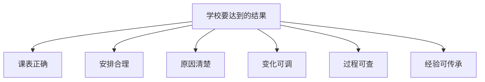
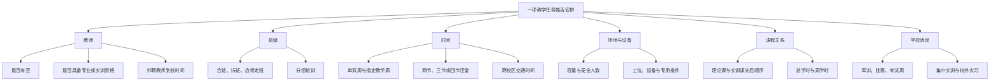
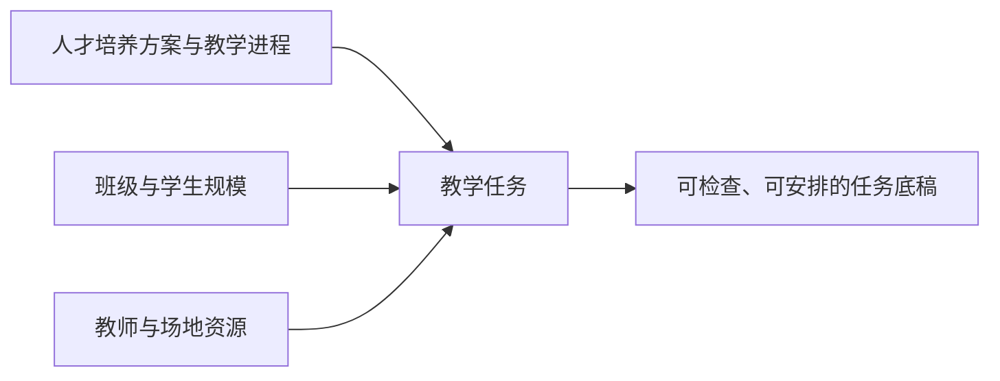
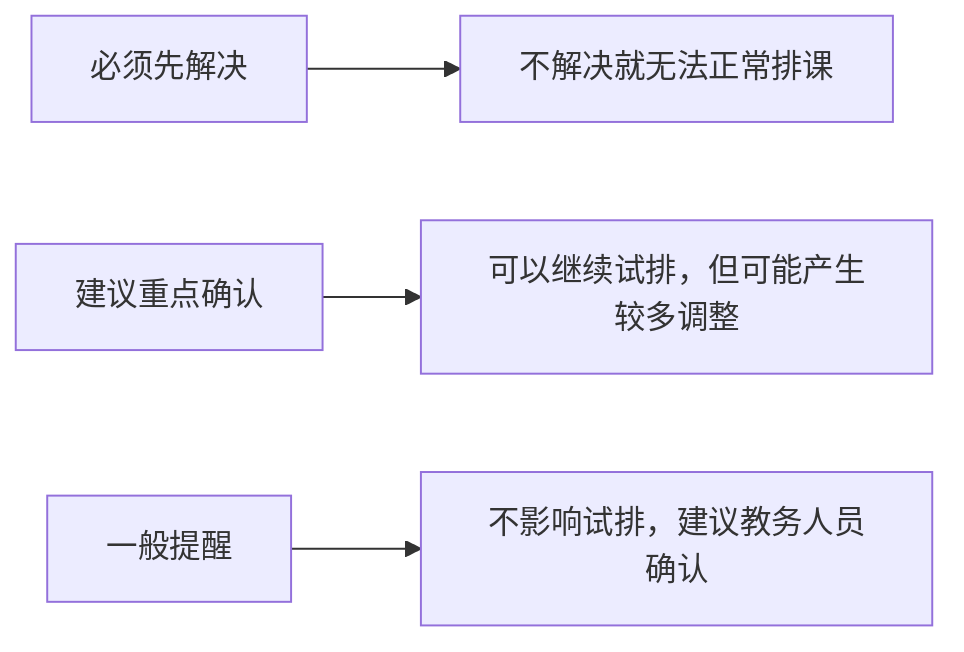
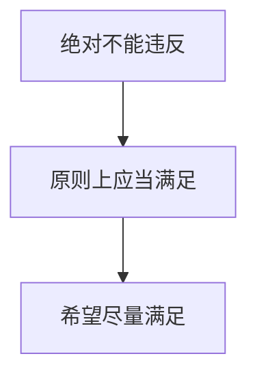
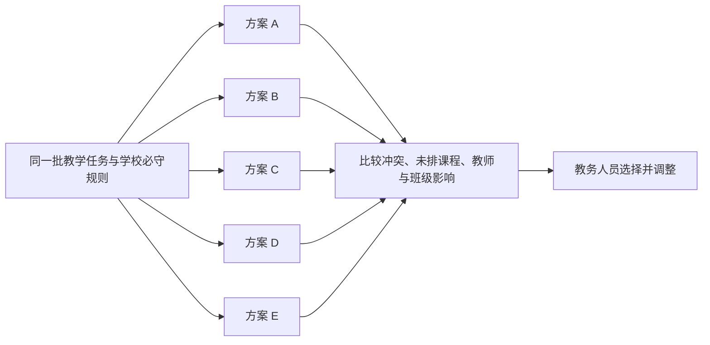
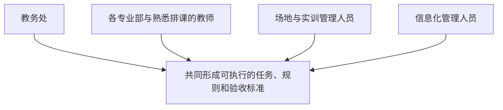

# 智能教学安排管理校方沟通展示稿

> 让学校少出错、少返工、看得清、调得动、管得住

> **学校当前最直接的痛点：**已经使用十多年的排课系统能够完成排课，但仍会出现教师、班级、教室、实训室和教学周之间的冲突，教务人员需要投入较长时间反复核对和人工调整。
>
> **这次建设最核心的改进：**先依据学校确认的规则排除不能接受的冲突，再形成多套都符合必守规则的课表方案，讲清楚每套方案的侧重点、优点、不足和影响对象。

## 从一轮真实排课讲起

学校已经使用现有排课系统十多年，每年都能完成排课，但老系统没有完全解决排课冲突问题。从教学任务收集、第一版课表形成，到人工调整、审核发布和日常调课，教务人员仍需要反复核对教师、班级、教室、实训室和教学周，许多关键判断还依赖资深人员的个人经验。

因此，这次建设关注的不是“能不能生成一张课表”，而是学校怎样把一次排课完整、稳妥地做完，并在课表发布后持续管好每一次变化。

沿着这条主线，学校可以逐项确认：现有工作怎样开展、哪些地方最费时间、哪些规则必须遵守、系统应提供什么帮助，以及最后怎样判断建设是否有效。

---

## 01 先明确目标：把课排出来，还要把全过程管起来

新系统希望帮助学校做到：

1. 正式发布的课表中，教师、班级、教室和实训室不再出现同时被重复安排的问题。
2. 在满足正常教学的基础上，减少教师空堂、班级课程过度集中等不合理安排。
3. 每一项安排都能说明原因，教务人员看得懂、能判断。
4. 教师请假、场地维修或学校临时活动发生时，能够快速找到影响较小的调整办法。
5. 每一次人工调整都有记录，可以比较调整前后的差异，必要时可以恢复。
6. 把资深教务人员多年积累的排课经验整理成全校可以长期使用的规则。

它面向的是职业学校教学计划、师资、班级、场地和实训资源的统筹安排，以及课表形成后的持续管理。自动生成课表只是其中一个环节。

目标明确以后，下一步要先理解职业学校为什么不能照搬普通课表的安排方式。

---

## 02 职业学校排课为什么更复杂

职业学校除了普通文化课，还有大量专业课、实训课和校外实习。一门课能否安排，不只取决于“这个时间有没有空”，还要同时判断人、班、时间、场地、设备和教学进程是否匹配。

实训室不能只当作一种普通教室。系统必须知道它能容纳多少人、有哪些设备和工位、适合哪些课程、教师是否具备相应资格，以及使用前后是否需要准备和复位时间。

教育部关于职业院校人才培养方案的相关要求中，明确提出应合理安排课程、学时和教学进程，并强化实践性教学。相关依据可参见：[教育部职业院校专业人才培养方案指导意见](https://www.moe.gov.cn/srcsite/A07/moe_953/201906/t20190618_386287.html)、[2025 年职业教育专业教学标准说明](https://www.moe.gov.cn/jyb_xwfb/s271/202502/t20250211_1178747.html?zbb=true)。

这些条件决定了：排课前必须先把任务资料准备完整，并把学校真实使用的规则说清楚。

---

## 03 排课从一份完整的教学任务开始

系统首先要统一管理排课所需的基础信息：

- 专业、年级、班级、课程、学期和教学周。
- 人才培养方案、教学进程表和课程要求。
- 每门课程的总学时、周学时、理论学时和实训学时。
- 任课教师、助教、外聘教师及教师擅长的专业方向。
- 合班、拆班、分组轮训和选修课。
- 单双周课程、阶段课程、集中实训和校外实习。
- 校区、上课节次、午休、晚自习和特殊工作日。

教务处不再需要在多个表格中重复整理同一批信息，各专业部也可以按照统一格式提交教学任务。这里的关键不是简单地“把表格导进去”，而是要让每一项任务都能回答清楚：谁来上、给谁上、上什么、上多少、什么时候可以上、需要什么场地和条件。

任务底稿形成后不能马上开始排课，先要检查资料是否完整、相互之间是否一致。

---

## 04 排课前先发现资料问题

很多课表问题不是在排课时产生的，而是来自排课前资料不完整、口径不一致或不同部门提供的信息互相矛盾。

系统应在开始排课前检查：

- 班级、课程、教师和场地是否存在重复或已经停用的信息。
- 课程学时与教学周、每周课时是否能够对应。
- 是否有课程还没有安排教师。
- 是否有课程找不到合适的教室或实训室。
- 教师承担的总课时是否已经超过可安排范围。
- 实训室工位、设备和安全容量是否满足班级人数。
- 教学任务是否符合已批准的人才培养方案。
- 不同部门提供的资料是否存在冲突。

检查结果分为三类，让教务人员知道先处理什么：

没有排进去的课程不能只显示“失败”，还要说明缺少的是教师、时间、场地、设备、资格，还是规则之间无法同时满足。

资料问题处理到可以试排的程度后，学校多年积累的经验还需要整理成共同规则。

---

## 05 把个人经验整理成全校共同规则

学校现有排课经验可能散落在制度、表格、口头约定和资深人员的工作习惯中。系统应把这些经验分成三个层次，避免把所有要求都当成同样严格的条件。

### 第一层：绝对不能违反

- 一名教师同一时间不能上两门课。
- 一个班级同一时间不能上两门课。
- 一间教室或实训室同一时间不能被重复使用。
- 教室容量不能小于上课人数。
- 教师请假或确定不能到校的时间不能安排课程。
- 课程需要的设备、工位或场地条件必须满足。
- 有资格要求的实训课程必须安排符合条件的教师。

以上内容用于说明这类规则的含义，具体规则应由学校结合实际定义。

### 第二层：原则上应当满足

- 必修课程和核心实训课程应优先排入。
- 指定课程需要连续两节或四节安排。
- 理论课程应安排在对应实训课程之前。
- 外聘教师只能在约定时间到校授课。
- 跨校区连续上课需要留出交通时间。
- 技能比赛、军训、考证和实习周不能再安排普通课程。

如果确实无法全部满足，应由有权限的人员确认是否允许特殊处理，并记录原因。

### 第三层：希望尽量满足

- 尽量减少教师一天中的长时间空堂。
- 尽量避免教师连续上课时间过长。
- 尽量让班级课程分布均匀。
- 尽量避免一天集中安排多门高强度实训课。
- 尽量减少教师跨校区奔波。
- 尽量保持同一课程的教室相对固定。
- 在不影响整体安排的情况下，照顾教师合理的时间意愿。

每条学校规则都要记录适用对象、执行时间、提出部门和确认人。这样既能长期使用，也能在规则变化时知道从什么时候开始执行、由谁确认。

当教学任务、资料和规则都准备好后，系统才有条件形成可供学校选择的课表方案。

---

## 06 形成多套方案，让教务人员比较后决定

### 先满足共同规则，再比较不同侧重点

多套方案不是把学校规则放宽以后随意生成多张课表。它们使用同一批经过确认的教学任务，并共同满足学校确定的必守规则；在此基础上，再分别突出不同的安排侧重点。系统不应只给出一张无法比较的课表，而应提供多套可行方案，例如：

- **方案 A：**优先减少教师空堂和连续授课。
- **方案 B：**优先保证班级课程分布均匀。
- **方案 C：**优先提高实训室和专用设备的使用效率。
- **方案 D：**尽量减少对上一版课表的改动。
- **方案 E：**综合兼顾各方面要求。

教务人员比较方案时，应能直接看到：

- 是否还有不能接受的冲突。
- 是否有课程没有安排进去。
- 哪些学校要求没有完全满足。
- 教师空堂和连续上课情况。
- 班级课程是否过度集中。
- 实训室和教室使用情况。
- 跨校区上课次数。
- 与上一版课表相比改动了多少门课。

系统不能只显示一个难以理解的总分，而应说明每套方案好在哪里、还存在哪些不足、影响哪些教师和班级。最终由学校根据教学安排和管理需要作出选择。

如果学校实际存在不同班型，并希望不同班型采用不同的安排侧重，后续也可以在学校明确班型定义和适用规则后纳入方案；本次沟通先以解决现有冲突、形成多套合规方案并讲清方案差异为重点。

形成方案并不等于可以直接发布。接下来还要把冲突原因、人工调整、审核和版本变化管理清楚。

---

## 07 冲突不仅要被发现，还要说明白

系统检查的不只是教师、教室和班级重复占用，还包括（例子）：

- 教室人数容量不足。
- 实训设备、工位或场地条件不符合要求。
- 教师不具备课程所要求的资格。
- 课程学时没有排够或出现超排。
- 连堂要求没有满足。
- 理论课和实训课顺序不合理。
- 单双周、教学周或实习周安排错误。
- 跨校区上课时间衔接不合理。
- 合班、拆班和分组轮训关系错误。
- 考试、比赛、活动和场地使用发生冲突。
- 一天内课程强度明显不合理。

每个问题都应按照同一套方式说明：

这使教务人员可以判断，而不是只能接受一个“有冲突”的提示。

---

## 08 人工调整要能控制影响范围

教务人员在试排阶段经常需要移动、交换或锁定课程。系统应支持锁定已经确认、不能再移动的课程；移动一门课后立即检查相关教师、班级、场地、教学周和前后课程，显示可能产生的后续影响。

已经确认的安排尽量保持不动，只调整确有必要的小范围课程。人工强制安排时必须填写原因，特殊处理要写明批准人和适用时间。

这个原则同样适用于课表发布后的临时变化。

---

## 09 教师请假或场地变化时，怎样完成一次临时调课

教师请假、教室维修、技能比赛和学校活动不可避免。发生变化时，不应每次重新排全校课表，而应按照“尽可能少改动”的原则处理：

系统需要明确告诉教务人员：

- 当前发生了什么变化。
- 影响哪些教师、班级、课程和场地。
- 有哪些可行的处理办法。
- 每种办法要调整哪些课程，还会影响谁。
- 推荐哪一种，以及推荐原因。
- 哪些内容还需要学校确认。

一次临时调课解决以后，它还应成为可查询的记录，用于以后处理相同情况和完善学校规则。

---

## 10 从试排到发布，每一步都有责任人和版本

建议课表按照以下过程逐步确认：

全过程应支持：

- 每一版课表有明确的版本号。
- 比较两个版本改了哪些课程。
- 记录谁在什么时间调整了什么内容。
- 人工强制安排时必须填写原因。
- 特殊处理需要明确批准人和适用时间。
- 正式发布前重新检查全部课程。
- 按班级、教师、教室、专业和周次查看课表。
- 支持打印以及导出常用文件。
- 支持教师和相关人员在手机端查看。
- 出现问题时可以恢复到上一版已经确认的课表。

正式发布、批量通知和允许特殊安排都属于学校的正式管理行为，必须由相应负责人确认。

---

## 11 排课助手“小慧”贯穿全过程

排课助手不是页面中的一个输入框，而是一位学校教务人员能够看到、能够呼叫、能够持续交流的女性数字人。她掌握学校已经交给系统的教学任务、排课规则、课表版本和调整记录，可以用教师和教务人员熟悉的语言回答问题、形成方案并解释结果。

数字人的名称可以由学校共同确定。产品设计阶段暂称“排课助手小慧”，学校正式使用时可以结合校名、校训或校园文化重新命名。

### 她的形象

- 女性数字人，整体感觉专业、亲切、沉稳，不使用过度娱乐化或幼龄化的形象。
- 服装和配色可以结合学校校徽、标准色和校园文化。
- 在电脑大屏、教务工作台和手机端保持统一形象。
- 回答问题时不仅“说一句话”，还同时展示课表、冲突位置、影响对象和可选方案。
- 当前先支持文字交流和点击呼叫，后续增加自然声音、口头问答和呼叫名字唤醒。

### 教师和教务人员可以直接问她

- “小慧，帮我看看还有哪些课程没有排进去。”
- “小慧，为什么机械设计不能放到周三第三、四节？”
- “小慧，张老师周四请假，会影响哪些班？”
- “小慧，给我找三种影响最小的调课办法。”
- “小慧，哪个实训室周二下午可以容纳 40 名学生？”
- “小慧，比较一下方案 A 和方案 B，哪一个教师空堂更少？”
- “小慧，按现在的教学任务生成一版课表。”
- “小慧，把汽车维修 23-1 班这周的课表调出来。”
- “小慧，方案 A、方案 B、方案 C 各自的侧重点是什么？哪个方案更适合某个班？”

她应直接给出结果和说明，而不是只告诉用户去哪个菜单查找。

### 她可以帮助完成的工作

- 接收教务人员用日常语言描述的要求，整理成待确认的学校排课规则。
- 根据已经确认的教学任务和学校规则，形成一版或多版课表供教务人员选择。
- 回答某位教师、某个班级、某间教室或某个实训室的课程和空闲情况。
- 解释某门课程为什么不能安排在指定时间或指定场地。
- 分析教师请假、教室维修或学校活动会影响哪些课程。
- 给出多种调课办法，并说明每种办法的影响范围。
- 比较多套课表的优缺点。
- 从历年的人工调整中发现经常使用的安排习惯，提交给教务人员确认。
- 帮助形成调课通知、审核说明和排课情况报告。
- 在课表发布前提醒尚未解决的问题和需要确认的事项。

### 她提供帮助，正式决定仍由学校作出

- 查询和说明类问题可以直接回答。
- 课表和调课方案可以直接生成，但先作为待确认方案展示。
- 修改已经确认的课程前，要说明具体影响，并请有权限的人员确认。
- 正式发布课表、批量通知教师和允许特殊安排，必须再次明确确认。
- 她不能绕过学校规则，也不能在资料不足时编造答案；无法判断时应明确说明还缺少什么资料。

这样，“小慧”更像一位随时在岗的数字教务员：能立即回答并拿出结果，最终确认权始终在学校。

---

## 12 这是一套全年持续使用的工作方式

全校集中排课可能一年只有一次，但教学安排的变化贯穿全年。在下一次全校排课之前，学校就可以使用：

- 日常冲突检查。
- 临时调课。
- 空闲教师和空闲教室查询。
- 实训室和设备使用安排。
- 课表版本管理。
- 教师教学工作量查看。
- 教学任务收集和资料检查。

因此，完整系统覆盖排课前、排课中、发布前和发布后的全过程。当前设想中“发现冲突、推荐调整方案、查看本周课表”等页面，可以先承担冲突处理和调课中心的作用，但还需要与前后的工作衔接起来。

---

## 13 当前产品设计需要补齐的环节

为了真正用于学校日常工作，当前产品设计需要完整覆盖以下事项：

1. 排课开始前的资料完整性检查。
2. 明确区分“绝对不能违反”和“希望尽量满足”的要求。
3. 说明每个推荐方案的好处、代价和影响范围。
4. 显示一门课调整后可能产生的后续影响。
5. 支持锁定已经确认、不能再移动的课程。
6. 支持只调整小范围课程，不轻易改动全校课表。
7. 增加审核、版本比较、恢复和操作记录。
8. 支持单双周、集中实训和不同教学周安排。
9. 支持实训室工位、设备和教师资格要求。
10. 对没有排进去的课程说明具体原因和缺少的条件。
11. 正式发布前再次检查全部课程。

这些事项不是彼此分离的功能点，而是一条连续工作链。前一个环节的结果要成为后一个环节的依据，后续发生变化也要能追溯到原来的任务、规则和确认记录。

---

## 14 学校怎样判断建设是否有效

不建议只用“智能程度”或“生成速度”评价系统。学校可以从结果、效率和课表质量三个方面验收。

### 必须达到的结果

- 正式发布课表中，教师、班级和教室重复占用数量为 0。
- 应排课程全部安排完成；如有未排课程，必须有明确原因并经过确认。
- 教师课表、班级课表和教室课表中的安排保持一致。
- 在相同资料和相同学校规则下，系统应得到稳定、一致的结果。
- 每一个正式版本都能查到来源、修改记录和批准人。
- 任何一次正式调整都可以查看调整前后的变化。

### 工作效率是否提高

- 从收集教学任务到形成第一版课表需要多长时间。
- 与过去相比，人工调整次数减少了多少。
- 从发现冲突到形成可用调整方案需要多长时间。
- 一次临时调课平均影响多少门课程。
- 教务处与各专业部之间需要往返确认多少轮。
- 对线下表格和人工核对的依赖是否明显减少。

### 课表质量是否提高

- 教师空堂是否减少，安排是否更公平。
- 班级课程是否分布得更加均匀。
- 连续高强度课程是否减少。
- 实训室和专用设备是否得到合理使用。
- 跨校区上课衔接是否合理。
- 正式发布后两周内被迫调课的次数是否减少。

这些验收内容需要在建设开始前由双方共同确认，包括使用哪一学年的资料、与哪一版现行课表比较、允许多长时间、允许多少次人工调整，以及由哪些部门和负责人确认。

---

## 15 利用下一次全校排课前的时间分阶段验证

今年的课表已经排完，未来约一年不会再次进行全校排课。这个时间可以用于整理资料、验证规则和试用日常功能，避免等到下一次正式排课才发现问题。

### 第一阶段：了解现状、整理资料和学校规则

收集最近 2—3 年的教学计划、排课原始资料、初步课表、最终课表和人工调整记录，形成：

- 学校当前排课流程图。
- 现有系统和资料情况清单。
- 各类信息的名称和含义说明。
- 学校排课规则清单。
- 历年冲突和人工调整情况分析。
- 项目能够解决什么、暂时不能解决什么的范围说明。

### 第二阶段：用历史资料进行模拟排课

使用上一年度资料重新安排一次课表，但不影响学校正在使用的正式系统和正式数据，主要验证：

- 学校规则是否整理完整。
- 是否还有只存在于教务人员经验中的隐性要求。
- 系统给出的原因说明是否容易理解。
- 现有资料是否足够支持自动排课。
- 新方案与学校最终人工调整后的课表相比，有哪些改进和不足。

### 第三阶段：先使用全年都需要的功能

先开展日常冲突检查、临时调课、空闲教师和教室查询、实训室和设备使用安排、课表版本管理、教师教学工作量查看，以及教学任务收集和资料检查。学校不必等待一年以后才开始使用。

### 第四阶段：下一次排课时新旧系统同时排课比对

- 现有系统继续正常使用。
- 新系统使用同一批资料同时试排。
- 比较两边的冲突数量、人工投入和课表质量。
- 由教务处和各专业部共同检查。
- 确认可靠后，再决定是否由新系统正式发布课表。

第一次试用不建议直接停用已经运行十多年的原系统。

---

## 16 学校与建设方需要共同完成什么

系统要真实反映学校的工作方式，需要教务处、专业部、熟悉排课的教师和信息化管理人员共同参与。

- **教务处：**说明完整流程、统一规则、审核与发布方式，并确定验收标准。
- **各专业部和熟悉排课的教师：**提供专业课程、教师安排、实训要求和真实调整经验。
- **场地与实训管理人员：**说明教室、实训室、设备、工位、安全容量和占用规则。
- **信息化管理人员：**协助确认现有系统、资料交换、访问权限、信息安全、备份和恢复方式。

下面的沟通清单不是独立于方案之外的问卷，而是为了把前面每个环节落实到学校真实情况。

---

## 17 第一组确认：学校要解决什么，排课规模有多大

先统一建设目标和范围，才能判断哪些问题优先处理、使用哪些资料验证。

<strong>A. 学校最希望解决的问题</strong>

- 这次建设最希望解决的前三个问题是什么？
- 学校所说的“经常冲突”具体包括哪些情况？每年大约发生多少次？
- 冲突出现在系统第一次排课时、人工调整时，还是课表发布以后？
- 有没有系统没有发现，直到教师或班级实际使用时才发现的问题？
- 从收集教学任务到正式发布，目前需要多少天、多少人参与？
- 人工调整一般持续多久？大约要改多少门课？
- 哪些人掌握最关键的排课经验？这些经验是否有书面记录？
- 学校希望新系统是帮助人工排课，还是逐步替代原有系统？
- 系统投入使用一年后，学校希望看到哪些具体变化？

<strong>B. 学校规模和管理方式</strong>

- 71 个“专业”具体是专业名称、专业方向，还是包含不同年级的统计？
- 学校有多少校区、专业部、年级、行政班和实际教学班？
- 学生总数、平均班级人数和最大班级人数是多少？
- 在编教师、外聘教师、兼职教师和企业教师分别有多少？
- 普通教室、机房、实验室、实训室和校外基地分别有多少？
- 是否存在跨校区上课和教师走教？
- 目前由谁负责全校排课？各专业部能否自行调整？
- 最终课表由谁审核和批准？

---

## 18 第二组确认：一次排课实际是怎样完成的

建议学校现场演示一次完整过程。每一步都记录由谁负责、使用什么资料、需要多长时间、有什么困难，以及遇到特殊情况时怎样处理。

<strong>C. 当前完整排课过程</strong>

1. 怎样建立新学年和新学期。
2. 怎样录入或导入教学计划。
3. 怎样形成每个班级需要上的课程。
4. 怎样给课程安排教师。
5. 怎样安排普通教室和实训室。
6. 怎样填写教师不能上课的时间。
7. 怎样开始排课。
8. 怎样查看冲突和没有排进去的课程。
9. 怎样人工移动、交换或锁定课程。
10. 怎样审核、发布和通知教师。
11. 临时调课怎样处理。
12. 学期结束后资料怎样保存。

<strong>D. 上课时间和教学周安排</strong>

- 是一次安排整个学年，还是分别安排两个学期？
- 每学期有多少教学周？
- 每周上课几天、每天几节？
- 不同校区、不同季节是否使用不同作息时间？
- 是否有单双周、指定周、连续周和间隔周课程？
- 是否有两节、三节或四节连堂？
- 是否有整周实训、军训、考试周、比赛周和实习周？
- 节假日调休时怎样调整课程？
- 晚自习、社团课和补课是否与正常课程共用教室和教师时间？

<strong>E. 课程和教学任务</strong>

- 人才培养方案保存在哪里，以什么形式保存？
- 教学计划由谁制定、谁审核？
- 课程总学时、周学时、理论学时和实训学时怎样维护？
- 一门课程能否由多名教师共同授课？
- 是否有合班、拆班、分组轮训和选修走班？
- 学校是否存在需要采用不同排课侧重的班型？如有，班型定义和适用规则是什么？
- 不同专业是否共同使用语文、数学、英语等公共课教师？
- 是否有“先上理论课、后上实训课”等先后要求？
- 课程学时没有排满时能否发布课表？
- 临时停开、更换或增加课程时怎样处理？

---

## 19 第三组确认：教师、场地和真实冲突怎样处理

这一组信息决定学校规则能否真实落地，也是历史模拟排课时必须重点核对的内容。

<strong>F. 教师安排要求</strong>

- 教师有哪些确定不能上课的时间和希望安排的时间？
- 教师每天和每周最多安排多少节课？
- 一名教师最多可以连续上多少节课？
- 是否需要考虑教师之间的工作量公平？
- 是否允许教师在不同校区连续上课？
- 外聘教师和企业教师有哪些固定到校时间？
- 哪些实训课程要求教师具备相应资格？
- 教师兼任行政工作、值班和教研活动时，时间怎样处理？
- 教师提出的时间要求，哪些必须满足，哪些只是尽量照顾？
- 教师请假后，由谁决定代课或调课？

<strong>G. 教室、实训室和设备要求</strong>

- 每间教室是否记录人数容量、用途、楼层、校区和设备？
- 实训室是按整间使用，还是可以按工位或设备数量分开使用？
- 班级人数超过实训工位数量时，是否必须分组？
- 一次实训是否需要同时使用多个房间或多种设备？
- 实训前后是否需要设备准备、清理或复位时间？
- 哪些课程只能在指定实训室开展？
- 场地维修、考试占用和对外借用怎样登记？
- 是否有安全人数上限或其他安全要求？
- 校外实训基地怎样纳入教学安排？

<strong>H. 真实冲突和人工调整案例</strong>

建议学校准备 10—20 个真实案例，每个案例说明：

- 原来的课程是怎样安排的？
- 原系统是否发现了问题？
- 冲突产生的真实原因是什么？
- 教务人员最后怎样调整？
- 调整影响了多少门课、多少位教师和多少个班？
- 为什么选择这种调法，而没有选择其他办法？
- 调整后是否又产生了新的问题？
- 以后遇到同类情况，希望系统怎样处理？

真实案例是了解学校排课规则最重要的材料，比只做口头介绍更有价值。

---

## 20 第四组确认：现有系统、资料和校内配合关系

这部分建议由教务处和信息化管理人员共同确认，目的是弄清现状和衔接方式，不预先假设学校必须更换现有系统。

<strong>I. 现有系统和数据资料</strong>

- 现有系统的名称、开发单位、版本和使用年限。
- 系统是学校自行开发还是采购，原开发单位是否仍提供维护。
- 系统安装在校内还是由外部单位提供服务。
- 是否有系统使用说明、数据说明和对接说明。
- 是否能够安全地导出经过隐去姓名等处理的样例资料。
- 是否能够按学校要求与其他系统交换数据。
- 课表是否保留历史版本和操作记录。
- 现有系统的自动排课功能可以设置哪些条件。
- 学校是否拥有源代码或后续修改权。
- 是否存在额外授权、维护或数据导出费用。
- 系统目前是否存在速度慢、容易卡顿或多人不能同时使用的问题。
- 数据怎样备份，系统出现故障后怎样恢复。

建议了解和准备的数据包括：

- 专业、年级、班级和学生人数。
- 课程、教学计划和教学任务。
- 教师、所属部门、专业资格和教学工作量。
- 教室、实训室、设备和工位。
- 学期、教学周、日期和节次。
- 教师和场地不能使用的时间。
- 各类排课规则和时间要求。
- 当前课表、历史课表和不同版本。
- 调课、代课和停课记录。
- 冲突记录、修改记录和审核记录。

<strong>J. 当前系统是否好用</strong>

- 请学校实际演示或录屏完整的排课过程，而不只是提供截图。
- 哪些页面使用最多？哪些页面最难用或最容易误操作？
- 哪些工作仍然依赖线下表格？
- 是否可以一次修改多条内容并撤销错误操作？
- 系统发现冲突时，是否能够说明原因？
- 人工调整一门课后，是否立即检查其他相关课程？
- 是否可以分别查看班级课表、教师课表和教室课表？
- 是否可以比较两版课表之间的变化？
- 教师是否可以通过手机查看课表和调课通知？
- 现有系统中有哪些功能是学校认为绝对不能丢失的？

<strong>K. 需要与哪些校内系统配合</strong>

- 是否需要与教务、学籍、人事、门禁、考勤、财务或统一登录系统配合？
- 教师、班级、课程和场地信息分别以哪个系统为准？
- 信息需要随时更新、每天更新，还是每学期更新一次？
- 是否需要通过企业微信、钉钉、微信或短信发送通知？
- 是否需要向电子班牌、校园门户或小程序发布课表？
- 调课后还需要更新哪些系统？
- 如果信息传递失败，由谁负责处理，是否允许人工补录？

---

## 21 第五组确认：谁能做什么，最后怎样验收

权限、信息安全、使用方式和验收标准需要在建设开始前说清楚，避免系统做完以后双方对“可以使用”的理解不同。

<strong>L. 权限、信息安全和使用方式</strong>

- 教师和管理人员是否允许在校外访问？
- 教务处、专业部、教师和场地管理员分别能查看和修改什么？
- 各专业部是否可以查看其他专业的教师和课表？
- 系统是否会使用学生姓名等个人信息？
- 课表和调整记录需要保存多少年？
- 学校是否有网络安全等级保护、日志保存和检查要求？
- 智能助手是否可以接触真实姓名和课表资料？
- 是否允许使用隐去个人信息后的历史资料改进系统？
- 学校数据、排课规则和建设成果归谁所有？

<strong>M. 项目怎样验收</strong>

在项目正式开始前，学校和建设方应共同明确：

- 什么情况才算“排课完成”？
- 哪些冲突必须为 0？
- 哪些学校要求在特殊情况下允许例外，由谁批准？
- 新系统课表与哪一版现行课表比较？
- 使用哪一学年的资料进行验收？
- 测试资料是否覆盖所有专业和特殊课程？
- 形成一套课表允许使用多长时间？
- 人工调整控制在多少次以内可以接受？
- 因学校资料缺失导致课程无法安排时怎样处理？
- 新旧系统需要同时使用多长时间？
- 最终由哪些部门和负责人签字确认？

---

## 22 学校会前准备哪些材料

为了提高沟通效率，建议学校提前准备：

1. 最近 2—3 年的教学进程表。
2. 最近 2—3 年开始排课时使用的原始资料。
3. 系统第一次生成的课表和最终发布课表。
4. 人工调课记录及有代表性的冲突案例。
5. 隐去个人敏感信息后的教师、班级、课程和场地资料。
6. 实训室设备和工位清单。
7. 教师不能上课的时间和其他特殊要求。
8. 当前系统的操作录屏或可供演示的账号。
9. 现有系统使用说明、数据说明和对接说明。
10. 当前系统的采购、授权和维护范围说明。
11. 学校现行排课、审核和课表发布制度。
12. 学校希望保留的功能和最希望改进的功能。

前期优先使用隐去个人敏感信息后的样例资料，不需要一开始就复制学校全部正式数据。

---

## 23 怎样顺畅开展

从三个实际问题开始：

1. 去年从第一版课表到最终定稿，一共经历了多少轮人工调整？
2. 哪三类安排最依赖资深教务人员的个人经验？
3. 如果明年继续使用现有系统，学校最担心再次发生什么问题？

然后沿着一轮真实排课，现场查看任务资料、规则、第一版课表、人工调整和最终发布结果。

第一次沟通建议取得五项成果：

- 学校当前的完整排课流程。
- 一批真实的冲突和人工调整案例。
- 排课资料分别来自哪里。
- 第一版学校排课规则清单。
- 学校可以实际检查和确认的验收标准。

在没有取得真实资料之前，可以讨论建设方向，但不宜过早承诺“一次就能自动排出最优课表”。

---

## 24 是否适合继续推进

项目值得进一步推进，但需要先确认学校是否愿意：

1. 提供隐去个人敏感信息后的历史排课资料。
2. 提供真实的冲突和人工调整案例。
3. 安排熟悉排课工作的教务人员共同整理学校规则。

如果缺少这三项条件，新系统很容易只做成一个看起来漂亮的课表页面，却不能真正解决学校问题。

如果学校能够共同参与，就有机会把十多年积累的排课经验整理成学校长期可用的工作规则，减少对个别人员经验的依赖，并逐步形成更加稳定、透明和高效的教学安排方式。

我们最终希望实现的不是让系统替学校作决定，而是：

> **让系统帮助学校少出错、少返工、看得清、调得动、管得住。**
